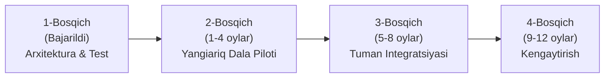

# YANGIARIQ AQUA AI (AGRONEXSUS) — STARTUP VA INVESTITSIYA TAQDIMOTI (PITCH DECK)

> **Loyiha nomi:** Yangiariq Aqua AI (Agronexsus)  
> **Yo'nalish:** AgriTech / Smart Water / Sun'iy Intellekt va Suv Resurslari Boshqaruvi  
> **Qamrovi:** Umumiy qishloq xo'jaligi suv taqsimoti va Yangiariq tumani miqyosidagi amaliy pilot tatbiqi  
> **Foydalanish maqsadi:** Ushbu hujjat 10 ta slaydli professional taqdimot (PowerPoint, Canva, Google Slides) tayyorlash uchun to'liq ssenariy va spiker qo'llanmasidir. Har bir bo'lim slayd matni, vizual dizayn tavsiyasi, spiker nutqi va hakamlar savollariga javoblarni o'z ichiga oladi.

---

## 📑 MUNDARIJA (10 TA PROFESSIONAL SLAYD STRUKTURASI)

1. [1-Slayd: Muqova — Hook va Asosiy Missiya](#1-slayd-muqova--hook-va-asosiy-missiya)
2. [2-Slayd: Muammo — Qishloq Xo'jaligida Suv Isrofi va Yangiariq Realligi](#2-slayd-muammo--qishloq-xojaligida-suv-isrofi-va-yangiariq-realligi)
3. [3-Slayd: Yechim — Yangiariq Aqua AI Yaxlit Raqamli Ekotizimi](#3-slayd-yechim--yangiariq-aqua-ai-yaxlit-raqamli-ekotizimi)
4. [4-Slayd: Texnologik va Ilmiy Ustunlik — Gibrid AI va Deterministik Xavfsizlik](#4-slayd-texnologik-va-ilmiy-ustunlik--gibrid-ai-va-deterministik-xavfsizlik)
5. [5-Slayd: Mahsulot Arxitekturasi va Dala Boshqaruvi Zanjiri](#5-slayd-mahsulot-arxitekturasi-va-dala-boshqaruvi-zanjiri)
6. [6-Slayd: Loyihani Amalga Oshirish Bosqichlari (Yo'l Xaritasi / Roadmap)](#6-slayd-loyihani-amalga-oshirish-bosqichlari-yol-xaritasi--roadmap)
7. [7-Slayd: Bozor Hajmi va Maqsadli Segmentlar (TAM, SAM, SOM)](#7-slayd-bozor-hajmi-va-maqsadli-segmentlar-tam-sam-som)
8. [8-Slayd: Biznes Model va Daromad Oqimlari (Monetizatsiya)](#8-slayd-biznes-model-va-daromad-oqimlari-monetizatsiya)
9. [9-Slayd: Kutilayotgan Iqtisodiy Natijalar va Samaradorlik (ROI)](#9-slayd-kutilayotgan-iqtisodiy-natijalar-va-samaradorlik-roi)
10. [10-Slayd: Jamoa, Talab Etiladigan Resurslar va Hamkorlikka Chorlov](#10-slayd-jamoa-talab-etiladigan-resurslar-va-hamkorlikka-chorlov)

---

## 1-SLAYD: MUQOVA — HOOK VA ASOSIY MISSIYA

### 🎯 Slayd Sarlavhasi:
**YANGIARIQ AQUA AI (AGRONEXSUS)**  
*Suv resurslarini adolatli taqsimlash va sug'orishni optimallashtirish bo'yicha sun'iy intellekt platformasi*

### 💡 Slayddagi Asosiy Matn (Bullet Points):
- **Bosh maqsad:** Suv taqsimotidagi isrofgarchilikni bartaraf etish, tuproq sho'rlanishini kamaytirish va hosildorlikni kafolatli oshirish.
- **Boshlang'ich hudud:** Yangiariq tumani (Xorazm viloyati) — tuman miqyosida to'liq sinovdan o'tkazilib, respublika bo'ylab kengaytiriladigan raqamli model.
- **Asosiy texnologiyalar:** Gibrid ML bashorati, GIS geofazoviy modellashtirish, IoT datchiklar telemetriyasi va shaffof suv balansi hisobi.
- **Taqdimotchi:** *[Ism-familiyangiz]*, Loyiha asoschisi va dasturiy injener
- **Teglar:** `#AgriTech #SmartIrrigation #AIinAgriculture #WaterAccounting #CleanTech`

### 🎨 Vizual Dizayn Tavsiyasi:
- Fon: To'q zumrad va moviy tusdagi zamonaviy texnologik gradient.
- Chap tomonda: "Yangiariq Aqua AI" logotipi va Yangiariq tumani kanallar tarmog'ining 3D raqamli xaritasi.
- O'ng tomonda: Zamonaviy planshetda platformaning GIS xaritasi va suv taqsimoti ko'rsatkichlari grafik ko'rinishida.

### 🎙️ Spiker Nutqi (Speaker Notes):
> *"Assalomu alaykum, hurmatli hakamlar hay'ati va investorlar!  
> Bugun qishloq xo'jaligida suv masalasi shunchaki resurs emas — bu hosildorlik, daromad va oziq-ovqat xavfsizligining poydevoridir. Hozirgi kunda suvning katta qismi dalagacha yetib borgunicha yo'qoladi, mavjud suv esa ilmiy me'yorsiz, taxminiy boshqariladi.  
> Biz shunchaki nazariy g'oya emas, balki backend va frontend tizimlari to'liq yozilgan, 920 ta dasturiy testdan o'tgan va 67 ta relyatsion jadvaldan iborat tayyor raqamli platforma — **Yangiariq Aqua AI** loyihasini yaratdik. Loyihamiz dastlabki bosqichda Yangiariq tumani misolida qanday qilib millionlab kub metr suvni tejashi va fermerlar daromadini oshirishini ko'rsatib beramiz."*

---

## 2-SLAYD: MUAMMO — QISHLOQ XO'JALIGIDA SUV ISROFI VA YANGIARIQ REALLIGI

### 🎯 Slayd Sarlavhasi:
**SUG'ORISH TIZIMIDAGI 4 TA ASOSIY TIZIMLI MUAMMO**  
*Nega an'anaviy sug'orish usullari fermerni ham, davlatni ham zarar keltirmoqda?*

### 💡 Slayddagi Asosiy Matn (Muammolar va Raqamlar):
1. **35% – 45% Kanal Yo'qotishlari:**
   - Suv magistral kanallardan dalagacha tuproq o'zanlar orqali oqib keladi. Sizib ketish, bug'lanish va nazoratsiz oqish oqibatida suvning uchdan bir qismi yo'lda yo'qoladi.
2. **"Suv Navbati" Noaniqligi va Suv O'g'irligi:**
   - Suv taqsimoti dispetcherlik daftarlarida qo'lda yuritiladi. Fermer suv qachon kelishini aniq bilmagani sababli doimiy xavotirda bo'ladi.
3. **Me'yordan Ortiq Bostirib Sug'orish va Ikkilamchi Sho'rlanish:**
   - Fermer "keyingi safar suv bo'lmaydi" degan xavf bilan dalaga ehtiyojdan 30-40% ko'p suv bostiradi. Bu esa sizot suvlarini ko'tarib, tuproqni sho'rlatadi va unumdorlikni tushiradi.
4. **Resurslarning Ortiqcha Sarfi:**
   - Suv nasoslarining asossiz ko'p ishlashi tufayli elektr energiyasi isrof bo'ladi, ortiqcha suv esa o'g'it va mineral moddalarni chuqur qatlamlarga yuvib ketadi.

### 🎨 Vizual Dizayn Tavsiyasi:
- 4 ta aniq infografik blok:
  - 1-blok: Sizib yo'qolayotgan suv oqimi (`-40% suv yo'qotilishi`).
  - 2-blok: Sho'rlangan tuproq va stressga tushgan ekin surati.
  - 3-blok: Qo'lda yozilgan eskirgan qog'oz daftar va suv navbati talashi.
  - 4-blok: Ortiqcha elektr sarflayotgan nasos agregati belgisi.

### 🎙️ Spiker Nutqi:
> *"Keling, muammoga real ko'z bilan qaraylik: Yangiariq tumanidagi kanallar tizimi juda zich, ammo ularning aksariyati ochiq tuproq o'zanlidir. Suv manbadan dalaga yetib kelguncha uning qariyb 40 foizi shunchaki yo'qoladi.  
> Fermer esa suv yetishmasligidan qo'rqib, navbat kelgan zahoti dalaga me'yoridan 40 foizgacha ortiqcha suv bostiradi. Oqibatda nima bo'ladi? Yer ostidagi sho'r suv yuqoriga ko'tariladi, tuproq sho'rxokka aylanadi, paxta va g'allaning ildizi chiriydi. Fermer har yili hosilining 20 foizini yo'qotadi, tuman suv xo'jaligi esa doimiy suv taqchilligidan aziyat chekadi. Biz bu zanjirni raqamli aniqlik bilan to'xtatamiz."*

---

## 3-SLAYD: YECHIM — YANGIARIQ AQUA AI YAXLIT RAQAMLI EKOTIZIMI

### 🎯 Slayd Sarlavhasi:
**YAXLIT RAQAMLI YECHIM: AGRO-GIDROLOGIK BOSHQARUV EKOTIZIMI**  
*Manbadan dalagacha, datchikdan amaliy agrotexnik harakatgacha*

### 💡 Slayddagi Asosiy Matn (3 Ta Asosiy Foydalanuvchi Markazi):
- **Yangiariq Aqua AI nima?**  
  Sun'iy intellekt, IoT sensorlari va GIS xaritalash asosida suv taqsimotini hisob-kitob qiladigan, prognozlaydigan va nazorat qiladigan aqlli boshqaruv platformasi.
- **1. Fermer Shaxsiy Kabineti (Agro-Navigatsiya):**
  - O'z konturlari bo'yicha tuproq namligi va sho'rlanishini onlayn ko'radi.
  - Ekin turi (paxta, g'alla, makkajo'xori, poliz) va tuproq tarkibiga moslashtirilgan aniq sug'orish tavsiyasini oladi (qaysi kuni, qancha m³ suv kerak).
- **2. Kanal Dispetcheri Boshqaruv Pulti (Dispetcherlik Markazi):**
  - Kanallardagi suv oqimi, to'g'onlar holati, suv navbati jadvallari va gidrologik balansni ko'radi.
  - Suv sizib ketishi yoki noqonuniy olinishini anomaliya signallari orqali aniqlaydi.
- **3. Tuman Suv Xo'jaligi Rahbariyati Tahliliy Paneli (Governance Dashboard):**
  - Tuman bo'yicha limitlar ijrosi, suv balansi va shaffoflik audit jurnallarini (Audit Logs) yagona ekranda nazorat qiladi.

### 🎨 Vizual Dizayn Tavsiyasi:
- Markazda platformaning backend yadrosi, uning atrofida 3 ta doiraviy foydalanuvchi roli (Fermer, Dispetcher, Tuman Rahbariyati).
- Har bir rolga mos platforma interfeyslarining skrinshotlari (Dashboard, Dala xaritasi, Suv taqsimoti jadvali).

### 🎙️ Spiker Nutqi:
> *"Biz qanday yechim taklif qilamiz? Biz fermer, kanal dispetcheri va tuman suv bo'limini yagona raqamli makonga birlashtirdik.  
> Tizim fermerga o'zbek tilida aniq aytadi: 'Falonchi aka, 14-konturingizdagi g'alla maydoniga dushanba kuni 350 kub metr suv bering, ortiqchasi tuproqni sho'rlatadi'. Dispetcher esa o'z ekranida kanalning qaysi nuqtasida suv navbati borligini, qayerda suv to'silganini ko'radi. Barcha ma'lumotlar ochiq va shaffof. Hech kim o'zboshimchalik bilan suv navbatini buza olmaydi."*

---

## 4-SLAYD: TEXNOLOGIK VA ILMIY USTUNLIK — GIBRID AI VA DETERMINISTIK XAVFSIZLIK

### 🎯 Slayd Sarlavhasi:
**ILMIY VA TEXNOLOGIK USTUNLIK: GIBRID AI VA XAVFSIZLIK STANDARTLARI**  
*Nega bizning sun'iy intellekt tavsiyalariga agrar sohada 100% ishonish mumkin?*

### 💡 Slayddagi Asosiy Matn (Innovatsion Yondashuv):
1. **Gibrid Bashorat Dvigateli (Hybrid ML Engine):**
   - Faqat "qora quti" AI emas: FAO-56 Penman-Monteith ilmiy agronomik formulalari + In-process Ridge Regression mashinali o'rganish modeli sintezi.
2. **Qat'iy Agronomik Xavfsizlik Cheklovi (Safety Invariant):**
   - Sun'iy intellekt agronomik tavsiyadan $\pm 5.0\%$ dan ortiq chetga chiqa olmaydi. Bu ekinning suvsiz qolishi yoki nobud bo'lish xavfini nolga tenglashtiradi.
3. **Jismoniy Klapanlarni Mustaqil Ochmaslik Qoidasi (Decision Support Only):**
   - Tizim maslahat beruvchi va tahliliy hisoblanadi. Yakuniy qarorni doimo inson (operator yoki fermer) qabul qiladi.
4. **"To'rt Ko'z" (Four-Eyes Principle) Ma'lumot Verifikatsiyasi:**
   - Dala o'lchovlarini kiritgan shaxs uni o'zi tasdiqlay olmaydi; mustaqil agronom yoki operator tasdiqlagachgina tizim hisobiga o'tadi.
5. **Yuqori Unumdorlik va Avtonomlik:**
   - Java 21 / Spring Boot 3 va PostgreSQL PostGIS asosida qurilgan. Tashqi qimmat API larsiz, to'liq mahalliylashtirilgan serverda avtonom ishlay oladi.

### 🎨 Vizual Dizayn Tavsiyasi:
- Gibrid AI arxitekturasi blok-sxemasi:
  `Sensor Ma'lumotlari` + `Ob-havo` $\to$ `[ Gibrid ML Dvigateli ]` $\to$ `[ ±5% Xavfsizlik Filtri ]` $\to$ `Tasdiqlangan Tavsiya`.
- Yashil qalqon belgisi va "100% Nazorat ostidagi AI" tamg'asi.

### 🎙️ Spiker Nutqi:
> *"Agrar sohada sun'iy intellektdan nega qo'rqishadi? Chunki neyrotarmoq adashsa, butun bir daladagi hosil kuyib ketishi mumkin.  
> Biz platformamiz arxitekturasini ilmiy asosda qurdik: bizda AI mustaqil ravishda qaror chiqarmaydi. U FAO-56 xalqaro agronomik formulasiga asoslanadi va mashinali o'rganish orqali unga aniqlik kiritadi. Xatolik ehtimoli agronomik chegaradan maksimal 5 foizdan ortiq chetlasha olmaydi. Bundan tashqari, barcha muhim amallar 'To'rt ko'z' tamoyili bilan tekshiriladi — bu soxta ma'lumotlar kiritilishining oldini oladi."*

---

## 5-SLAYD: MAHSULOT ARXITEKTURASI VA DALA BOSHQARUVI ZANJIRI

### 🎯 Slayd Sarlavhasi:
**PLATFORMA MODULLARI VA 7 BOSQICHLI AMALIYOT ZANJIRI**  
*Muammoni aniqlashdan tortib, natijani tekshirishgacha to'liq sikl*

### 💡 Slayddagi Asosiy Matn:

#### 5 Ta Asosiy Funktsional Modul:
1. **GIS Dala va Kanal Geokadastri:** Konturlar, tuproq turlari (qumloq, bo'z, soz tuproq), ekin holati va gidravlik tarmoq xaritasi.
2. **Suv Balansi va Hisobi (Water Accounting Ledger):** Magistraldan tarmoqlarga va dalagacha bo'lgan yo'qotishlarni aniq hisoblovchi ikki yoqlama buxgalteriya balansi.
3. **Risk va Anomaliyalar Monitoringi:** Tuproq sho'rining ko'tarilishi, kanal to'g'oni buzilishi yoki suv o'g'irligini avtomatik aniqlash.
4. **Harakatlar Markazi (Action Center):** 7 bosqichli reglamentlangan ish jarayoni:
   `Anomaliya aniqlanadi` $\to$ `AI yechim beradi` $\to$ `Ziddiyat tekshiriladi` $\to$ `Dispetcher tasdiqlaydi` $\to$ `Fermer ijro etadi` $\to$ `Sensorlar natijani tasdiqlaydi`.
5. **Markazlashtirilgan RBAC Xavfsizlik:** 4 ta rol (`SUPER_ADMIN`, `ADMIN`, `OPERATOR`, `FARMER`) va 32 ta qat'iy granular huquqlar.

### 🎨 Vizual Dizayn Tavsiyasi:
- 7 bosqichli jarayon chizig'i (Chevron workflow): Har bir qadam chiroyli belgilar bilan ko'rsatilgan.
- Yon tomonda platformaning real dashboard skrinshotlari (Dark/Light mode).

### 🎙️ Spiker Nutqi:
> *"Yangiariq Aqua AI — bu faqatgina hisobot ko'rsatadigan monitor emas. Bu to'liq 7 bosqichli ish konveyeridir.  
> Masalan: sensor tuproq quriyotganini sezsa, tizim zudlik bilan anomaliya qayd etadi, gidravlik ziddiyatlarni tekshiradi, navbatdagi bo'sh vaqtni topadi va dispetcherga tasdiqlash uchun yuboradi. Dispetcher bitta tugma bilan tasdiqlaydi, fermerga esa SMS yoki Telegram orqali topshiriq boradi. Sug'orish tugagach, datchik tuproq namlangani haqida tizimga hisobot qaytaradi. Butun jarayon yopiq zanjirda ishlaydi."*

---

## 6-SLAYD: LOYIHANI AMALGA OSHIRISH BOSQICHLARI (YO'L XARITASI / ROADMAP)

### 🎯 Slayd Sarlavhasi:
**LOYIHANI AMALGA OSHIRISH STRATEGIYASI: 4 TA ANIQ BOSQICH**  
*Yangiariq tumanidagi boshqariladigan tajribadan umumiy tizimga qadar*

### 💡 Slayddagi Asosiy Matn (Bosqichlar va Muddatlar):

1. **1-Bosqich (Hozirgi holat — Tizim To'liq Tayyor):**
   - Dasturiy ta'minot yadrosi ishlab chiqilgan; 920 ta backend va 305 ta frontend testlari 100% muvaffaqiyatli topshirilgan.
   - PostgreSQL 16 ma'lumotlar bazasi, RBAC boshqaruvi va avtomatlashtirilgan zaxiralash (Disaster Recovery) tizimi sozlangan.
2. **2-Bosqich (1 – 4-oylar: Yangiariq Tumani Dala Sinovi):**
   - Yangiariqdagi 50 ta ixtiyoriy fermer xo'jaligi va 4 ta magistral kanalda pilot infratuzilmasini o'rnatish.
   - Tuproq namligi va ultratovushli suv sathi datchiklarini kalibrlash; "To'rt ko'z" ma'lumot verifikatsiyasini sinash.
3. **3-Bosqich (5 – 8-oylar: To'liq Operatsion Ishga Tushirish):**
   - Yangiariq tumani "Suv yetkazib berish xizmati" davlat muassasasi dispetcherlari va tuman agroklasterlari bilan to'liq integratsiya.
   - Suv hisobi daftari va sun'iy intellekt jadvallari asosida sug'orish mavsumini o'tkazish.
4. **4-Bosqich (9 – 12-oylar: Natijalarni Baholash va Miqyoslashtirish):**
   - Tejalgan suv hajmi va hosildorlik ko'rsatkichlarini mustaqil auditdan o'tkazish.
   - Modelni qo'shni tumanlar va viloyat miqyosida kengaytirish.

### 🎨 Vizual Dizayn Tavsiyasi:
- Gorizontal vaqt chizig'i (Timeline) 4 ta asosiy bekat bilan.
- 1-bekatda yashil "BAJARILDI / TAYYOR" belgisi, qolgan 3 ta bekatda amalga oshirish muddatlari va natijalari.

### 🎙️ Spiker Nutqi:
> *"Loyiha qanday amalga oshiriladi? Biz havoyi reja tuzmadik.  
> 1-bosqich allaqachon yakunlangan: platformaning barcha dasturiy kodlari yozilgan, arxitekturasi tekshirilgan.  
> 2-bosqichda biz Yangiariq tumanining eng muammoli qismidagi 50 ta fermer maydonida datchiklarni o'rnatamiz va boshqariladigan dala sinovini o'tkazamiz.  
> 3-bosqichda tuman suv xo'jaligi bilan to'liq integratsiya qilamiz.  
> 4-bosqichda esa Yangiariqda isbotlangan ushbu muvaffaqiyatli modelni boshqa tumanlarga replikatsiya qilamiz."*

---

## 7-SLAYD: BOZOR HAJMI VA MAQSADLI SEGMENTLAR (TAM, SAM, SOM)

### 🎯 Slayd Sarlavhasi:
**BOZOR HAJMI VA MAQSADLI MIJOZLAR SEGMENTI**  
*Yangiariq tumanidan boshlab respublika agrar sektorining ulkan ehtiyojigacha*

### 💡 Slayddagi Asosiy Matn:
- **TAM (Umumiy Bozor — O'zbekiston Qishloq Xo'jaligi Sug'oriladigan Yerlari):**  
  - **$430 Milyon+**: O'zbekistondagi 4.3 million gektar sug'oriladigan ekin maydonlari va 150+ tuman suv xo'jaligi boshqarmalari.
- **SAM (Xizmat Ko'rsatilishi Mumkin Bo'lgan Bozor — Quyi Amudaryo Havzasi):**  
  - **$28 Milyon**: Xorazm viloyati va unga yondosh sug'orma dehqonchilik zonalari — 270,000+ gektar ekin maydoni, agroklasterlar va 7,000+ fermer xo'jaliklari.
- **SOM (Dastlabki Erishiladigan Bozor — Yangiariq Tumani):**  
  - **$350,000 – $500,000**: Yangiariq tumanidagi 2,500+ gektar boshlang'ich pilot maydoni, 50+ fermer va tuman suv yetkazib berish tizimi.

### 👥 Bizning 3 Ta Asosiy Mijozlar Segmentimiz:
1. **Agroklasterlar (B2B):** Paxta, g'alla va meva-sabzavot klasterlari — suv isrofini kamaytirish, hosildorlikni oshirish va energiya sarfini optimallashtirish uchun.
2. **Davlat Suv Xo'jaligi Tashkilotlari (B2G):** Tuman "Suv yetkazib berish xizmati" (SYX) davlat muassasalari va havza boshqarmalari — taqsimot shaffofligi va hisob-kitob uchun.
3. **Mustaqil Fermer Xo'jaliklari (B2B/B2C):** Hosilini qurg'oqchilik va sho'rlanishdan himoya qilishni istagan fermerlar.

### 🎨 Vizual Dizayn Tavsiyasi:
- 3 ta konsentrik doira: TAM ($430M) $\to$ SAM ($28M) $\to$ SOM ($500K).
- 3 ta mijoz portreti kartochkasi: Agroklaster rahbari, Tuman suv xo'jaligi muhandisi, Dehqon/fermer.

### 🎙️ Spiker Nutqi:
> *"Bozor ehtiyoji qanchalik katta? Bugungi kunda O'zbekistonda 4 million gektardan ortiq sug'oriladigan yer bor. Suv yetishmovchiligi sababli davlat har bir kub metr suvni tejashni talab qilmoqda.  
> Biz dastlabki bosqichda butun respublikani emas, aynan Yangiariq tumanining 2,500 gektarlik eng nozik qismini qamrab olamiz (SOM = $500,000). Ushbu tuman modelini muvaffaqiyatli topshirganimizdan so'ng, viloyat va respublika bo'yicha 400 million dollarlik ulkan bozorga chiqamiz."*

---

## 8-SLAYD: BIZNES MODEL VA DAROMAD OQIMLARI (MONETIZATSIYA)

### 🎯 Slayd Sarlavhasi:
**BIZNES MODEL: BIZ QANDAY VA QAYERDAN DAROMAD OLAMIZ?**  
*Ko'p bosqichli va barqaror takroriy daromad (SaaS + B2G + Xizmatlar)*

### 💡 Slayddagi Asosiy Matn (4 Ta Daromad Oqimi):

1. **B2B SaaS Obuna Modeli (Fermer va Klasterlar uchun):**
   - Gektariga yillik dasturiy ta'minot litsenziyasi: **$2.5 – $4.0 / gektar / yil**.
   - 10,000 gektarlik bitta klaster uchun yillik obuna: **$25,000 – $35,000**.
   - Klaster tejalgan suv, elektr energiyasi va ortgan hosildan har yili **$120,000+** sof foyda ko'radi.
2. **B2G Yillik Dispetcherlik Litsenziyasi (Tuman Suv Tashkilotlari):**
   - Tuman "Suv yetkazib berish xizmati" (SYX) uchun markaziy dispetcherlik, GIS monitoring va balans dasturi: **$15,000 – $20,000 / tuman / yil**.
3. **IoT Uskunalarni Yetkazish va O'rnatish Paketi (Hardware & Setup):**
   - Tuproq namlik datchiklari, LoRaWAN tayanch stansiyalari va kanallar uchun ultratovushli sath o'lchagichlarni yetkazib berish, o'rnatish va kalibrlash: **20% – 25% savdo marjasi**.
4. **Agro-Analitika va Konsalting Xizmatlari:**
   - Ekin maydonlari degradatsiyasi, sho'rlanish xaritasi va suv balansi auditi bo'yicha maxsus tahliliy hisobotlar tayyorlash.

### 🎨 Vizual Dizayn Tavsiyasi:
- 4 ta zamonaviy daromad kartochkasi:
  - 1: `SaaS Yillik Obuna` (Asosiy takroriy daromad - ARR).
  - 2: `B2G Davlat Litsenziyasi` (Barqaror tushum).
  - 3: `IoT Integratsiya Marjasi` (Boshlang'ich kassa oqimi).
  - 4: `Chuqur Analitika` (Qo'shimcha qiymat).

### 🎙️ Spiker Nutqi:
> *"Biz qanday qilib daromad ko'ramiz? Bizning biznes modelimiz bir martalik emas, balki yillik takroriy SaaS daromadiga asoslangan.  
> Fermer yoki klaster har bir gektar yer uchun yiliga atigi 3 dollar to'laydi. Ammo tejalgan suv, tejalgan elektr energiyasi va ortiqcha sho'rlanmagan hosil hisobiga har gektardan 60 dan 100 dollargacha sof foyda oladi. Bu mijoz uchun 1 ga 20 qaytim (ROI) demakdir. Shu sababli mijozlar har yili xizmatimizdan foydalanishda davom etadi."*

---

## 9-SLAYD: KUTILAYOTGAN IQTISODIY NATIJALAR VA SAMARADORLIK (ROI)

### 🎯 Slayd Sarlavhasi:
**KUTILAYOTGAN NATIJALAR VA IQTISODIY SAMARADORLIK**  
*Yangiariq tumani miqyosidagi yillik aniq o'lchanadigan yutuqlar*

### 💡 Slayddagi Asosiy Matn (Aniq Metrikalar va Raqamlar):

| Ko'rsatkich | An'anaviy Holat | Yangiariq Aqua AI Bilan | Kutilayotgan Foyda |
| :--- | :---: | :---: | :---: |
| **Kanal Suv Isrofi** | 35% – 45% yo'qotish | 15% – 20% gacha pasayadi | **25% – 30% suv tejaladi** |
| **Yillik Tejalgan Suv Hajmi** | 0 m³ | 18 – 22 million m³ | **Tuman bo'yicha 18+ mln m³ tejam** |
| **Ekin Hosildorligi** | Doimiy suv stressi | Balanslangan namlik | **Hosildorlik +15% – +20% o'sadi** |
| **Paxta va G'alla Qo'shimcha Hosili** | O'rtacha 22-25 snt/ga | 28-32 snt/ga | **+4 – +7 sentner/ga sof o'sish** |
| **Nasoslar Elektr Sarfi** | Nazoratsiz ishlash | Jadval asosida aniq rejim | **Elektr sarfi 20% qisqaradi** |
| **Tuproq Sho'rlanish Xavfi** | Yillik o'sish | Sizot suvlari nazoratda | **Sho'rlanish xavfi 35% kamayadi** |
| **Suv Taqsimoti Shaffofligi** | Qog'oz daftar (subyektiv) | 100% raqamli audit jurnali | **Nizolar va inson omili yo'qoladi** |

### 💰 Moliyaviy Samaradorlik (Yangiariq fermeri misolida):
- 100 gektarlik o'rtacha fermer xo'jaligi yiliga dastur uchun **$300** to'laydi.
- Qo'shimcha olingan hosil va tejalgan resurslardan keladigan yillik sof foyda: **$6,000 – $9,000**.
- Investitsiyaning o'zini oqlash muddati: **Atigi 1 ta sug'orish mavsumi (4 oy)!**

### 🎨 Vizual Dizayn Tavsiyasi:
- 4 ta yirik raqamli KPI bloklari (Yashil va moviy ranglarda):
  - `18-22 Mln m³` (Tejalgan suv).
  - `+18%` (O'rtacha hosildorlik).
  - `-20%` (Elektr energiyasi sarfi).
  - `1 Mavsum` (O'zini oqlash davri).

### 🎙️ Spiker Nutqi:
> *"Eng asosiy savol: loyiha nimani o'zgartiradi va qanday foyda keltiradi?  
> Yangiariq tumanining o'zida bir yilda 20 million kub metrga yaqin suv isrofdan saqlab qolinadi! Bu butun tuman aholisining bir yillik maishiy suv ehtiyojidan ko'proqdir.  
> Fermer uchun esa bu gektariga 5-6 sentner qo'shimcha paxta va g'alla degani. 100 gektar yeri bor fermer xizmatimiz uchun 300 dollar to'lab, mavsum oxirida 7,000 dollardan ortiq qo'shimcha daromad ko'radi. Tizim o'zini birinchi mavsumdayoq to'liq oqlaydi."*

---

## 10-SLAYD: JAMOA, TALAB ETILADIGAN RESURSLAR VA HAMKORLIKKA CHORLOV

### 🎯 Slayd Sarlavhasi:
**JAMOA, TALAB ETILADIGAN MABLAG' VA HAMKORLIK TAKLIFI**  
*Raqamli suv boshqaruvini Yangiariqda birgalikda joriy etamiz!*

### 💡 Slayddagi Asosiy Matn:

#### Kerakli Resurslar (Dala Piloti uchun $55,000 Talab Etiladi):
- **40% ($22,000):** IoT uskunalar — 40 ta tuproq namlik datchigi, 10 ta kanallar oqim o'lchagichi, 4 ta LoRaWAN stansiyasi.
- **25% ($13,750):** Yangiariq tuprog'i va kanallarining gidravlik parametrlarini tizimga kalibrlash va joyida sinov.
- **20% ($11,000):** Dala infratuzilmasi, fermerlar va dispetcherlar uchun amaliy treninglar va o'quv qo'llanmalar.
- **15% ($8,250):** Server infratuzilmasi, axborot xavfsizligi va tizim litsenziyalari.

#### Jamoa Tarkibi va Salohiyati:
- **Loyiha Rahbari & Software Architect:** Full-stack va backend arxitektura (Java 21, Spring Boot, React).
- **Gidrolog-Muhandis va Agronom:** Ekin suv balans me'yorlari va suv taqsimoti qoidalarini verifikatsiya qiluvchi ekspert.
- **Data & AI Engineer:** Mashinali o'rganish, anomaliyalarni aniqlash va sensor telemetriyasi mutaxassisi.
- **Dala Koordinatori:** Yangiariq tumani fermerlari va tuman suv bo'limi bilan bevosita ishlovchi vakil.

### 🚀 Bizning Taklifimiz (Call to Action):
- Biz hozirda **davlat innovatsion grantlari, agrar pilot maydonlari va strategik investorlar** bilan hamkorlik qilishga tayyormiz.
- Dasturiy ta'minot 100% tayyor, endigi maqsad — uni Yangiariq dalalarida amaliyotga tatbiq etish!

### 📞 Aloqa Ma'lumotlari:
- **Loyiha nomi:** Yangiariq Aqua AI (Agronexsus)
- **Veb-sayt / Demo:** `http://localhost:5173` (lokal) / `https://aqua.yangiariq.uz`
- **Email:** *[Sizning elektron pochtangiz]*
- **Telefon / Telegram:** *[Sizning telefon raqamingiz / Telegram havolangiz]*

### 🎨 Vizual Dizayn Tavsiyasi:
- Markazda 4 ta jamoa a'zosi fotosuratlari va asosiy kompetensiyalari.
- Pastki o'ng burchakda jonli demo tizimiga yo'naltiruvchi QR-kod va yirik ishonchli shior.

### 🎙️ Spiker Nutqi:
> *"Hurmatli hakamlar hay'ati!  
> Yangiariq Aqua AI — bu ertaga boshlanadigan loyiha emas. Bu bugun ishlashga to'liq tayyor bo'lgan, backend va frontend kodlari sinovdan o'tgan real platformadir.  
> Bizga faqatgina Yangiariq tumanidagi 50 ta fermer maydonida datchiklarni o'rnatish va amaliyotga tushirish uchun 55,000 dollarlik boshlang'ich pilot resursi kerak.  
> Keling, suvni eski usulda isrof qilishni bas qilaylik. Yangiariqdan boshlab qishloq xo'jaligimizni raqamli va adolatli suv taqsimotiga o'tkazaylik.  
> E'tiboringiz uchun katta rahmat, barcha savollaringizga mamnuniyat bilan javob beraman!"*

---

## 💡 TAQDIMOTCHI UCHUN MAXSUS QO'LLANMA (HAKAMLAR SAVOLLARIGA ANIQ JAVOBLAR):

1. **"Nega loyiha aynan Yangiariq tumanidan boshlanmoqda?"**
   - *Javob:* Yangiariq tumani Xorazm viloyatida sug'orish kanallari eng tarmoqlangan, tuproq sho'rlanish darajasi yuqori va magistral daryodan eng uzoqda joylashgan tumanlardan biridir. Agar loyiha Yangiariqning og'ir gidrologik sharoitida o'zini to'liq oqlasa, uni O'zbekistonning istalgan tumanida hech qanday qiyinchiliksiz tatbiq etish mumkin.

2. **"Agar dalada internet yoki elektr uzilsa, tizim to'xtab qoladimi?"**
   - *Javob:* Yo'q, to'xtamaydi. Bizning datchiklarimiz LoRaWAN orqali uzoq masofaga kam energiya sarflab ma'lumot uzatadi va batareyada 3 yilgacha ishlaydi. Aloqa uzilgan taqdirda ham, backend tizimimizda "Telemetry Fallback" mexanizmi mavjud bo'lib, o'rnatilgan agronomik modellar asosida hisob-kitobni davom ettiradi. Aloqa tiklanganda keshdagi ma'lumotlar avtomatik sinxronlanadi.

3. **"Oddiy fermer bu murakkab tizimdan foydalana oladimi?"**
   - *Javob:* Fermer interfeysi maksimal darajada soddalashtirilgan, o'zbek tilida va xuddi Telegram kabi qulay. Fermerdan grafiklar chizish talab etilmaydi — unga faqat 3 ta rangdagi tushunarli signal ko'rinadi: Yashil — namlik me'yorda; Sariq — sug'orish yaqinlashmoqda; Qizil — zudlik bilan suv berish kerak. Xohlovchilar uchun Telegram-bot integratsiyasi ham mavjud.

4. **"Sun'iy intellekt xato qilib klapanlarni o'zboshimchalik bilan ochib yuborishi mumkinmi?"**
   - *Javob:* Mutlaqo yo'q. Bizning arxitekturamizda "Decision Support Only" qat'iy xavfsizlik printsipi amal qiladi: platforma faqat tavsiya beradi, jismoniy nasos yoki to'g'onlarni ochish esa faqat inson — dispetcher yoki fermer tomonidan amalga oshiriladi. Shuningdek, AI tavsiyasi ilmiy me'yordan $\pm 5\%$ dan ortiq chetlashishi kod darajasida taqiqlangan.

5. **"Kutilayotgan daromad va biznes model qanchalik hayotiy?"**
   - *Javob:* Biznes modelimiz 4 ta aniq manbaga asoslangan: agroklasterlar uchun gektariga $3/yil SaaS obunasi, tuman suv tashkiloti uchun $15,000/yil litsenziyasi, datchiklarni o'rnatishdan 20% marja va maxsus agro-analitika xizmatlari. Fermer xizmatimizga 300 dollar sarflab, 6,000 dollardan ortiq qo'shimcha hosil va tejamkorlik oladi, bu esa uning har yili xizmatimizda qolishini kafolatlaydi.
