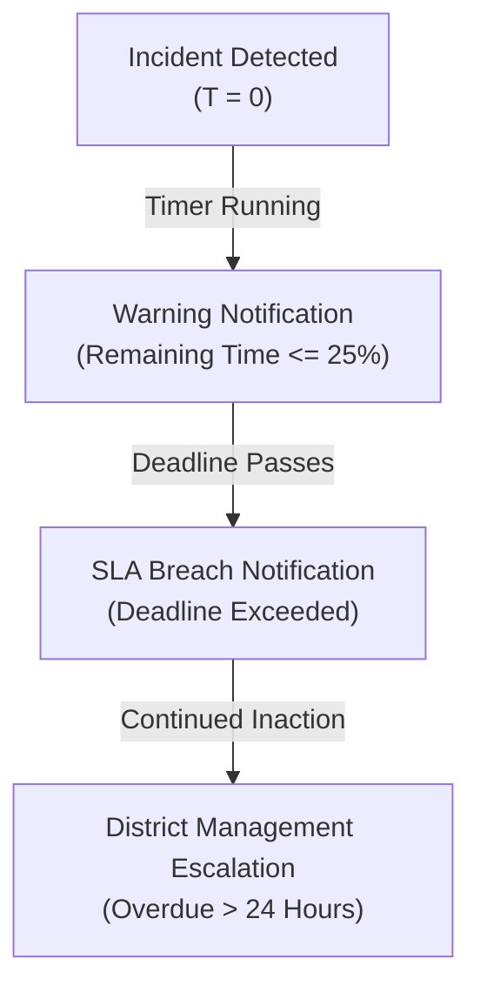

# Accountability SLA and Escalation Governance
# Yangiariq Aqua AI — Milestone 08.16

## 1. Deterministic SLA Calculation

To prevent administrative neglect of critical findings and hydraulic safety risks, **YANGIARIQ AQUA AI** enforces deterministic, wall-clock Service Level Agreement (SLA) deadlines based on incident severity.

### Target Hours per Severity Level:
- **`CRITICAL`**: 4 Hours (Emergency review and on-site dispatch)
- **`HIGH`**: 24 Hours (Full preliminary diagnostic and investigation)
- **`MEDIUM`**: 72 Hours (Action plan proposed and reviewed)
- **`LOW`**: 168 Hours (7 Days) (Routine scheduled maintenance inspection)
- **`INFORMATIONAL`**: None (No breach deadline computed)

### SLA Formulas (`IncidentSlaCalculator`):

$$\text{Deadline} = \text{DetectedAt} + \text{Severity.TargetHours}$$

$$\text{RemainingHours} = \frac{\text{Deadline} - \text{CurrentInstant}}{3600.0}$$

$$\text{IsOverdue} = (\text{CurrentInstant} > \text{Deadline}) \land (\text{Status} \notin \{\text{RESOLVED}, \text{DISMISSED}, \text{CLOSED}\})$$

Once an incident transitions into a terminal or resolved state (`RESOLVED`, `DISMISSED`, or `CLOSED`), the overdue timer is frozen, and SLA performance is permanently archived.

---

## 2. Real-Time Overdue Tracking & Dashboard Metrics

The accountability dashboard (`GetAccountabilityDashboardUseCase`) calculates:

1. **`activeIncidentsCount`**: Total open cases in non-terminal states.
2. **`overdueCount`**: Cases where `isOverdue == true`.
3. **`slaComplianceRatePercent`**:
   $$\text{SLA Compliance \%} = \frac{\text{Total Active} - \text{Overdue Active}}{\text{Total Active}} \times 100\%$$
4. **`averageResolutionHours`**: Mean time from `detectedAt` to verified `resolvedAt`.
5. **`verifiedEvidenceRatioPercent`**: Proportion of evidence entries backed by verified sensor or physical inspections.

---

## 3. Escalation Tiers & Notification Cooldowns

### Anti-Alert Storming & Cooldown Policy:
In `InAppAccountabilityNotificationAdapter`:
- To prevent spamming operators during high-concurrency dispatch windows, notifications for the same incident are rate-limited with a minimum **1-hour cooldown window** unless the severity level is upgraded to `CRITICAL`.
- Hydraulic safety alarms (`CRITICAL`) bypass cooldown limits and dispatch immediate notifications to all connected dispatch operators and administrative supervisors.
