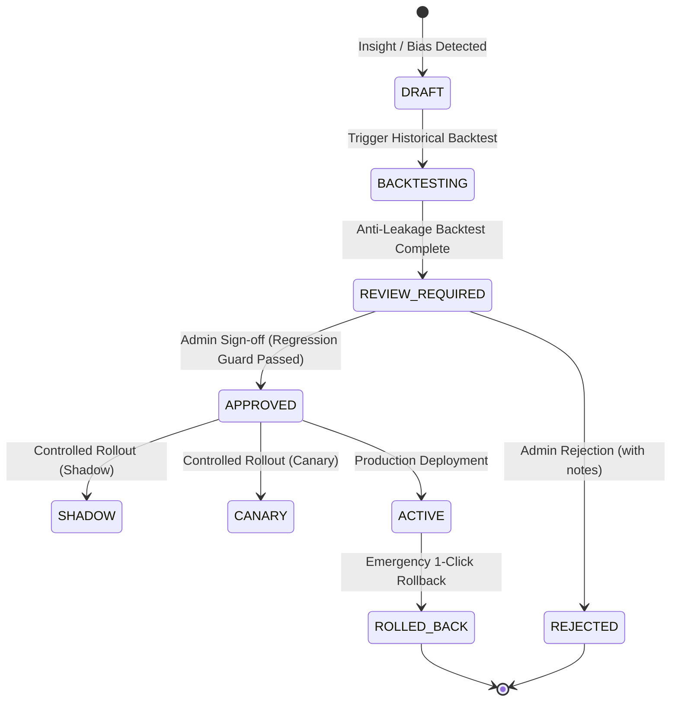

# YANGIARIQ AQUA AI: Adaptive Intelligence Architecture

## 1. Executive Summary & Objective

Adaptive Intelligence in YANGIARIQ AQUA AI closes the continuous feedback loop established in Milestone 08.8:
$$\text{Insight} \longrightarrow \text{Calibration Proposal} \longrightarrow \text{Historical Backtest} \longrightarrow \text{Human Review} \longrightarrow \text{Version} \longrightarrow \text{Controlled Rollout} \longrightarrow \text{Monitoring} \longrightarrow \text{Rollback}$$

The system transitions from passive degradation observation (*"Soil moisture forecast error increased by 14%"*) to proactive, controlled adaptation:
1. Detecting systematic bias or performance drift from empirical verification outcomes.
2. Formulating bounded calibration proposals on soft agronomic parameters.
3. Simulating proposals deterministically against past ground-truth observations via strict anti-leakage backtesting.
4. Requiring authenticated human administrative sign-off before any production transition.
5. Providing instantaneous, one-click rollback to prior stable baselines with immutable audit logging.

---

## 2. Zero Autonomous Self-Modification Principle

```
+--------------------------------------------------------------------------------+
|                           CRITICAL SAFETY MANDATE                              |
|                                                                                |
|  THE SYSTEM NEVER ALTERS ITS OWN PRODUCTION CONFIGURATION WITHOUT EXPLICIT     |
|  HUMAN ADMINISTRATOR APPROVAL. NO AUTONOMOUS RE-WEIGHTING OR LOGIC MUTATION    |
|  OCCURS IN THE BACKGROUND.                                                     |
+--------------------------------------------------------------------------------+
```

1. **Passive Generation, Active Decision**: An algorithmic calibration proposal is merely a draft candidate. It has zero operational effect on predictions until backtested and explicitly approved by an authenticated user with `ROLE_ADMIN`.
2. **Hard Safety Sovereignty**: Predictive models and calibrations deal strictly with forecasting. Hard hydraulic safety interlocks (pipe burst pressure trips, emergency main valve shutoffs, maximum flow constraints) are completely outside the scope of calibration and cannot be proposed, relaxed, or bypassed.

---

## 3. The Continuous Governance Lifecycle



---

## 4. Bounded Soft Parameters vs. Protected Constraints

| Parameter Category | Modifiable via Calibration? | Examples | Safety Boundary |
| :--- | :--- | :--- | :--- |
| **Soft Agronomic** | **YES** (with human review) | `smoothingAlpha`, `trendWindowHours`, `kcReference`, `applicationEfficiency` | Bounded within FAO-56 scientific limits |
| **Forecasting Tolerances** | **YES** (with human review) | `forecastPeriodDays`, `packetLossWarningThreshold` | Empirically validated |
| **Hard Hydraulic Safety** | **STRICTLY FORBIDDEN (NEVER)** | `pipeBurstPressure`, `hydraulicSafetyInterlock`, `emergencyCutoff` | Enforced at aggregate level by `validateSafetyParameters()` |
| **Actuator Control** | **STRICTLY FORBIDDEN (NEVER)** | Pump valve commands, motor speed overrides | Zero direct control access |

---

## 5. Architectural Components

1. **`CalibrationProposalGenerator`**: Domain service analyzing empirical `NumericalEvaluationMetrics` from Milestone 08.8. Formulates structured proposals if Mean Bias Error $|\text{MBE}| > 6.0$ or if temporal drift is detected.
2. **`BacktestingEngine`**: Deterministic historical simulator evaluating candidate configuration against identical historical evaluations ($T_{\text{target}} \le T_{\text{gen}}$).
3. **`RegressionGuardService`**: Enforces that candidate parameter tuning does not inflate systematic bias, reduce classification accuracy by $>5\%$, or reduce F1 score by $>0.08$.
4. **`ControlledRolloutManager`**: Manages state transitions across `SHADOW`, `CANARY`, `ACTIVE`, and `ROLLBACK` states with audit trail emission.
