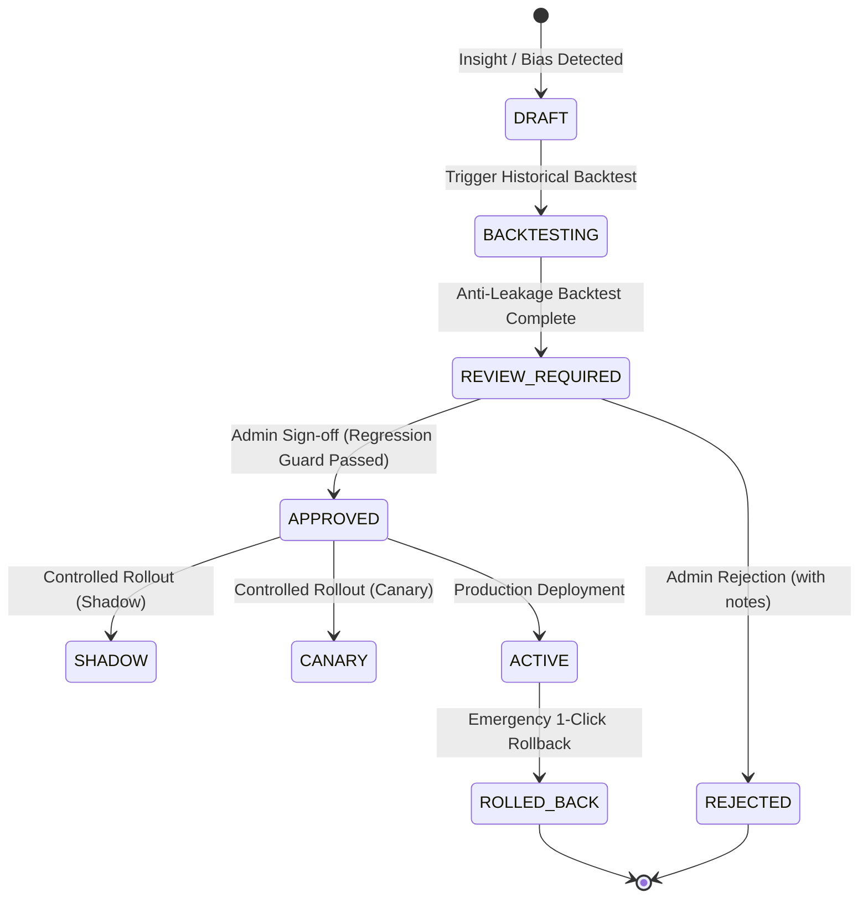

# YANGIARIQ AQUA AI: Adaptive Intelligence Architecture

## 1. Executive Summary & Objective

Adaptive Intelligence in YANGIARIQ AQUA AI closes the continuous feedback loop established in Milestone 08.8:
$$\text{Insight} \longrightarrow \text{Calibration Proposal} \longrightarrow \text{Historical Backtest} \longrightarrow \text{Human Review} \longrightarrow \text{Version} \longrightarrow \text{Controlled Rollout} \longrightarrow \text{Monitoring} \longrightarrow \text{Rollback}$$

The system transitions from passive degradation observation (*"Soil moisture forecast error increased by 14%"*) to proactive, controlled adaptation:
1. Detecting systematic bias or performance drift from empirical verification outcomes.
2. Formulating bounded calibration proposals on soft agronomic parameters.
3. Simulating proposals deterministically against past ground-truth observations via strict anti-leakage backtesting.
4. Requiring authenticated human administrative sign-off before any production transition.
5. Providing instantaneous, one-click rollback to prior stable baselines with immutable audit logging.

---

## 2. Zero Autonomous Self-Modification Principle

```
+--------------------------------------------------------------------------------+
|                           CRITICAL SAFETY MANDATE                              |
|                                                                                |
|  THE SYSTEM NEVER ALTERS ITS OWN PRODUCTION CONFIGURATION WITHOUT EXPLICIT     |
|  HUMAN ADMINISTRATOR APPROVAL. NO AUTONOMOUS RE-WEIGHTING OR LOGIC MUTATION    |
|  OCCURS IN THE BACKGROUND.                                                     |
+--------------------------------------------------------------------------------+
```

1. **Passive Generation, Active Decision**: An algorithmic calibration proposal is merely a draft candidate. It has zero operational effect on predictions until backtested and explicitly approved by an authenticated user with `ROLE_ADMIN`.
2. **Hard Safety Sovereignty**: Predictive models and calibrations deal strictly with forecasting. Hard hydraulic safety interlocks (pipe burst pressure trips, emergency main valve shutoffs, maximum flow constraints) are completely outside the scope of calibration and cannot be proposed, relaxed, or bypassed.

---

## 3. The Continuous Governance Lifecycle



---

## 4. Bounded Soft Parameters vs. Protected Constraints

| Parameter Category | Modifiable via Calibration? | Examples | Safety Boundary |
| :--- | :--- | :--- | :--- |
| **Soft Agronomic** | **YES** (with human review) | `smoothingAlpha`, `trendWindowHours`, `kcReference`, `applicationEfficiency` | Bounded within FAO-56 scientific limits |
| **Forecasting Tolerances** | **YES** (with human review) | `forecastPeriodDays`, `packetLossWarningThreshold` | Empirically validated |
| **Hard Hydraulic Safety** | **STRICTLY FORBIDDEN (NEVER)** | `pipeBurstPressure`, `hydraulicSafetyInterlock`, `emergencyCutoff` | Enforced at aggregate level by `validateSafetyParameters()` |
| **Actuator Control** | **STRICTLY FORBIDDEN (NEVER)** | Pump valve commands, motor speed overrides | Zero direct control access |

---

## 5. Architectural Components

1. **`CalibrationProposalGenerator`**: Domain service analyzing empirical `NumericalEvaluationMetrics` from Milestone 08.8. Formulates structured proposals if Mean Bias Error $|\text{MBE}| > 6.0$ or if temporal drift is detected.
2. **`BacktestingEngine`**: Deterministic historical simulator evaluating candidate configuration against identical historical evaluations ($T_{\text{target}} \le T_{\text{gen}}$).
3. **`RegressionGuardService`**: Enforces that candidate parameter tuning does not inflate systematic bias, reduce classification accuracy by $>5\%$, or reduce F1 score by $>0.08$.
4. **`ControlledRolloutManager`**: Manages state transitions across `SHADOW`, `CANARY`, `ACTIVE`, and `ROLLBACK` states with audit trail emission.
5. **`ContextNormalizer` (Milestone 08.10)**: Normalizes parcel telemetry, sensors, anomalies, and weather into standardized multidimensional `PredictionContext`.
6. **`AdaptiveSelectionEngine` (Milestone 08.10)**: Evaluates governed methods against parcel operational context strictly adhering to the 9-level deterministic hierarchy.
7. **`ContextualDriftDetector` (Milestone 08.10)**: Identifies localized performance degradation ($\ge 30\%$ error inflation or $\ge 8\%$ bias shift) on specific crop or soil slices.

---

## 6. Milestone 08.10 Context-Aware Adaptive Intelligence Extension

Milestone 08.10 introduces context-aware adaptive intelligence:
$$\text{Context} \longrightarrow \text{Candidate Methods} \longrightarrow \text{Historical Performance} \longrightarrow \text{Context Match} \longrightarrow \text{Method Selection} \longrightarrow \text{Prediction} \longrightarrow \text{Real Outcome} \longrightarrow \text{Evaluation} \longrightarrow \text{Continuous Learning Signal}$$

- **Core Product Principle**: *"YANGIARIQ AQUA AI selects from human-governed prediction methods using verified historical performance for the current context."*
- **Precedence Hierarchy**: Safety Interlock (Level 1) > Governance Status (Level 2-3) > Sensor Availability (Level 4) > Context Match (Level 5) > Historical MAE Ranking & Sample Gating $n \ge 10$ (Level 6) > Confidence Calibration (Level 7) > Contextual Drift Guard (Level 8) > Active Baseline Fallback (Level 9).
- **Explainability**: Every decision records an audit log with context snapshot, alternatives considered, selection score, and plain language rationale.

---

## 7. Related Documentation

- [Context-Aware Prediction Engine](context-aware-prediction.md)
- [Adaptive Selection & 9-Level Hierarchy](adaptive-selection.md)
- [Context Performance & Local Drift Detection](context-performance.md)
- [Model Governance Architecture](model-governance.md)
- [Prediction Versioning & Immutability](prediction-versioning.md)
- [Historical Backtesting & Calibration Engine](calibration-and-backtesting.md)
- [Controlled Rollout & Rollback](controlled-rollout.md)
- [Prediction Architecture](prediction-architecture.md)
- [Prediction Evaluation & Ground Truth](prediction-evaluation.md)
- [Module Boundaries](module-boundaries.md)
