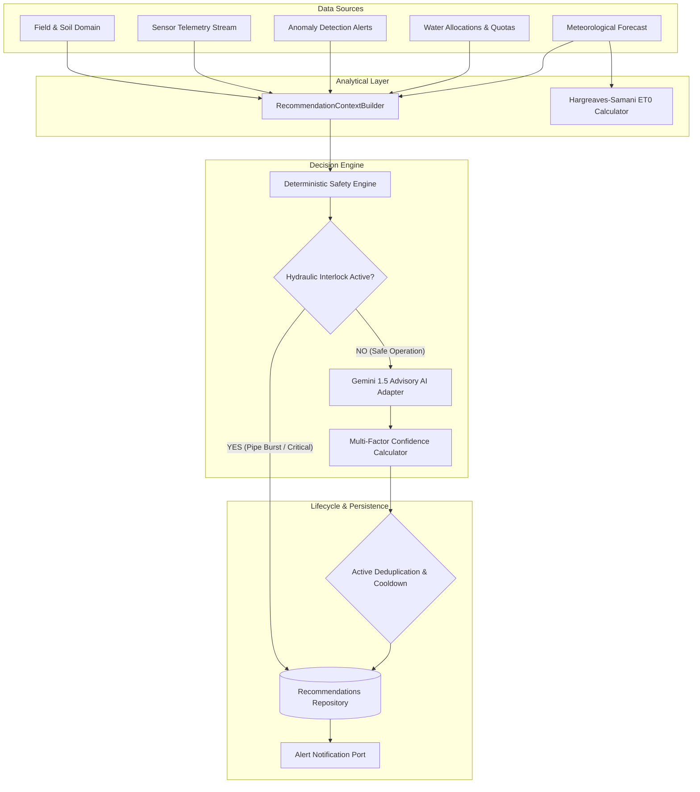
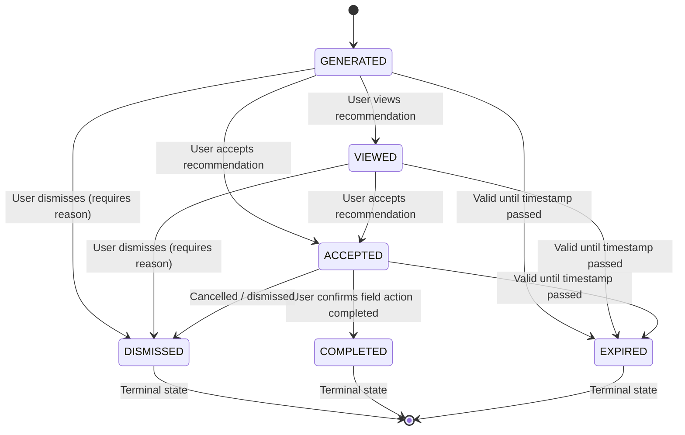

# YANGIARIQ AQUA AI — AI AGRONOMIC RECOMMENDATIONS & DECISION SUPPORT SYSTEM

## 1. Executive Summary & Objective

The **AI Agronomic Recommendations & Decision Support System** (`com.aquaai.recommendation`) is the intelligent advisory tier of YANGIARIQ AQUA AI. It synthesizes telemetry, anomaly detection, parcel boundaries, crop water requirements, regional weather forecasts, and historical water allocations into explainable, evidence-based agricultural recommendations for farmers and district water operators in Yangiariq, Khorezm (Uzbekistan).

---

## 2. Core Architectural Principles & Invariants

### 2.1 Pure Java Domain Layer
The domain layer (`com.aquaai.recommendation.domain`) contains pure Java business models, value objects, and domain services. It has zero dependencies on Spring Framework, Jakarta Persistence (JPA), REST frameworks, or proprietary AI SDKs. All external interactions are modeled via explicit Ports (Hexagonal Architecture).

### 2.2 Hydraulic Safety Interlock
When anomalous hydraulic conditions are detected on a field parcel (`SUSPECTED_PIPE_BURST` or `WATER_PRESSURE_DROP`), the system strictly suppresses irrigation advisories. An immediate `INSPECT_PIPE_BURST` recommendation with `CRITICAL` priority is generated unconditionally by the deterministic engine, preventing catastrophic water loss, canal embankment breaches, and soil erosion.

### 2.3 Regional Agronomic Reality
Universal agronomic constants are avoided. Calculations reflect the arid, continental climate of Khorezm bordering the Karakum desert:
- High summer temperatures (38–42°C during the 40-day *chilla*).
- Intense evaporation driven by dry *garmsel* winds.
- High secondary salinization risks requiring salt leaching fractions.
- Alluvial sandy loam and loam soil hydraulic properties.

---

## 3. Recommendation Taxonomy & Priority

| Recommendation Type | Default Priority | Description | Agronomic Action |
|:---|:---|:---|:---|
| `IRRIGATE_NOW` | `CRITICAL` / `HIGH` | Root zone moisture below Management Allowable Depletion (MAD) | Initiate furrow or drip delivery within allocation window |
| `DELAY_IRRIGATION` | `HIGH` / `MEDIUM` | Significant rainfall (≥15mm) forecasted within 48h | Suspend irrigation release; avoid nutrient leaching |
| `REDUCE_WATER_VOLUME` | `MEDIUM` | Telemetry indicates overconsumption or slow percolation | Reduce depth by 15–25% to prevent waterlogging |
| `AVOID_IRRIGATION` | `MEDIUM` / `HIGH` | Soil moisture near field capacity or saturated | Halt water delivery to avoid root hypoxia |
| `INSPECT_PIPE_BURST` | `CRITICAL` | Pressure drop combined with unexpected flow divergence | Immediate sector valve isolation; visual physical inspection |
| `INSPECT_SENSOR` | `MEDIUM` | Sensor stuck, offline, or possible drift detected | Inspect sensor physical connection and calibration |
| `MONITOR_SOIL_MOISTURE` | `INFO` | Soil moisture and hydraulic parameters within target bounds | Maintain routine telemetry sampling |
| `MANAGE_SALINITY` | `HIGH` | Electrical conductivity (EC) exceeds 4.0 dS/m | Apply 15–20% leaching fraction into collector ditches |
| `PREPARE_HEAT_STRESS` | `HIGH` | Extreme temperature (≥40°C) and low RH (≤15%) | Nocturnal cooling misting and light pre-wetting |
| `PREPARE_FROST` | `HIGH` | Temperature approaching 0°C during sensitive growth | Protective light sprinkling or smoke generation |
| `INVESTIGATE_OVERCONSUMPTION` | `MEDIUM` | Delivered volume exceeds seasonal water quota | Audit distribution gates and canal intake meters |

---

## 4. Multi-Factor Confidence Calibration

Confidence scores ($C \in [0.10, 0.95]$) are dynamically calculated by `ConfidenceCalculator` using four weighted factors:

$$C = \text{clamp}(0.10, 0.95, w_e \cdot E + w_q \cdot Q + w_c \cdot C_{\text{context}} + w_a \cdot A)$$

Where:
- $w_e = 0.40$ — **Evidence Strength ($E$)**: Number and physical consistency of corroborated sensor measurements.
- $w_q = 0.25$ — **Data Freshness & Quality ($Q$)**: Age of observations and sensor reading quality flag (`VALID` vs `SUSPECT`).
- $w_c = 0.20$ — **Context Completeness ($C_{\text{context}}$)**: Presence of crop type, soil type, irrigation method, water quotas, and weather.
- $w_a = 0.15$ — **Model Assessment Factor ($A$)**: Advisory confidence score returned by the reasoning adapter.

---

## 5. Lifecycle State Machine & Deduplication

### Deduplication Rules:
1. **Active Dedup Key**: Only one recommendation per `(fieldId, recommendationType)` can exist in active states (`GENERATED`, `VIEWED`, `ACCEPTED`).
2. **Cooldown Period**: A 4-hour cooldown prevents re-generating identical recommendations unless priority has escalated (e.g., `MEDIUM` $\to$ `CRITICAL`).
3. **Optimistic Locking**: Handled via JPA `@Version` on `AgronomicRecommendation.version`.

---

## 6. Security & Anti-IDOR Protection

- **Role-Based Access Control**:
  - `FARMER`: Scoped strictly to parcels they own.
  - `DISTRICT_OPERATOR`: District-wide visibility and allocation control.
  - `ADMIN`: Full system administrative and configuration control.
- **Anti-IDOR & Anti-Enumeration**:
  - `FieldOwnershipChecker` validates parcel ownership.
  - If a farmer attempts to query, generate, view, accept, or dismiss recommendations for a field they do not own, the system throws `ResourceNotFoundException` (HTTP 404), completely eliminating resource enumeration vulnerabilities.
