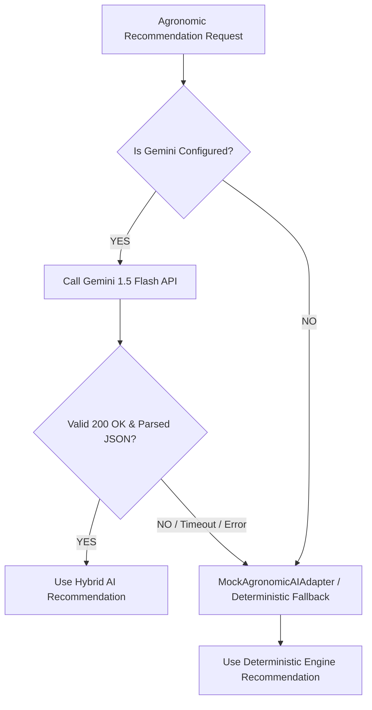

# YANGIARIQ AQUA AI — AI PROVIDER & ADVISORY REASONING ARCHITECTURE

## 1. Overview
The advisory AI component transforms empirical telemetry, anomaly events, and weather forecasts into explainable, localized agronomic recommendations. It is implemented using an asynchronous, zero-downtime hybrid architecture connecting Google Generative AI (Gemini 1.5 Flash) with deterministic safety rules.

---

## 2. Zero-Hallucination Prompt Architecture

Prompts are synthesized by `AgronomicPromptBuilder` with strict constraints:

1. **Hydraulic Safety Interlock**: The model is forbidden from recommending irrigation when pipe bursts or pressure drops are detected.
2. **Strict JSON Output**: The LLM is directed to return raw JSON conforming to the schema of `AIRecommendationResponse`. No conversational filler or markdown code fences are permitted.
3. **Zero PII Exposure**: Personal farmer names, telephone numbers, and credentials are never included in prompts. Only anonymized field IDs, crop types, soil characteristics, and physical metrics are passed.
4. **Empirical Fact Anchoring**: Every action step must reference specific observed values (moisture %, flow rate, pressure, EC, temperature).

### Prompt Schema:
```json
{
  "recommendationType": "IRRIGATE_NOW",
  "priority": "HIGH",
  "title": "Short title",
  "summary": "1-2 sentence executive summary",
  "explanation": "Detailed agronomic reasoning referencing metrics",
  "actions": ["Step 1", "Step 2"],
  "doNotActions": ["Explicit do not action"],
  "limitations": "Provisional advisory statement",
  "confidenceScore": 0.85
}
```

---

## 3. Gemini 1.5 Flash Adapter (`GeminiAgronomicAIAdapter`)

- **Model**: `gemini-1.5-flash`
- **Protocol**: Standard HTTPS REST POST (`HttpClient`) with 5-second connection timeout and 10-second request timeout. Zero proprietary SDK dependencies.
- **Generation Parameters**:
  - `temperature: 0.2` (low temperature for deterministic, consistent agronomic reasoning)
  - `responseMimeType: "application/json"`
- **Response Handling**:
  - Validates candidates text.
  - Strips accidental markdown fences if present.
  - Parses into structured DTO.

---

## 4. Graceful Fallback Strategy (`CompositeAgronomicAIProvider`)

If Gemini is not configured, times out, returns HTTP 4xx/5xx, or returns unparseable JSON:



This guarantees **100% operational uptime** even during network partitions or cloud provider outages.
