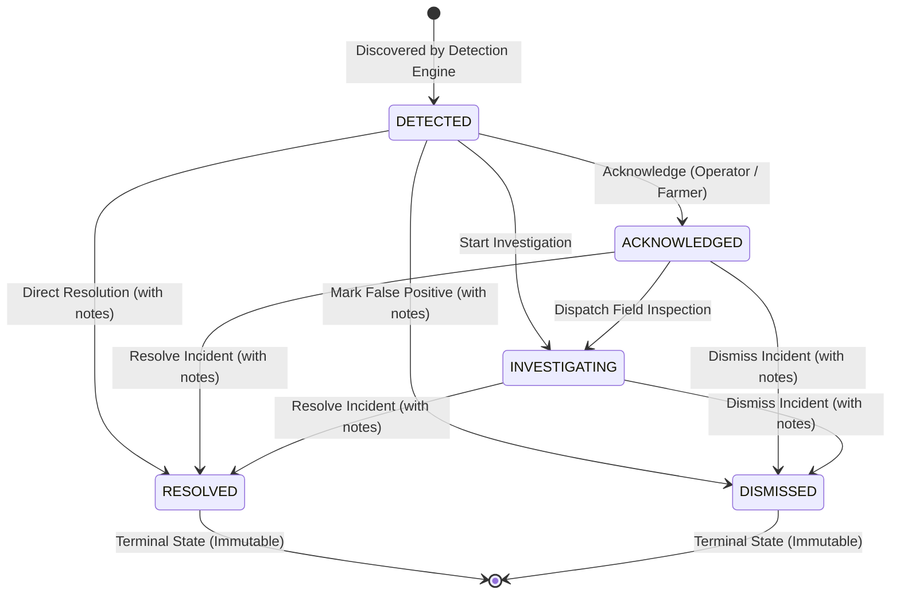

# Alert Lifecycle, Deduplication & Management (`docs/alert-management.md`)

## 1. Alert Lifecycle State Machine

Anomalies transition through an explicit, finite state machine managed directly within the aggregate root [`Anomaly`](file:///home/izzatbek/Desktop/agronexsus/backend/src/main/java/com/aquaai/anomaly/domain/model/Anomaly.java):



### State Machine Invariants:
1. **Terminal State Immutability (Refinement #6)**: Once an anomaly transitions to `RESOLVED` or `DISMISSED`, it cannot be reopened, acknowledged, or investigated. Attempting invalid transitions throws `BusinessRuleException("INVALID_STATUS_TRANSITION")`.
2. **Mandatory Resolution Notes**: Transitioning to `RESOLVED` or `DISMISSED` strictly requires non-blank resolution notes explaining actions taken or rationale for dismissal.
3. **Audit Tracking**: Every transition stamps the acting user's ID (`acknowledgedBy`, `resolvedBy`) and timestamp (`acknowledgedAt`, `resolvedAt`, `updatedAt`).

---

## 2. Active Deduplication & Recurrence Invariant

To prevent notification spam and database bloat when a sensor repeatedly transmits abnormal readings (e.g. soil moisture remaining critically low for hours):

1. **Active Dedup Key**: Active anomalies are unique per tuple `(fieldId, sensorId, anomalyType)` while in non-terminal states (`DETECTED`, `ACKNOWLEDGED`, `INVESTIGATING`).
2. **Database Partial Unique Index (PostgreSQL)**:
   ```sql
   CREATE UNIQUE INDEX uq_active_anomaly_dedup 
   ON anomalies(field_id, COALESCE(sensor_id, '00000000-0000-0000-0000-000000000000'::uuid), anomaly_type) 
   WHERE status IN ('DETECTED', 'ACKNOWLEDGED', 'INVESTIGATING');
   ```
3. **Recurrence Consolidation**: When a candidate matches an existing active anomaly:
   - `observationCount` is incremented.
   - `lastObservedAt` is updated to the current reading timestamp.
   - `detectedValue` is updated to the latest reading value.
   - The original `firstObservedAt` and `detectedAt` timestamps are preserved.

---

## 3. Alert Throttling & Cooldown Period

To prevent flood notifications:
- A cooldown window (`aquaai.anomaly.notification-cooldown-minutes`, default 30 minutes) is enforced.
- When an active anomaly is re-observed, [`Anomaly.shouldNotify(cooldownMinutes)`](file:///home/izzatbek/Desktop/agronexsus/backend/src/main/java/com/aquaai/anomaly/domain/model/Anomaly.java) checks if:
  $$\text{Duration}(\text{lastNotifiedAt}, \text{now}) \ge 30\text{ minutes}$$
- If within the cooldown window, notification dispatch is skipped, avoiding repeat SMS or push alerts.

---

## 4. Simulation Isolation (Refinement #5)

Simulated sensor telemetry must **never** silently trigger production-critical alerts to farmers.

1. **Flag Marking**: Any anomaly detected on a reading originating from a simulated sensor or simulation pipeline is explicitly marked with `isSimulated = true`.
2. **Notification Isolation**: The notification adapter ([`InAppAnomalyNotificationAdapter`](file:///home/izzatbek/Desktop/agronexsus/backend/src/main/java/com/aquaai/anomaly/infrastructure/notification/InAppAnomalyNotificationAdapter.java)) checks `anomaly.isSimulated()`.
3. **Production Guard**: If `isSimulated` is true, SMS / external webhook dispatch is suppressed. The event is logged and made available in the UI exclusively under simulation filters.

---

## 5. Concurrency Control

To guarantee safe concurrent state changes and prevent race conditions when multiple operators or automated pipelines interact:
- Table `anomalies` maintains a `version BIGINT DEFAULT 0` column.
- The persistence layer utilizes JPA optimistic locking (`@Version private Long version`).
- Concurrent write collisions automatically throw `OptimisticLockingFailureException`, protecting audit trail integrity.
