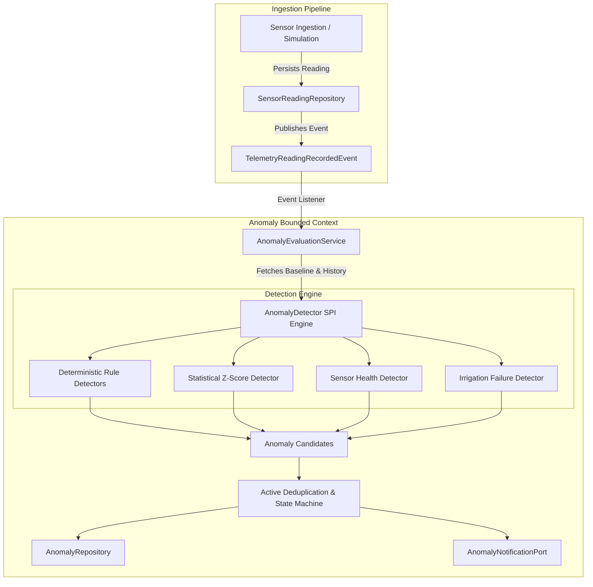

# Telemetry Anomaly Detection Architecture (`docs/anomaly-detection.md`)

## 1. Architectural Overview & Design Principles

Milestone 08.0 establishes the **Telemetry Anomaly Detection & Intelligent Alerting System** (`com.aquaai.anomaly`) for the YANGIARIQ AQUA AI platform.

The system is designed as an independent bounded context adhering strictly to **Clean Architecture**, **Hexagonal Architecture**, **Domain-Driven Design (DDD)**, **SOLID**, and **DRY** principles.



### Key Architectural Invariants
1. **Decoupled Asynchronous Telemetry Ingestion**: The `sensor` module publishes a lightweight `TelemetryReadingRecordedEvent` via Spring's `ApplicationEventPublisher`. The anomaly evaluation service consumes this event via `@EventListener`, ensuring zero compile-time or runtime dependencies on the anomaly module from ingestion.
2. **Pure Domain Core**: All domain models ([`Anomaly`](file:///home/izzatbek/Desktop/agronexsus/backend/src/main/java/com/aquaai/anomaly/domain/model/Anomaly.java), [`AnomalyCandidate`](file:///home/izzatbek/Desktop/agronexsus/backend/src/main/java/com/aquaai/anomaly/domain/model/AnomalyCandidate.java), [`AnomalyEvidence`](file:///home/izzatbek/Desktop/agronexsus/backend/src/main/java/com/aquaai/anomaly/domain/model/AnomalyEvidence.java), [`AnomalyRuleConfig`](file:///home/izzatbek/Desktop/agronexsus/backend/src/main/java/com/aquaai/anomaly/domain/model/AnomalyRuleConfig.java)) and ports are pure Java standard library code with zero Spring, JPA, or web annotations.
3. **Pluggable Detector SPI**: The detection engine exposes the [`AnomalyDetector`](file:///home/izzatbek/Desktop/agronexsus/backend/src/main/java/com/aquaai/anomaly/domain/port/AnomalyDetector.java) interface. New detection algorithms can be registered simply by implementing this contract.

---

## 2. Detection Engine SPI Contract

Every detector implements [`AnomalyDetector`](file:///home/izzatbek/Desktop/agronexsus/backend/src/main/java/com/aquaai/anomaly/domain/port/AnomalyDetector.java):

```java
public interface AnomalyDetector {
    Set<SensorType> supportedSensorTypes();
    List<AnomalyCandidate> detect(DetectionContext context);
    int getOrder();
}
```

### Detection Context Payload
The [`DetectionContext`](file:///home/izzatbek/Desktop/agronexsus/backend/src/main/java/com/aquaai/anomaly/domain/model/DetectionContext.java) encapsulates all analytical data required for a single evaluation cycle:
- `currentReading`: Current telemetry observation ([`SensorReading`](file:///home/izzatbek/Desktop/agronexsus/backend/src/main/java/com/aquaai/sensor/domain/model/SensorReading.java)).
- `sensor`: Device metadata and provider type (`PHYSICAL_GATEWAY` vs `SIMULATED`).
- `recentReadings`: Rolling window of the 15 most recent observations from the same sensor.
- `statisticalBaseline`: 24-hour aggregate containing mean, variance, min, max, and count.
- `ruleConfigs`: Map of dynamic threshold configurations keyed by rule code.
- `isScheduledIrrigationActive`: Flag indicating whether the parcel is currently in an active irrigation window.
- `parcelPressure`: Corroborating pressure reading from the same parcel (if available).
- `parcelFlow`: Corroborating water flow reading from the same parcel (if available).

---

## 3. Implemented Detection Algorithms

### 3.1 Deterministic Modality Rule Detectors
Each agricultural sensor modality has a specialized rule detector that reads configurable thresholds from [`AnomalyRuleConfig`](file:///home/izzatbek/Desktop/agronexsus/backend/src/main/java/com/aquaai/anomaly/domain/model/AnomalyRuleConfig.java):

| Detector | Supported Sensor | Anomaly Type | Severity | Default Condition |
| :--- | :--- | :--- | :--- | :--- |
| [`SoilMoistureRuleDetector`](file:///home/izzatbek/Desktop/agronexsus/backend/src/main/java/com/aquaai/anomaly/infrastructure/detection/SoilMoistureRuleDetector.java) | `SOIL_MOISTURE` | `SOIL_MOISTURE_CRITICAL` | `CRITICAL` | $V \le 15.0\%$ volumetric moisture |
| [`SoilMoistureRuleDetector`](file:///home/izzatbek/Desktop/agronexsus/backend/src/main/java/com/aquaai/anomaly/infrastructure/detection/SoilMoistureRuleDetector.java) | `SOIL_MOISTURE` | `SOIL_MOISTURE_DROP` | `HIGH` | Drop rate $> 5.0\%$ in 1 hour |
| [`WaterFlowRuleDetector`](file:///home/izzatbek/Desktop/agronexsus/backend/src/main/java/com/aquaai/anomaly/infrastructure/detection/WaterFlowRuleDetector.java) | `WATER_FLOW` | `WATER_FLOW_SPIKE` | `HIGH` | $V \ge 45.0\text{ m}^3/\text{h}$ |
| [`WaterFlowRuleDetector`](file:///home/izzatbek/Desktop/agronexsus/backend/src/main/java/com/aquaai/anomaly/infrastructure/detection/WaterFlowRuleDetector.java) | `WATER_FLOW` | `WATER_FLOW_ZERO` | `HIGH` | $V \le 0.1\text{ m}^3/\text{h}$ during active irrigation |
| [`WaterPressureRuleDetector`](file:///home/izzatbek/Desktop/agronexsus/backend/src/main/java/com/aquaai/anomaly/infrastructure/detection/WaterPressureRuleDetector.java) | `PRESSURE` | `WATER_PRESSURE_DROP` | `HIGH` | $V \le 1.2\text{ bar}$ while line energized |
| [`SalinityRuleDetector`](file:///home/izzatbek/Desktop/agronexsus/backend/src/main/java/com/aquaai/anomaly/infrastructure/detection/SalinityRuleDetector.java) | `SALINITY` | `SALINITY_INCREASE` | `CRITICAL` / `HIGH` | $V \ge 6.5\text{ dS/m}$ (Critical) or $\ge 4.0\text{ dS/m}$ |
| [`TemperatureRuleDetector`](file:///home/izzatbek/Desktop/agronexsus/backend/src/main/java/com/aquaai/anomaly/infrastructure/detection/TemperatureRuleDetector.java) | `TEMPERATURE` | `TEMPERATURE_ANOMALY` | `HIGH` | $V \le 2.0^\circ\text{C}$ (Frost) or $V \ge 42.0^\circ\text{C}$ (Heat) |
| [`HumidityRuleDetector`](file:///home/izzatbek/Desktop/agronexsus/backend/src/main/java/com/aquaai/anomaly/infrastructure/detection/HumidityRuleDetector.java) | `HUMIDITY` | `HUMIDITY_ANOMALY` | `MEDIUM` | $V \le 15.0\%$ RH (Dry Garmsel) |
| [`RainfallRuleDetector`](file:///home/izzatbek/Desktop/agronexsus/backend/src/main/java/com/aquaai/anomaly/infrastructure/detection/RainfallRuleDetector.java) | `RAINFALL` | `RAINFALL_ANOMALY` | `HIGH` | $V \ge 50.0\text{ mm/h}$ cloudburst |

---

### 3.2 Statistical Outlier Detection (Z-Score)
Implemented in [`StatisticalAnomalyDetector`](file:///home/izzatbek/Desktop/agronexsus/backend/src/main/java/com/aquaai/anomaly/infrastructure/detection/StatisticalAnomalyDetector.java).

The Z-score represents how many standard deviations an observation deviates from the historical moving baseline:

$$Z = \frac{x - \mu}{\sigma}$$

Where:
- $x$: Current observed telemetry value.
- $\mu$: 24-hour historical mean of valid observations.
- $\sigma = \sqrt{\text{variance}}$: Standard deviation of historical observations.

#### Guardrails & Stability Protections
1. **Sample Size Floor**: Z-score calculation is only triggered if sample count $N \ge 10$. If fewer than 10 readings exist in the rolling window, the baseline is considered statistically unrepresentative and detection is skipped.
2. **Zero-Variance Guard**: If historical telemetry is constant ($\sigma < 10^{-6}$), division by zero is prevented; statistical outlier detection gracefully yields zero candidates.
3. **Threshold & Confidence Mapping**:
   - Outlier condition: $|Z| \ge 3.0$ (representing 99.7% normal distribution bounds).
   - Confidence: $\text{confidence} = \min(0.99, 0.70 + 0.05 \times (|Z| - 3.0))$.
   - Severity: `CRITICAL` if $|Z| \ge 4.5$, `HIGH` if $|Z| \ge 3.5$, `MEDIUM` if $|Z| \ge 3.0$.

---

### 3.3 Sensor Health & Hardware Failure Monitoring
Implemented in [`SensorHealthDetector`](file:///home/izzatbek/Desktop/agronexsus/backend/src/main/java/com/aquaai/anomaly/infrastructure/detection/SensorHealthDetector.java).

1. **Stuck Sensor Detection (`SENSOR_STUCK`)**:
   - Triggered when $\ge 5$ consecutive readings arrive with zero variance ($\max - \min < 0.0001$) for dynamic environmental parameters (e.g. soil moisture, ambient temperature, humidity).
   - Severity: `MEDIUM`. Confidence: $0.85$.
2. **Provisional Sensor Drift Classification (`POSSIBLE_SENSOR_DRIFT`)**:
   - User Refinement #3: In the absence of factory calibration metadata or a secondary reference standard, gradual monotonic divergence from regional parcel means is labeled **`POSSIBLE_SENSOR_DRIFT`** with `LOW` severity and provisional confidence ($0.70$), rather than asserting hardware calibration failure.
3. **Sensor Offline Monitoring (`SENSOR_OFFLINE`)**:
   - The [`AnomalySchedulerService`](file:///home/izzatbek/Desktop/agronexsus/backend/src/main/java/com/aquaai/anomaly/application/service/AnomalySchedulerService.java) executes every 5 minutes (`aquaai.anomaly.offline-check-cron`).
   - If an active sensor has not reported a reading within `aquaai.anomaly.offline-threshold-minutes` (default 30 minutes), an anomaly of type `SENSOR_OFFLINE` with severity `MEDIUM` is raised.

---

### 3.4 Multi-Metric Irrigation Failure & Pipe Burst
Implemented in [`IrrigationFailureDetector`](file:///home/izzatbek/Desktop/agronexsus/backend/src/main/java/com/aquaai/anomaly/infrastructure/detection/IrrigationFailureDetector.java).

User Refinement #2 is strictly enforced: A confirmed pipe burst cannot be declared solely from a flow spike.

#### Corroborated Hydraulic Analysis:
1. **Multi-Metric Corroboration**:
   - Condition: Water flow exceeds threshold ($Q \ge 45\text{ m}^3/\text{h}$) **AND** line pressure drops significantly ($P \le 1.2\text{ bar}$).
   - Classification: **`SUSPECTED_PIPE_BURST`**.
   - Severity: `CRITICAL`. Confidence: $0.92$.
   - Evidence: Cross-references both flow and pressure observations in `AnomalyEvidence`.
2. **Uncorroborated Flow Spike**:
   - Condition: Water flow spike detected ($Q \ge 45\text{ m}^3/\text{h}$), but pressure telemetry is unavailable on the parcel.
   - Classification: **`SUSPECTED_PIPE_BURST`**.
   - Confidence: Downgraded to $\le 0.65$.
   - Explanation: Explicitly includes notice: *"Quvur yorilishi ehtimoli mavjud, biroq bosim sensori ma'lumotlari mavjud emasligi sababli to'liq tasdiqlanmagan."*
3. **Zero Delivery During Active Irrigation**:
   - Condition: An active scheduled irrigation event is ongoing, but water flow remains $\le 0.1\text{ m}^3/\text{h}$.
   - Classification: **`IRRIGATION_FAILURE`**.
   - Severity: `HIGH`. Confidence: $0.88$.
