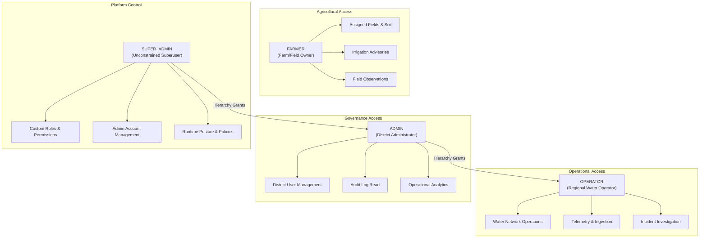

# Centralized Role-Based Access Control (RBAC) & Authorization Model

## 1. Executive Summary

Milestone **08.20.1** establishes a centralized, auditable, and hierarchical Role-Based Access Control (RBAC) architecture for **YANGIARIQ AQUA AI**.

Prior to this milestone, authorization was decentralized across role string comparisons (`ROLE_ADMIN`, `ROLE_OPERATOR`, `ROLE_FARMER`). Milestone 08.20.1 formalizes:
1. **Four Unified Platform Roles**: `SUPER_ADMIN`, `ADMIN`, `OPERATOR`, `FARMER`.
2. **Granular Permissions Catalog**: 30 distinct platform authorities spanning 8 functional domains.
3. **Database-Driven Role-Permission Mapping**: Dynamic permission assignments persisted via Liquibase migration `028-create-admin-rbac-and-audit-tables.sql`.
4. **Clean Architecture Boundary Separation**: The `admin` bounded context maintains domain repository purity (zero Spring framework imports) while enforcing platform-wide security governance.
5. **Strict Anti-Privilege Escalation**: Standard administrators cannot modify Super Administrator accounts, escalate privileges, or evade audit logging.
6. **Strict Distinction Between Platform Roles and Pilot Roles**: Operational pilot participant roles (`FIELD_LEAD`, `OBSERVER`, `OPERATOR`, `FARMER`) remain business-level metadata within pilot programs and never implicitly grant platform security permissions.

---

## 2. Platform Roles Architecture



### Role Definitions

| Platform Role | Description | Scope & Authority |
|---|---|---|
| `SUPER_ADMIN` | Root system administrator | Unrestricted platform control. Can create/modify `ADMIN` accounts, configure custom roles and permission mappings, inspect global immutable audit logs, and inspect runtime security settings. Authorities granted: `ROLE_SUPER_ADMIN`, `ROLE_ADMIN`, `ROLE_OPERATOR`, plus all 30 platform permissions. |
| `ADMIN` | District administrator | Administrative access over authorized district scope. Can manage farmers and operators, inspect audit trails, provision user accounts (`FARMER`, `OPERATOR`, `ADMIN`), and review regional metrics. **Cannot** create or modify `SUPER_ADMIN` accounts, delete the last administrator, or alter system role permissions. |
| `OPERATOR` | Water basin & canal network operator | Manages water distribution turns, canal sensors, telemetric anomalies, pilot ground-truth reviews, and corrective action workflows. Restricted from administrative user provisioning and role management. |
| `FARMER` | Agricultural field owner / agronomist | Access strictly restricted to owned fields and farms (Anti-IDOR). Can view crop water requirements, receive irrigation schedules, submit ground-truth field observations, and view field telemetry. |

---

## 3. Distinction from Pilot Operational Roles

> [!IMPORTANT]
> Platform security roles and pilot participant roles represent fundamentally different architectural concepts and must never be conflated:
> - **Platform Roles** (`SUPER_ADMIN`, `ADMIN`, `OPERATOR`, `FARMER`): Govern authentication, JWT tokens, API authorization, and tenant isolation.
> - **Pilot Participant Roles** (`FIELD_LEAD`, `OBSERVER`, `OPERATOR`, `FARMER` in Milestone 08.20): Represent operational responsibilities assigned within a specific pilot program. A user who is an `OBSERVER` in a pilot program still retains their platform role (e.g. `FARMER`) for API authorization.

---

## 4. Granular Permissions Catalog (30 Permissions)

Permissions are organized into 8 functional categories:

### 4.1 User Management (`USER_MANAGEMENT`)
- `USER_CREATE`: Provision new platform accounts.
- `USER_READ`: View user profiles within authorized organizational scope.
- `USER_UPDATE`: Modify user details and organizational assignments.
- `USER_STATUS_CHANGE`: Activate, deactivate, or block user accounts.
- `USER_ROLE_CHANGE`: Assign or modify platform roles.
- `USER_DELETE`: Soft-delete or archive user accounts.

### 4.2 Farm & Field Governance (`FARM_AND_FIELD`)
- `FARM_CREATE`: Register agricultural farms.
- `FARM_READ`: Inspect farm boundaries, soil profiles, and crop types.
- `FARM_UPDATE`: Update farm parameters and water quotas.
- `FIELD_CREATE`: Create land parcels with GeoJSON GIS polygons.
- `FIELD_READ`: Access parcel attributes and telemetry.
- `FIELD_UPDATE`: Adjust parcel soil data and crop stages.

### 4.3 Sensor & Telemetry (`SENSOR_AND_TELEMETRY`)
- `SENSOR_READ`: Inspect soil moisture, canal ultrasonic, and weather sensors.
- `SENSOR_MANAGE`: Register, calibrate, and bind sensors to parcels/canals.
- `TELEMETRY_INGEST`: Ingest telemetry data via HTTP sensor gateway.

### 4.4 Water Accounting & Distribution (`WATER_AND_DISTRIBUTION`)
- `WATER_DISTRIBUTION_SCHEDULE`: Generate and modify rotational irrigation schedules.
- `WATER_ACCOUNTING_READ`: View volumetric water accounting ledgers.
- `WATER_LIMIT_OVERRIDE`: Apply emergency water allowance overrides.

### 4.5 Reporting & Analytics (`REPORTING_AND_ANALYTICS`)
- `REPORT_READ`: Inspect operational, volumetric, and predictive reports.
- `REPORT_EXPORT`: Export compliance and synthetic evaluation reports.

### 4.6 Governance & Auditing (`GOVERNANCE_AND_AUDIT`)
- `AUDIT_LOG_READ`: Inspect immutable security and operational audit logs.
- `ROLE_MANAGE`: Create custom roles and configure permission matrices.
- `SYSTEM_SETTINGS_READ`: Inspect runtime configurations, token windows, and policies.

### 4.7 Field Pilot Governance (`PILOT_MANAGEMENT`)
- `PILOT_CREATE`: Define new controlled pilot programs.
- `PILOT_READ`: Inspect pilot status, participants, and telemetry.
- `PILOT_PARTICIPANT_MANAGE`: Enroll or withdraw pilot participants.
- `GROUND_TRUTH_SUBMIT`: Record field ground-truth measurements.
- `GROUND_TRUTH_REVIEW`: Validate ground-truth under Four-Eyes governance.

### 4.8 Incident Investigation (`INCIDENT_MANAGEMENT`)
- `INCIDENT_READ`: View hydraulic and operational incidents.
- `INCIDENT_INVESTIGATE`: Manage root cause analysis and assign corrective actions.

---

## 5. Enforcement Mechanisms

### 5.1 Spring Security Authorities Mapping
In `UserPrincipal.java`, each authenticated user receives:
1. Exact role authority: `ROLE_<ROLE_NAME>` (e.g. `ROLE_SUPER_ADMIN`).
2. Hierarchical authorities: `ROLE_SUPER_ADMIN` automatically receives `ROLE_ADMIN` and `ROLE_OPERATOR` authorities.
3. Permission authorities: Every mapped permission from `PlatformPermission` is assigned as a granted authority (e.g. `USER_CREATE`, `AUDIT_LOG_READ`).

### 5.2 Method-Level Security
Controllers enforce granular authorization using `@PreAuthorize`:
```java
@PreAuthorize("hasAuthority('USER_ROLE_CHANGE') or hasRole('SUPER_ADMIN')")
@PatchMapping("/{id}/role")
public ResponseEntity<UserProfileResponse> changeUserRole(...) { ... }
```

### 5.3 Resource Ownership & Anti-IDOR Verification
For field-level operations, `FieldSecurityService` and domain use cases verify ownership:
- A `FARMER` can only access fields belonging to their user ID or associated farm.
- Access attempts to other farmers' fields are rejected with `403 FORBIDDEN` (or `404 NOT_FOUND` where enumeration defense is required).
- `ADMIN` and `SUPER_ADMIN` can access fields across the district scope.

### 5.4 Privilege Escalation Defenses
1. **Super Admin Account Immunity**: A standard `ADMIN` attempting to update, change the role of, deactivate, or delete a `SUPER_ADMIN` account receives `403 FORBIDDEN`.
2. **Sole Super Admin Protection**: The platform prevents deactivating, demoting, or deleting the last active `SUPER_ADMIN` in the system.
3. **Session Revocation on Status Change**: In `JwtAuthenticationFilter.java`, every incoming request verifies the user's active status directly against the persistence store. If an account is toggled to `INACTIVE` or `BLOCKED`, all active JWT sessions are immediately invalidated with `401 UNAUTHORIZED`.

---

## 6. Security Audit Trail

All sensitive administrative actions emit an append-only, immutable record into `security_audit_logs`:
- **Actor Metadata**: `actor_user_id`, `actor_username`, `actor_role`.
- **Action Details**: `action` (e.g. `USER_CREATED`, `USER_ROLE_CHANGED`, `ROLE_PERMISSIONS_UPDATED`).
- **Target Metadata**: `target_type` (e.g. `USER`, `ROLE`, `SYSTEM`), `target_id`.
- **Payload & Network Context**: `details` (JSON payload without credentials), `ip_address`, `result` (`SUCCESS` / `FAILURE`).
