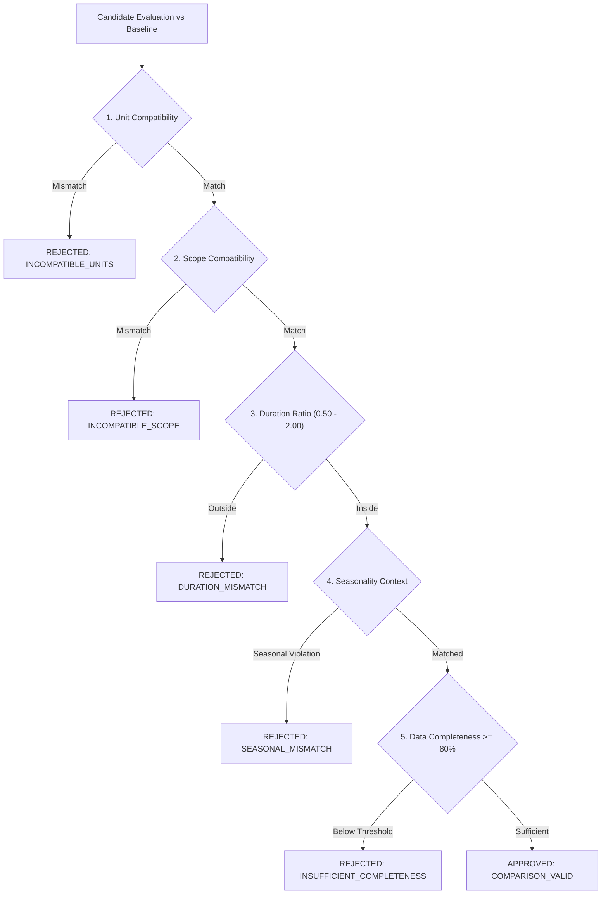

# Baseline and Comparability Methodology

## 1. Principles of Meaningful Comparison

Performance claims in irrigation management and regional water logistics cannot exist in a vacuum. To claim that conveyance losses were reduced or delivery adherence improved, an observation must be rigorously evaluated against an approved, comparable baseline.

The `BaselineComparabilityEngine` enforces five mandatory comparability criteria:

---

## 2. Mandatory Validation Criteria

### 2.1 Measurement Unit Compatibility
The baseline and evaluation periods must employ identical SI units:
- For example, an indicator in percentage (`%`) cannot be compared against a volumetric sum ($m^3$).
- Water depth ($mm$) cannot be compared directly with conveyance flow rates ($m^3/s$).

### 2.2 Geographic Scope Alignment
- A reach-level baseline (`CANAL_REACH`) cannot be applied directly to evaluate an entire district (`DISTRICT`), as channel morphology, seepage rates, and network branching differ fundamentally.
- Comparisons require matched scope types or an explicit aggregation transformation.

### 2.3 Temporal Duration Ratio
The duration of the evaluation period ($T_{\text{eval}}$) and baseline period ($T_{\text{base}}$) must satisfy:
$$0.50 \le \frac{T_{\text{eval}}}{T_{\text{base}}} \le 2.00$$
Comparing a 3-day rainfall event against a 90-day seasonal baseline produces spurious rate comparisons and is explicitly rejected.

### 2.4 Seasonal & Climatic Homogeneity
- Peak summer vegetative demand periods (June–August) cannot serve as a valid baseline for spring pre-sowing leaching (March–April).
- Comparisons across different hydrological years must account for upstream transboundary intake quotas and precipitation anomalies.

### 2.5 Data Completeness Threshold
A baseline is considered invalid for impact attribution if data completeness is below 80.0%:
$$\text{Completeness} = \frac{N_{\text{valid observations}}}{N_{\text{expected scheduled observations}}} \times 100.0 \ge 80.0\%$$

---

## 3. Operational Target Taxonomy

The platform distinguishes four distinct target categories in `PerformanceTarget`:
1. `OPERATIONAL_TARGET`: Internal dispatch management goals (e.g., maintain 92% schedule adherence).
2. `ENGINEERING_CONSTRAINT`: Physical hydraulic thresholds (e.g., maximum canal head capacity of $24.5\ m^3/s$, minimum freeboard).
3. `POLICY_THRESHOLD`: Ministry of Water Resources and regional river basin administration decrees (e.g., maximum allowable distribution variance $CV \le 0.18$).
4. `PILOT_DEMO_TARGET`: Experimental demo targets for sensor-assisted furrow irrigation pilots.

### Compliance Evaluation
Targets are evaluated deterministically:
- `MINIMUM`: Target requires $\text{Value} \ge \text{TargetValue} - \text{Tolerance}$
- `MAXIMUM`: Target requires $\text{Value} \le \text{TargetValue} + \text{Tolerance}$
- `RANGE`: Target requires $\text{RangeMin} \le \text{Value} \le \text{RangeMax}$
