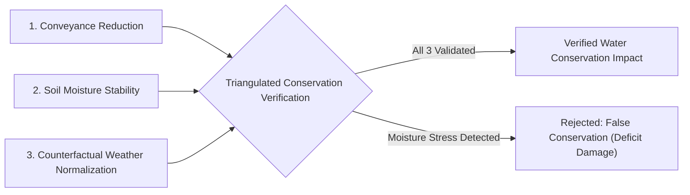

# Water Conservation Impact Verification Methodology

## 1. Principles of Empirical Conservation Verification

In agricultural water management, conservation claims often suffer from unverified assumptions:
- Merely recommending drip irrigation or generating a conservation plan does NOT constitute actual water savings.
- Reducing delivery to a canal head does NOT automatically prove on-farm water efficiency if fields suffered moisture stress or crop failure.

Milestone 08.17 integrates directly with the conservation intelligence module (08.15) and field telemetry (08.08) to measure **empirically verified conservation outcomes**.

---

## 2. Conservation Verification Protocol

A conservation claim requires verification across three orthogonal dimensions:

### 2.1 Conveyance Reduction
Measured by ultrasonic flow post meters at the canal inlet and farm outlet gates:
$$\Delta V_{\text{conveyance}} = V_{\text{baseline inflow}} - V_{\text{actual inflow}}$$

### 2.2 Soil Moisture Stability
Telemetric soil moisture sensors ($10\ cm$, $30\ cm$, $60\ cm$ depths) must confirm that root-zone moisture remained above the Management Allowed Depletion (MAD) threshold:
$$\theta_{\text{root zone}} \ge \theta_{\text{MAD}}$$
If soil moisture plummeted into permanent wilting point territory, the reduction in delivery was under-irrigation, NOT conservation.

### 2.3 Counterfactual Weather Normalization
Precipitation events ($P$) during the irrigation window naturally reduce the irrigation requirement. The counterfactual volume is adjusted:
$$V_{\text{counterfactual}} = V_{\text{baseline}} - \left(10 \times P_{\text{effective, mm}} \times A_{\text{ha}}\right)$$
Attributing rain-induced delivery reductions to platform conservation efficiency is strictly prohibited.

---

## 3. Disparity & Rebound Effects

The verification engine monitors for the **Jevons Rebound Effect**:
- When water saved along an upstream canal reach is immediately misappropriated by unauthorized upstream acreage expansions rather than flowing to tail-end water users.
- The `distributionEquityCv` metric provides real-time verification: true regional conservation must maintain or improve the delivery equity to downstream Water User Associations (WUAs).
