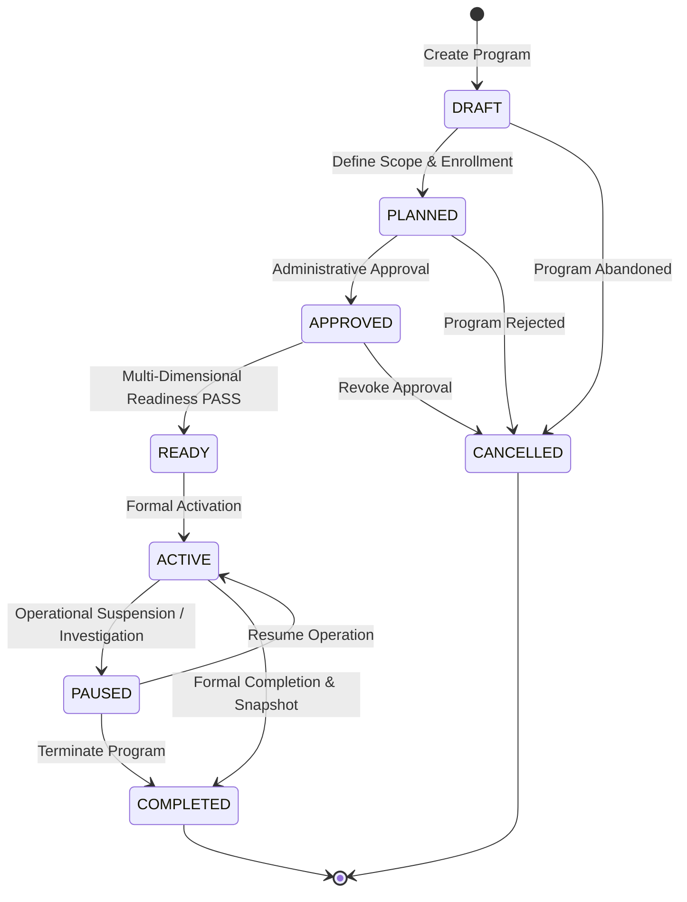
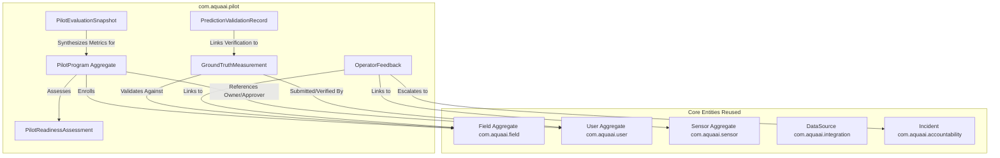

# Controlled Field Pilot Program Framework (Milestone 08.20)

## 1. Executive Overview

The **Controlled Field Pilot Program Framework** provides **YANGIARIQ AQUA AI** with a rigorous, bounded operational governance mechanism to validate agricultural water intelligence in real-world field conditions across Khorezm, Uzbekistan.

In prior milestones (08.01–08.19), the platform established GIS field mapping, sensor telemetry simulation, irrigation scheduling algorithms, regional water accounting, incident investigation, production infrastructure, and external data ingestion (weather APIs, CSV batch imports, and HTTP gateway contracts). However, software execution and synthetic data tests do not constitute proof of real-world agricultural efficacy.

The controlled field pilot framework establishes an audited, defensible process to:
1. Formulate bounded pilot programs with explicit geographic scope, time horizons, and measurable operational objectives.
2. Enroll existing farm parcels and participants (farmers, agronomists, canal operators) without parallel or divergent entity models.
3. Enforce formal administrative approval and multi-dimensional pre-flight readiness gates before granting operational activation.
4. Maintain human-in-the-loop oversight throughout the pilot lifecycle, with zero autonomous actuation of canal gates, valves, or pumps.

---

## 2. Program Lifecycle State Machine

A pilot program transitions through a deterministic lifecycle designed to prevent premature or unvalidated operations:

### Lifecycle States Defined

| State | Description | Invariant / Transition Pre-condition |
| :--- | :--- | :--- |
| **`DRAFT`** | Initial formulation of pilot objectives, dates, and geographic scope. | Editable by creator; participants and fields can be added/removed. |
| **`PLANNED`** | Scope finalized; participants and parcels fully mapped; awaiting district review. | Measurement plan and validation criteria must be specified. |
| **`APPROVED`** | Formally approved by authorized water resource officer or regional agronomist. | Records `approvedBy`, `approvedAt`, and mandatory `approvalNotes`. |
| **`READY`** | Multi-dimensional readiness check evaluates all mandatory gates to `PASS` or non-blocking `WARNING`. | Cannot transition to `READY` if any mandatory readiness check is `BLOCKED`. |
| **`ACTIVE`** | Live operational pilot execution. Ground truth collection and prediction validation enabled. | Only transitions from `APPROVED` or `READY`. Submissions recorded with real timestamps. |
| **`PAUSED`** | Temporarily suspended due to critical sensor discrepancies, weather anomalies, or incident investigation. | Ingestion or validations paused; retains history without data loss. |
| **`COMPLETED`** | Pilot closed; final evaluation snapshot generated; performance indicators frozen. | Terminal state. No further field modifications permitted. |
| **`CANCELLED`** | Program aborted prior to full completion. | Terminal state with audit justification logged. |

---

## 3. Domain Model Architecture & Boundary Discipline

In accordance with Clean Architecture and Hexagonal boundaries, the pilot framework integrates seamlessly with pre-existing core domain modules:

### 3.1 Pilot Program Attributes
- **`id`** (`UUID`): Primary key.
- **`code`** (`VARCHAR(64)`): Unique identifier (e.g., `PILOT-YANGIARIQ-2026-01`).
- **`name`** (`VARCHAR(255)`): Descriptive program title.
- **`description`** (`TEXT`): Background, hypothesis, and methodology.
- **`geographicScope`** (`VARCHAR(255)`): Bounded administrative/hydrological zone (e.g., *Yangiariq District, Sector 4, Suvchilar WUA*).
- **`startDate` / `endDate`** (`LocalDate`): Bounded operational envelope. Enforces `startDate <= endDate`.
- **`organization`** (`VARCHAR(255)`): Responsible regional water basin administration or research institute.
- **`ownerId`** (`UUID`): Foreign key to `users(id)`.
- **`operationalObjectives`** (`TEXT`): Explicit, testable goals (e.g., *Validate 12% water conveyance reduction and keep soil moisture forecasting RMSE <= 3.5%*).
- **`status`** (`PilotStatus`): Program lifecycle status.
- **`approvedBy` / `approvedAt` / `approvalNotes`**: Attestation metadata for four-eyes administrative governance.

### 3.2 Participant Enrollment (`PilotParticipant`)
- Connects existing user accounts (`users`) to the pilot with a designated role:
  - `FIELD_LEAD`: Regional agronomist or senior water technician.
  - `OBSERVER`: Independent verifier or academic auditor.
  - `OPERATOR`: Field ditch rider or canal gatekeeper.
  - `FARMER`: Landholder or cooperative tenant.
- Enforces uniqueness on `(pilot_id, user_id)`: a user cannot be enrolled twice in the same pilot.

### 3.3 Field Parcel Enrollment (`PilotField`)
- Connects existing surveyed field polygons (`fields`) to the pilot program.
- Captures field-specific protocols:
  - `monitoringTarget`: Target variable (e.g., *Root zone moisture at 30cm depth, turnout volumetric discharge*).
  - `measurementPlan`: Protocol for data capture (e.g., *Daily handheld TDR probe sampling at 10:00 AM; turnout flume staff gauge read twice daily*).
  - `validationCriteria`: Acceptable tolerance thresholds (e.g., *Handheld reading must correlate within 5% of gravimetric lab drying*).

---

## 4. Multi-Stage Readiness Assessment Gatekeeper

Before any pilot program can transition to `ACTIVE`, the platform executes a deterministic readiness assessment covering four operational pillars:
1. **Infrastructure Readiness**: Backend API health, PostgreSQL connectivity, Liquibase status, monitoring telemetry.
2. **Data Readiness**: Registered data sources, external weather adapter fallback, manual measurement workflows, sensor hardware availability status.
3. **Operational Readiness**: Assigned field leads, verified participants, registered parcel measurement plans, incident escalation paths.
4. **Governance Readiness**: Administrative sign-off, participant consent/authorization, four-eyes independent verification role assignment.

If any mandatory check evaluates to `BLOCKED`, activation is programmatically rejected with an `IllegalStateException`.

---

## 5. Standard Operational Statuses

To prevent ambiguity between software readiness, hardware presence, and real-world execution, the platform enforces explicit status terminology across all pilot surfaces:

| Operational Status | Exact Meaning |
| :--- | :--- |
| **`IMPLEMENTED`** | Software logic, database schemas, and REST APIs are developed, compiled, and tested. |
| **`CONFIGURED`** | Integration parameters, field boundaries, and user accounts are provisioned in the database. |
| **`READY`** | All mandatory pre-flight checks evaluated to `PASS`. Ready for field activation. |
| **`BLOCKED`** | A mandatory pre-condition failed (e.g., no operators assigned, missing approval). |
| **`ACTIVE`** | Pilot program is currently underway; live field data and validations are being collected. |
| **`COMPLETED`** | Pilot period elapsed and immutable evaluation snapshot archived. |
| **`NOT_CONFIGURED`** | External adapter credentials or physical flume specifications have not yet been registered. |
| **`AWAITING_HARDWARE`** | Automated IoT telemetry gateways or digital flumes are pending physical installation in Yangiariq canals. |
| **`AWAITING_FIELD_VALIDATION`** | Measurements submitted but pending four-eyes review by an independent inspector. |

---

## 6. Strict Non-Negotiable Boundaries

1. **No Real Pilot Claim Without Physical Evidence**: The existence of software and database tables does not constitute an operational field pilot. Real pilot claims require audited ground-truth records, signed participant attestations, and physical inspection notes.
2. **Simulated Data Is Never Ground Truth**: Synthetic telemetry generated by `SimulatedSensorProvider` must remain explicitly tagged as `SIMULATED` and is strictly prohibited from being ingested into `ground_truth_validations`.
3. **Zero Autonomous Actuation**: The platform generates agronomic recommendations and hydraulic schedules for human operators. It does not interface with PLC/SCADA pump or valve actuators.
4. **No Unsubstantiated Savings**: Water conservation percentages and crop yield impacts must never be reported without an audited baseline dataset and verified ground-truth flow measurements.
