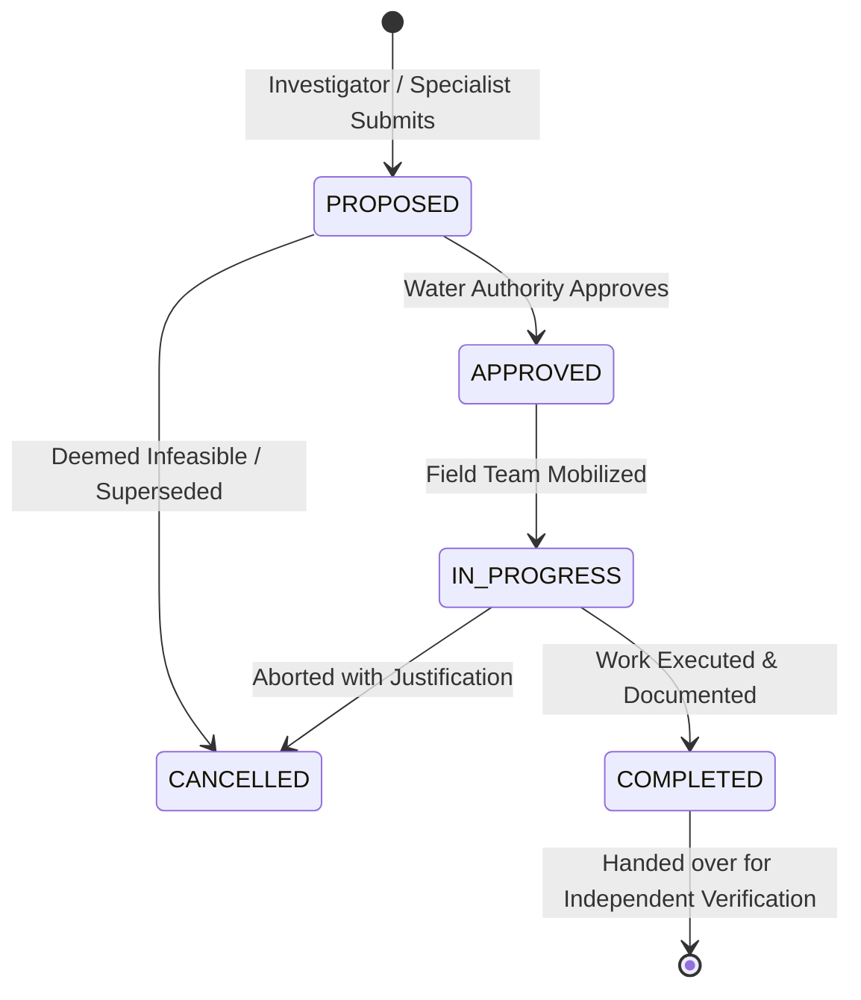

# Corrective Action Governance
# Yangiariq Aqua AI — Milestone 08.16

## 1. Governance Purpose

Corrective actions within **YANGIARIQ AQUA AI** operationalize findings into tangible, accountable field and engineering tasks.

They do **not** form a separate generic task management system or compete with enterprise ticketing. They are strictly bound to water incidents, ensuring that every identified discrepancy, safety issue, or unmetered loss has an authorized plan, an assigned owner, clear physical milestones, and a requirement for independent verification.

---

## 2. Corrective Action Data Model

Each corrective action contains:

```java
public record CorrectiveAction(
    String id,
    String incidentId,
    String actionNumber,          // e.g. "ACT-2026-0001-01"
    String title,
    String description,
    String objective,             // Specific measurable goal (e.g. "Eliminate 15% canal bank seepage")
    String actionOwnerId,
    String actionOwnerName,
    String actionOwnerOrg,
    String priority,              // IMMEDIATE, HIGH, MEDIUM, ROUTINE
    Instant dueDate,
    String expectedOutcome,
    ActionStatus status,          // PROPOSED, APPROVED, IN_PROGRESS, COMPLETED, CANCELLED
    String approvedById,
    String approvedByName,
    Instant approvedAt,
    String approvalNotes,
    String completedById,
    String completedByName,
    Instant completedAt,
    String completionNotes,       // Mandatory physical work summary
    String verificationRequirement, // Specific proof required (e.g. "Secondary acoustic flow survey")
    Instant createdAt,
    Instant updatedAt
) {}
```

---

## 3. Action Lifecycle



### Action Lifecycle Rules:
1. **Proposal**: An investigator proposes an action detailing what physical or administrative steps will be taken, who will do it, and what the verifiable success criteria are.
2. **Approval**: An authorized official (`ROLE_OPERATOR` or `ROLE_ADMIN`) approves the action with formal approval notes. Work may not commence before approval.
3. **Execution**: The action owner marks the action `IN_PROGRESS`.
4. **Completion**: When physical repairs, meter recalibration, or quota adjustments are finished, the owner submits `completionNotes` documenting the work done.
5. **State Transition**: Completing the action automatically shifts the parent incident into **`PENDING_VERIFICATION`**. It **never** auto-resolves the incident.

---

## 4. Typical Corrective Action Categories

- **Canal Segment Remediation**: Physical inspection of canal embankments, lining crack sealing, silt clearance, or vegetation removal along suspected seepage reaches.
- **Sensor Recalibration & Gauge Repair**: Acoustic doppler flow meter calibration, ultrasonic sensor alignment, float chamber desilting, or solar/battery replacement.
- **Turnout Delivery & Meter Verification**: Joint field inspection of WUA turnout gates, verifying manual staff gauge readings against automated telemetric logs.
- **Allocation & Ledger Adjustment**: Administrative correction of erroneous meter factors or double-counted ledger transfers in the regional water balance.
- **Temporary Flow Redistribution**: Scheduled re-balancing of canal gate settings to relieve tail-end water deficits without violating hydraulic head limits.

---

## 5. Non-Actuation Constraint

Corrective actions govern **human operational directives only**.

> [!CAUTION]
> Under no circumstances does the system automatically open, close, throttle, or reposition motorized canal gates, turnout valves, or pump motors.
> All physical gate movements must be executed by certified water operators following local safety protocols. This rule is enforced at the domain architecture level (ArchUnit Rule 100).
