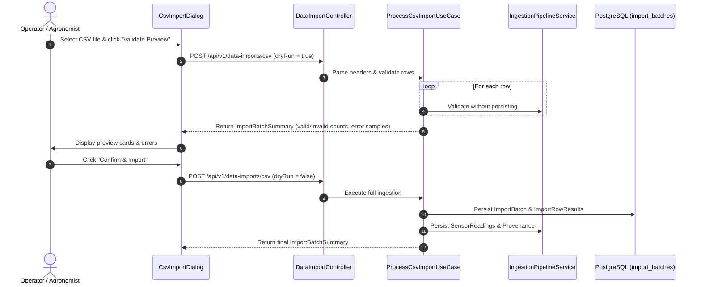

# CSV Batch Import & Operator Manual Measurements

## 1. Overview
In agricultural regions transitioning toward digital automation, manual sampling and periodic spreadsheet uploads are the primary bridge between physical field realities and digital intelligence. Milestone 08.19 implements two robust ingestion channels:
1. **CSV Telemetry Batch Import** with dry-run validation preview.
2. **Operator Field Measurement Entry** with physical verification governance.

## 2. CSV Batch Import Architecture

### Workflow


### Supported CSV Format
Headers are case-insensitive and support standard aliases:
```csv
field_id,sensor_type,value,unit,measured_at,external_record_id
9b1deb4d-3b7d-4bad-9bdd-2b0d7b3dcb6d,SOIL_MOISTURE,48.5,%,2026-11-09T08:00:00Z,ROW-101
9b1deb4d-3b7d-4bad-9bdd-2b0d7b3dcb6d,TEMPERATURE,22.4,C,2026-11-09T08:00:00Z,ROW-102
9b1deb4d-3b7d-4bad-9bdd-2b0d7b3dcb6d,WATER_FLOW_RATE,15.2,m3/h,2026-11-09T08:00:00Z,ROW-103
```

### Validation & Limits
- **File size limit**: 10 MB per file.
- **Allowed MIME types**: `text/csv`, `text/plain`, `application/vnd.ms-excel`.
- **Fault-Tolerant Row Processing**: Valid rows succeed even if adjacent rows fail; all row errors are captured in `import_row_results`.
- **Dry-Run Preview**: Guarantees zero side-effects to database tables or downstream intelligence models during pre-validation.

## 3. Operator Manual Measurements

### Use Case: `RecordManualMeasurementUseCase`
Provides on-site agronomists and ditch riders with a direct method to record physical meter readings (e.g., portable soil probe or flow meter at a canal turnout).

### Request Payload
```json
{
  "fieldId": "9b1deb4d-3b7d-4bad-9bdd-2b0d7b3dcb6d",
  "sensorType": "SOIL_MOISTURE",
  "value": 46.2,
  "unit": "%",
  "measuredAt": "2026-11-09T08:30:00Z",
  "verified": true,
  "notes": "Handheld TDR sensor reading at parcel midpoint"
}
```

### Verification Governance
- **`verified = true`**: Assigned `EvidenceClassification.VERIFIED` only if submitted by an authenticated `OPERATOR` or `ADMIN`.
- **`verified = false`**: Assigned `EvidenceClassification.ESTIMATED` (unverified farmer submission).
- Farmers cannot claim unverified readings are verified without operator inspection.
