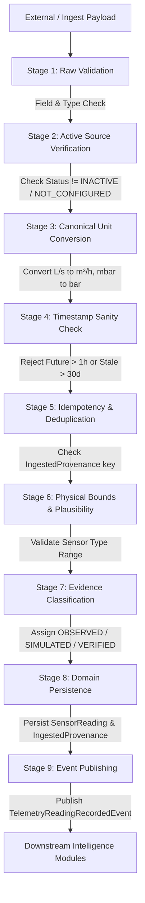

# Normalized Data Ingestion Pipeline

## 1. Overview
The `IngestionPipelineService` is a 9-stage pipeline responsible for validating, normalizing, deduplicating, evaluating, persisting, and dispatching all incoming telemetry and environmental readings.

## 2. Pipeline Stages in Detail

### Stage 1: Raw Data Validation
- Validates presence of `fieldId`, `sensorType`, `value`, and `unit`.
- Rejects empty, null, or malformed numeric inputs with `DataQualityStatus.INVALID`.

### Stage 2: Active Source Verification
- Looks up the registered `DataSource`. If the source status is `INACTIVE` or `NOT_CONFIGURED`, rejects the payload with `DataQualityStatus.INVALID` and logs the rejection.

### Stage 3: Canonical Unit Normalization (`CanonicalUnitConverter`)
Converts raw provider units to the platform's canonical representation:
- **Soil Moisture**: `%` (Canonical: `%`)
- **Water Flow**: `L/s` $\rightarrow$ $\times 3.6 \rightarrow$ `m³/h`, `gal/min` $\rightarrow \times 0.227125 \rightarrow$ `m³/h`
- **Water Volume**: `L` $\rightarrow \div 1000 \rightarrow$ `m³`, `m³` (Canonical: `m³`)
- **Temperature**: `°F` $\rightarrow (F - 32) \times 5/9 \rightarrow$ `°C`, `K` $\rightarrow K - 273.15 \rightarrow$ `°C`
- **Water Pressure**: `kPa` $\rightarrow \div 100 \rightarrow$ `bar`, `mbar` $\rightarrow \div 1000 \rightarrow$ `bar`, `psi` $\rightarrow \div 14.5038 \rightarrow$ `bar`
- **Rainfall**: `mm` (Canonical: `mm`)
All values rounded to 4 decimal places using `RoundingMode.HALF_UP`.

### Stage 4: Timestamp Sanity & Timezone Handling
- All timestamps stored internally in UTC (`Instant`).
- **Future Rejection**: Rejects timestamps greater than 1 hour into the future (`DataQualityStatus.INVALID`).
- **Stale Quarantine**: Flags timestamps older than 30 days as `DataQualityStatus.STALE`.

### Stage 5: Deduplication & Idempotency
- Generates natural idempotency key:
  - If `externalRecordId` provided: `{sourceCode}:{externalRecordId}`
  - Otherwise: `{sourceCode}:{fieldId}:{sensorType}:{measuredAtEpochMillis}`
- Performs fast index lookup on `ingested_provenance.idempotency_key`.
- If duplicate exists, returns existing record with `DataQualityStatus.DUPLICATE` without creating secondary domain entities.

### Stage 6: Physical Bounds Validation
Checks plausible physical limits based on `SensorType`:
- `SOIL_MOISTURE`: `0.0%` to `100.0%`
- `WATER_FLOW_RATE`: `0.0 m³/h` to `50,000.0 m³/h`
- `WATER_PRESSURE`: `0.0 bar` to `25.0 bar`
- `TEMPERATURE`: `-40.0 °C` to `65.0 °C`
- `WATER_LEVEL`: `0.0 m` to `20.0 m`
- `WATER_VOLUME`: $\ge 0.0\text{ m}³$
- `RAINFALL`: `0.0 mm` to `500.0 mm/h`
Out-of-bounds readings are recorded in provenance as `DataQualityStatus.OUT_OF_RANGE` and rejected from domain aggregation.

### Stage 7: Evidence Classification
- External physical devices / APIs: `EvidenceClassification.OBSERVED`
- Handheld physical measurements verified by operator: `EvidenceClassification.VERIFIED`
- Unverified manual submissions: `EvidenceClassification.ESTIMATED`
- Simulated data source: `EvidenceClassification.SIMULATED` (Strictly maintained)

### Stage 8 & 9: Persistence & Event Publishing
- Persists `SensorReading` into database.
- Persists `IngestedProvenance` into audit ledger.
- Increments `total_ingested_count` on `DataSource`.
- Publishes Spring Application Event `TelemetryReadingRecordedEvent` to update water accounting, predictive models, and anomaly detectors.
