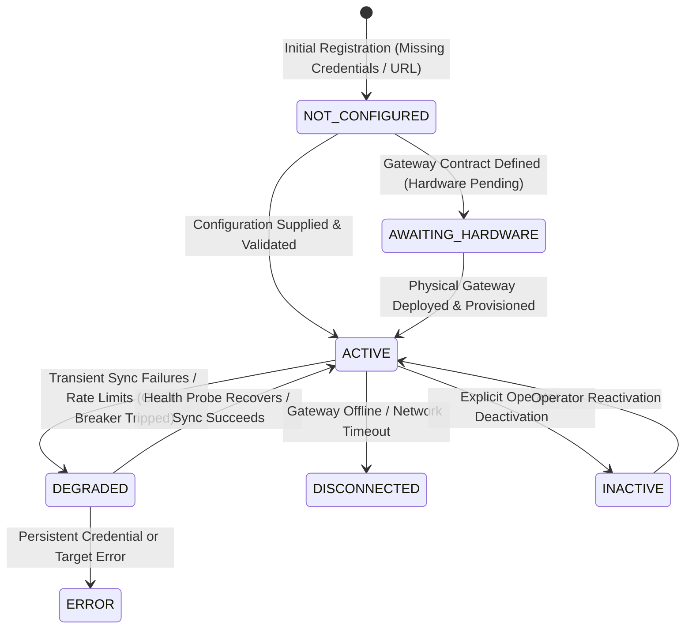

# Data Source Registry Architecture & Specification

## 1. Overview
The Data Source Registry (`data_sources` table and `DataSource` domain aggregate) serves as the centralized directory for all external and internal data providers feeding YANGIARIQ AQUA AI.

## 2. Source Categories (`DataSourceType`)
- `SENSOR_DEVICE`: Physical or virtual telemetry devices communicating over field protocols.
- `WEATHER_PROVIDER`: External regional meteorological services (e.g., Open-Meteo REST API).
- `OPERATOR_INPUT`: Agronomists and irrigation district operators submitting manual field readings.
- `FARMER_INPUT`: Self-reported observations submitted by local water users and farmers.
- `CSV_IMPORT`: Batch-uploaded telemetry logs and historical sensor spreadsheets.
- `EXTERNAL_API`: Khorezm regional water management authority APIs and hydro-meteorological feeds.
- `MANUAL_MEASUREMENT`: Verified on-site measurements recorded with handheld physical equipment.
- `SIMULATED_PROVIDER`: Synthetic edge sensor generator used for testing and baseline simulation.

## 3. Source Lifecycle & Statuses (`DataSourceStatus`)

- `ACTIVE`: Fully configured, operational, and receiving valid payloads.
- `INACTIVE`: Temporarily disabled by operator or administrator.
- `DEGRADED`: Encountering partial payload errors, rate limits, or transient timeouts.
- `NOT_CONFIGURED`: Missing environment credentials, base URL, or API token.
- `DISCONNECTED`: Target endpoint unreachable or socket closed.
- `ERROR`: Unrecoverable misconfiguration or persistent authentication rejection.
- `AWAITING_HARDWARE`: Provider integration contract implemented in code; waiting for physical IoT sensor deployment in Khorezm fields.

## 4. Entity Schema & Persistence
Liquibase changeset `026-create-data-integration-tables.sql` manages `data_sources`:
- `id` (UUID, Primary Key)
- `source_code` (VARCHAR(64), Unique natural code, e.g., `OPEN_METEO_WEATHER`)
- `name` (VARCHAR(255), Display name)
- `source_type` (VARCHAR(64))
- `provider_name` (VARCHAR(255), Java class or adapter identifier)
- `description` (TEXT)
- `status` (VARCHAR(32))
- `configuration_json` (TEXT, typed JSON without sensitive plain-text secrets)
- `total_ingested_count` (BIGINT, default 0)
- `total_rejected_count` (BIGINT, default 0)
- `last_sync_at` (TIMESTAMP WITH TIME ZONE)
- `last_failure_at` (TIMESTAMP WITH TIME ZONE)
- `last_failure_reason` (TEXT)
- `created_at`, `updated_at` (TIMESTAMP WITH TIME ZONE)

## 5. Security & Access Control
- `GET /api/v1/data-sources`: Accessible to `ADMIN`, `OPERATOR`, and `AGRONOMIST`.
- `POST /api/v1/data-sources`: Restricted to `ADMIN` and `OPERATOR`.
- `PUT /api/v1/data-sources/{id}`: Restricted to `ADMIN` and `OPERATOR`.
- `POST /api/v1/data-sources/{id}/toggle-status`: Restricted to `ADMIN` and `OPERATOR`.
- `POST /api/v1/data-sources/{id}/sync`: Restricted to `ADMIN` and `OPERATOR`.
- Farmers (`FARMER`) have no permissions to manage or reconfigure data sources.
- No plain-text API keys or tokens are stored in `configuration_json` or returned in API responses.
