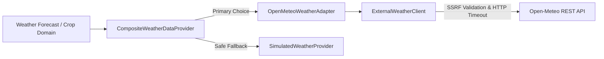

# External Weather Data Provider Integration

## 1. Overview
The external weather data integration connects YANGIARIQ AQUA AI with live meteorological data feeds while preserving strict architectural isolation, fail-safe fallbacks, and rate-limiting resilience.



## 2. Open-Meteo REST Adapter (`OpenMeteoWeatherAdapter`)
- **Default Base URL**: `https://api.open-meteo.com/v1/forecast`
- **Location**: Khorezm / Yangiariq coordinates (Lat: `41.3431° N`, Lon: `60.6033° E`).
- **Telemetry Variables**:
  - `temperature_2m` (°C)
  - `relative_humidity_2m` (%)
  - `precipitation` (mm)
  - `wind_speed_10m` (km/h)
  - `surface_pressure` (hPa / bar)
- **Forecast Horizon**: 7-day hourly and daily forecast envelopes.

## 3. Resilience & Security Controls
1. **SSRF Guarding**: `ExternalWeatherClient` verifies target URLs against private/reserved IP blocks (rejecting `localhost`, `127.0.0.1`, `10.0.0.0/8`, `192.168.0.0/16`, `169.254.169.254`).
2. **Circuit Breaker & Timeouts**: Connect timeout configured to 3,000ms; Read timeout to 5,000ms.
3. **Fail-Safe Fallback**: If Open-Meteo is unconfigured, unreachable, or returns an HTTP 429/500 error, `CompositeWeatherDataProvider` logs a warning and falls back to `SimulatedWeatherProvider` without throwing runtime exceptions.
4. **Attribution & Provenance**: Weather observations from Open-Meteo retain `source_type = WEATHER_PROVIDER` and `evidence_classification = OBSERVED`. Forecast periods are classified as `ESTIMATED`.

## 4. Configuration Properties (`aquaai.weather.*`)
```properties
aquaai.weather.enabled=false
aquaai.weather.base-url=https://api.open-meteo.com/v1/forecast
aquaai.weather.api-key=
aquaai.weather.connect-timeout-ms=3000
aquaai.weather.read-timeout-ms=5000
aquaai.weather.max-retries=3
aquaai.weather.rate-limit-per-minute=60
aquaai.weather.latitude=41.3431
aquaai.weather.longitude=60.6033
```
If `enabled=false` or no credentials/network access exists, the data source status reports `NOT_CONFIGURED`.
