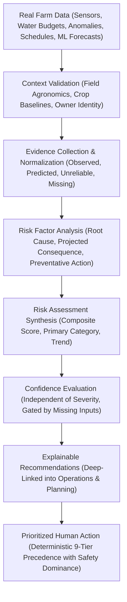
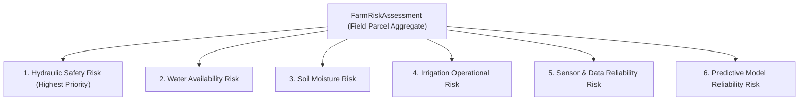

# Farm-Level Predictive Risk & Resilience Intelligence

> **Milestone 08.13 — Yangiariq Aqua AI Intelligence Layer**  
> *Transforming multi-source agricultural telemetry, hydraulic interlocks, water budgets, operational schedules, and predictive ML models into explainable, evidence-based risk profiles and prioritized human actions.*

---

## 1. Executive Overview

Agricultural risk management in the arid climate of the Yangiariq district (Khorezm, Uzbekistan) requires balancing scarce canal water allocations, fragile secondary distribution pipelines, volatile soil drying rates, and fluctuating groundwater salinity. Historically, decision-makers were forced to synthesize siloed dashboards—checking sensor charts, canal schedules, anomaly alerts, and forecasting tools independently.

**Milestone 08.13** establishes a unified **Farm-Level Predictive Risk & Resilience Intelligence Layer**. This capability is:
- **NOT** another prediction engine: it reuses existing predictive intelligence and ML models (Milestones 08.7, 08.11, 08.12).
- **NOT** another monitoring dashboard: it answers targeted operational questions with deterministic evidence.
- **NOT** an autonomous controller: all operational actions strictly require human farmer/operator approval.

### The 7 Core Operational Questions Answered

```
┌─────────────────────────────────────────────────────────────────────────────┐
│                       YANGIARIQ AQUA AI RISK INTELLIGENCE                   │
└─────────────────────────────────────────────────────────────────────────────┘
  1. Which fields are currently at risk?        ──► Ranked Field Risk Matrix
  2. What exactly is causing the risk?          ──► Multi-Factor Root-Cause Analysis
  3. How serious is the situation?              ──► Explicit Risk Severity (CRITICAL..LOW)
  4. How reliable is the available evidence?    ──► Independent Confidence (HIGH..INSUFFICIENT)
  5. What could happen if no action is taken?   ──► Projected Agronomic/Hydraulic Impact
  6. What should the farmer/operator do next?   ──► Actionable, Deep-Linked Recommendations
  7. Which actions should receive priority?     ──► Deterministic 9-Tier Precedence Hierarchy
```

---

## 2. Core Product Principle & Pipeline

The system adheres to an end-to-end, evidence-based reasoning pipeline:



### Strict Distinctions Enforced by Design

| Concept | Definition & Platform Treatment |
| :--- | :--- |
| **Actual Observed Problems** | Real-world anomalies directly detected by hardware sensors or confirmed water budget balance (e.g., pipe rupture, water quota exhausted). Marked as `OBSERVED` ground truth. |
| **Predicted Future Risks** | Forecasted conditions generated by FAO-56 or Ridge regression models (e.g., moisture falling below 15% in 24h). Marked as `PREDICTED` and never presented as confirmed fact. |
| **Missing / Unreliable Information** | Hardware offline, stale telemetry (>6h), or missing seasonal quota. Gated with `INSUFFICIENT_DATA` or `UNRELIABLE`. Missing data is **never** interpreted as healthy. |
| **Model Uncertainty** | Degraded model health (`DEGRADED`), contextual drift, or sample size $N < 30$. Transparently lowers confidence without suppressing human warnings. |
| **Operational Constraints** | Canal capacity limits, scheduled delivery contention, or safety interlock blocks. |
| **Preventative Recommendations** | Actionable proposals deep-linked to existing platform workflows, awaiting human verification. |

---

## 3. The 6 Risk Domains

The intelligence layer inspects and synthesizes risk across six distinct agricultural and operational domains:



### 3.1 Hydraulic Safety Risk (Absolute Precedence)
- **Monitored Evidence**: Suspected pipe bursts (`SUSPECTED_PIPE_BURST`), critical pressure drops, intake flow surges with pressure collapse, line pressure $< 1.2$ bar.
- **Safety Interlock**: Physical rupture triggers `isHydraulicBlocked = true`, locking line pressurization and assigning Rank #1 emergency status.
- **Precedence Rule**: Hydraulic safety strictly overrides all agricultural scores and automated delivery recommendations.

### 3.2 Water Availability Risk
- **Monitored Evidence**: Remaining water budget ($V_{remaining}$), seasonal allocated quota ($V_{allocated}$), historical consumption, committed run volumes, upcoming planned demand ($V_{upcoming}$).
- **Key Indicators**: Unregistered quota, exhausted quota with active demand, projected quota deficit ($V_{remaining} < V_{upcoming}$), and high utilization ($>90\%$).

### 3.3 Soil Moisture Risk
- **Monitored Evidence**: Ground-truth soil moisture telemetry, telemetry freshness, 24-hour moisture trend ($\Delta\text{moisture}/\Delta t$ in $\%/\text{hr}$), and ML 24-hour forward moisture forecast.
- **Key Indicators**: Permanent wilting point deficit ($< 15.0\%$), rapid root-zone depletion, moderate deficit ($15-20\%$), and waterlogging/saturation risk ($> 35.0\%$).

### 3.4 Irrigation Operational Risk
- **Monitored Evidence**: Smart irrigation plans in `SCHEDULED` or `APPROVED` state, scheduled execution date vs calendar today, secondary canal capacity contention.
- **Key Indicators**: Overdue irrigation runs ($T_{planned} < T_{today}$), overlapping delivery windows on shared canal branches.

### 3.5 Sensor and Data Reliability Risk
- **Monitored Evidence**: Registered IoT sensor inventory, sensor operational status (`ONLINE`, `OFFLINE`, `MAINTENANCE`), telemetry timestamp freshness ($> 6\text{h}$ = stale), measurement quality flags (`VALID`, `SUSPECT`, `INVALID`).
- **Key Indicators**: Zero configured sensors, single/multiple offline nodes, stale telemetry feeds.

### 3.6 Predictive Model Reliability Risk
- **Monitored Evidence**: Production model health status (`HEALTHY`, `DEGRADED`, `UNKNOWN`), contextual performance drift flags, historical outcome sample count ($N < 30$).
- **Key Indicators**: Model error variance elevation, concept drift, insufficient statistical samples.

---

## 4. Architecture & Module Boundaries

The `risk` module is isolated within `com.aquaai.risk` following Clean Architecture and hexagonal ports:

```
backend/src/main/java/com/aquaai/risk/
├── api/                                 # REST API Layer
│   ├── RiskIntelligenceController.java  # HTTP Endpoints
│   └── dto/                             # DTO Requests & Responses
├── application/                         # Use Cases & Application Services
│   ├── service/                         # RiskAssessmentCoordinatorService
│   └── usecase/                         # 8 Dedicated Use Cases
├── domain/                              # Pure Domain Layer (Zero Spring / JPA dependencies)
│   ├── model/                           # FarmRiskAssessment, RiskFactor, RiskEvidence, etc.
│   ├── port/                            # Outbound Domain Ports (Field, Water, Sensor, Anomaly, etc.)
│   ├── repository/                      # RiskAssessmentRepository Interface
│   └── service/                         # RiskAssessmentEngine (Deterministic evaluation logic)
└── infrastructure/                      # Infrastructure & Adapters
    ├── adapter/                         # Boundary adapters to water, field, sensor, anomaly, etc.
    ├── notification/                    # InAppRiskNotificationAdapter
    └── persistence/                     # JPA Entity, Spring Data Repository, Liquibase
```

### Architectural Guardrails (ArchUnit Tests #77–82)
1. Risk controllers must reside in `..risk.api..`.
2. Risk domain classes must not depend on JPA, Hibernate, or Spring Data.
3. Risk domain classes must not depend on Spring Framework.
4. Risk domain classes must not depend on Spring MVC or Servlet web classes.
5. Risk persistence entities must reside in `..risk.infrastructure.persistence..`.
6. Risk module must not depend on physical hardware or actuator SDKs (Paho, Pi4J).

---

## 5. Security & Anti-IDOR Model

The intelligence layer enforces multi-tenant field authorization:
- **FARMER**:
  - Automatically filtered at query-level to fields owned by the authenticated farmer.
  - Foreign field ID access in `/api/v1/risk-intelligence/fields/{fieldId}` returns `404 Not Found` (anti-enumeration).
  - Can acknowledge or resolve only assessments belonging to their owned fields.
- **OPERATOR**:
  - Authorized to inspect district-level risk profiles and coordinate secondary canal contention.
- **ADMIN**:
  - Full platform-wide visibility and administrative governance.

---

## 6. Frontend Farm Risk Intelligence Center

Located at route `risks` in the frontend application (`frontend/src/pages/risks/RisksPage.tsx`), featuring:
- **RiskOverviewCards**: 6 interactive KPI cards displaying total parcels, critical emergencies, hydraulic interlocks, water shortages, soil deficits, and telemetry gaps.
- **CriticalRiskBanner**: High-visibility emergency banner displaying hydraulic interlocks and blocking unsafe operations.
- **FieldRiskTable & FieldRiskCard**: Dual-mode grid and table views with multi-criteria filtering (severity, category, search) and composite score progress bars.
- **RiskAssessmentDetailModal**: Deep inspection modal featuring:
  - Tab 1: **Risk Factors & Evidence Breakdown** (root cause, projected impact, preventative actions, and missing input warnings).
  - Tab 2: **Actionable Recommendations** (direct deep-links to operations and planning workflows).
  - Tab 3: **Historical Trend & Timeline** (composite score delta, evaluation logs).
- **RiskActionPanel**: Human-in-the-loop action controls requiring explicit notes for risk resolution.
- **FarmRiskDashboardCard**: Embedded in the main Farm Intelligence Dashboard (`DashboardPage.tsx`) for instant 10-second situational awareness.
