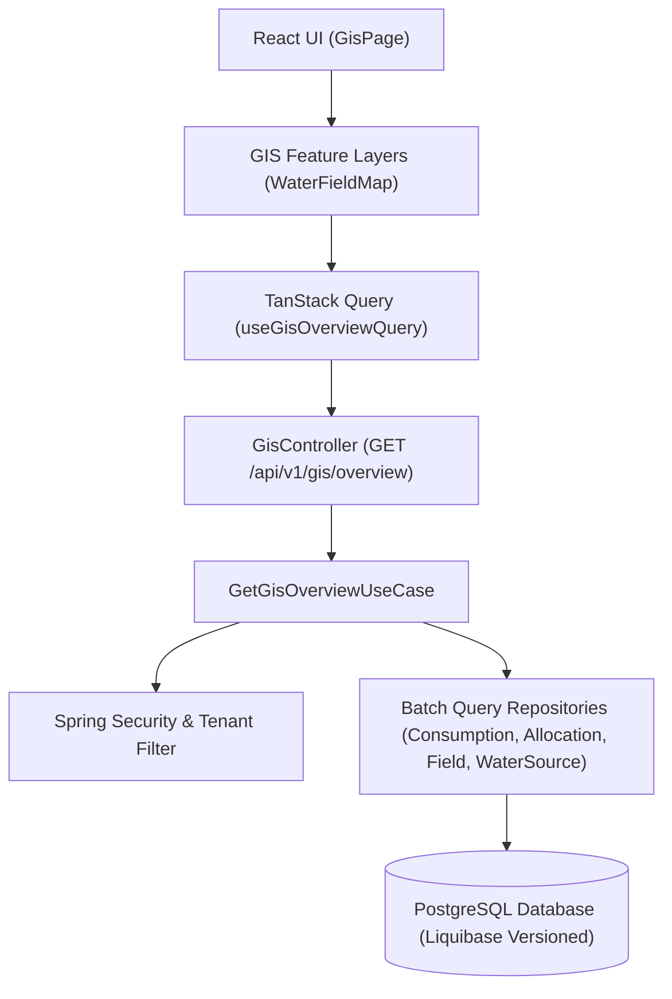

# Water + GIS Intelligence Integration Architecture (Milestone 06.5)

## 1. Executive Summary & Operational Vision
In **YANGIARIQ AQUA AI**, the **Water + GIS Intelligence** layer represents the spatial operational bridge between agronomic land management and water resource distribution. It unites:

$$\text{Field Parcel} \longrightarrow \text{Water Source} \longrightarrow \text{Water Allocation Quota} \longrightarrow \text{Irrigation Plan} \longrightarrow \text{Irrigation Event} \longrightarrow \text{Water Consumption}$$

Rather than functioning as a decorative basemap, this layer provides a high-density operational workbench for agricultural producers, water operators, and district administrators. It visualizes the spatial distribution of irrigation infrastructure, volumetric allocation quotas, actual metered consumption, and critical over-consumption alerts across Yangiariq district.

---

## 2. Architectural Principles & Module Boundaries

### 2.1 Backend Authority Principle
All volumetric water balances, percentage utilization thresholds, and quota compliance rules remain strictly calculated on the backend. The frontend map acts purely as an interactive projection and visualization layer.

### 2.2 PostGIS Architectural Decision
- **Status**: **NOT INTRODUCED**.
- **Rationale**: PostGIS is intentionally omitted in accordance with architectural guidelines. All field perimeters are stored as standard RFC 7946 GeoJSON JSONB documents, and water source coordinates are stored as standard `NUMERIC(9,6)` fields (`latitude`, `longitude`). Centroid calculations, spatial bounds, and viewport fitting are computed client-side using lightweight spherical trigonometry. This eliminates complex C-extensions, keeps cloud deployment minimal, and preserves sub-millisecond database queries.

---

## 3. Water Source Geospatial Modeling

### 3.1 Persistence & Liquibase Schema
Water sources (`water_sources` table) support optional geographic positioning via Liquibase changeSet `007-add-water-sources-location`:
- `latitude`: `NUMERIC(9,6)` with check constraint `[-90.0, 90.0]`
- `longitude`: `NUMERIC(9,6)` with check constraint `[-180.0, 180.0]`
- When coordinates are absent, the source is treated as a logical catalog entity and rendered in catalog listings and side panels without crashing spatial layers.

### 3.2 Domain Invariant Enforcement
The [`WaterSource`](file:///home/izzatbek/Desktop/agronexsus/backend/src/main/java/com/aquaai/water/domain/WaterSource.java) domain entity guarantees:
- Latitude and Longitude must both be present or both be null.
- Precision is bounded, and values are validated against Uzbekistan geographical bounds (`37.0°N` to `45.6°N`, `56.0°E` to `73.2°E`).

---

## 4. Multi-Tenant Isolation & Anti-IDOR Security

The GIS intelligence layer strictly enforces tenant boundaries:
1. **FARMER**:
   - Authorized to view **only their own fields**.
   - Receives only allocations and consumption records associated with their registered parcels.
   - Supplying water sources linked to their parcels are visible to contextualize irrigation sources.
   - Any attempt to query unowned parcels or inspect unauthorized water balances yields strict isolation (no data leakage).
2. **OPERATOR & ADMIN**:
   - Granted district-wide visibility across all parcels, channels, wells, and quotas in Yangiariq district.
   - Read-only spatial surveillance for operators; administrative quota adjustments permitted for administrators.

---

## 5. Unified GIS Feature Layers

The map presents 4 synchronized, toggleable layers:

| Layer | Visual Presentation | Description |
| :--- | :--- | :--- |
| **Field Boundaries** | Polygon overlay (`[lon, lat]` GeoJSON) | Boundary perimeters styled by crop and status. |
| **Water Status Posture** | Polygon fill color coding | Derived directly from backend status category: `NORMAL` (Emerald, $\le 80\%$), `WARNING` (Amber, $80\% - 100\%$), `OVER_CONSUMED` (Rose, $> 100\%$), `NO_ALLOCATION` (Slate). |
| **Water Sources** | Custom SVG Map Pins | Semantic iconography for `CANAL`, `DITCH`, `RESERVOIR`, `WELL`, `RIVER`, and `OTHER`. Active vs inactive styling. |
| **Supply Links** | Dynamic dashed geodesics | Visualizes supply relationship from water source coordinates to field polygon centroids. |

---

## 6. Zero N+1 Performance Strategy

To ensure sub-second response times for hundreds of parcels across Yangiariq district:
1. **Single-Roundtrip Read Model**: `GET /api/v1/gis/overview` delivers all parcels, sources, aggregated volumetric balances, and supply links in one atomic HTTP response.
2. **Native Batch SQL Aggregations**:
   - `WaterConsumptionQueryRepositoryImpl.aggregateAllocationsByFieldIdsAndPeriod`: Single `GROUP BY a.field_id` query summing allocated volume and counting active quotas.
   - `WaterConsumptionQueryRepositoryImpl.aggregateEventsByFieldIdsAndPeriod`: Single `GROUP BY e.field_id` query summing actual metered consumption and event counts.
3. **Frontend Memoization**: Polygons, SVG icons, bounding boxes, and filtered collections are memoized using `useMemo` hooks, preventing Leaflet layer rebuilds during map panning or zooming.
4. **Resiliency to Invalid Geometry**: Non-conforming or corrupted polygon rings trigger non-blocking UI warnings without crashing Leaflet or breaking adjacent parcel rendering.

---

## 7. Interactive Side Panel & Cross-Module Navigation

Selecting any field or water source opens the [`FieldWaterSidePanel`](file:///home/izzatbek/Desktop/agronexsus/frontend/src/features/water/gis/components/FieldWaterSidePanel.tsx):
- **Field Context**: Displays cadastral area, crop type, soil type, irrigation method, visual volumetric progress bar, exact remaining quota, over-quota alert banner, and direct links to supplying canals or wells.
- **Water Source Context**: Displays source type, operational status, count of connected parcels, total active quota commitment, and interactive parcel cards that focus the map upon click.
- **Action Links**: Role-aware deep links to `/irrigation` allow operators and farmers to record completed irrigation events or manage quotas seamlessly.
