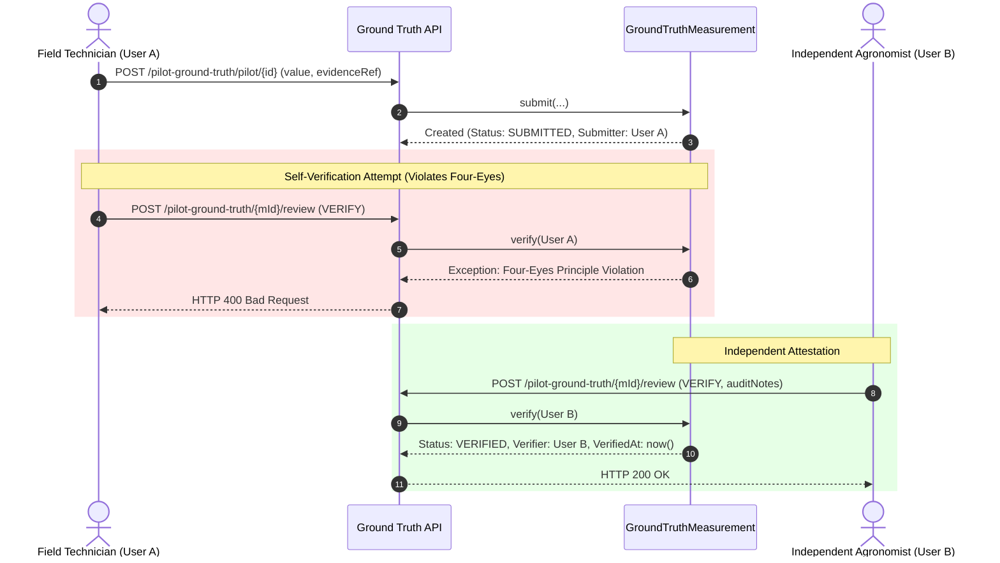
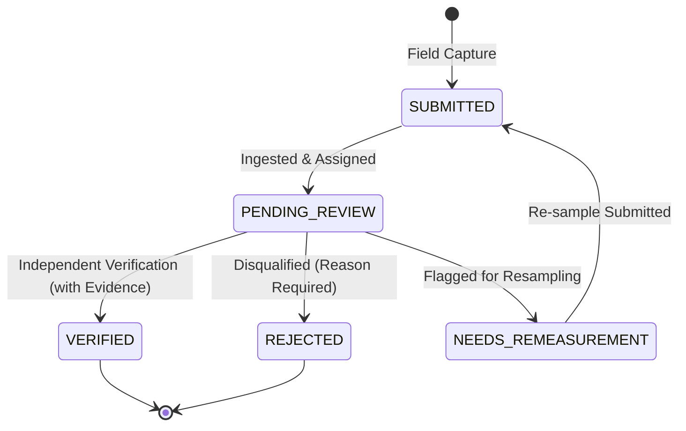

# Ground-Truth Measurement & Four-Eyes Validation (Milestone 08.20)

## 1. Ground Truth in Agricultural Intelligence

In **YANGIARIQ AQUA AI**, **Ground Truth** represents an independently collected, physically verified measurement or observed agricultural outcome against which platform predictions and telemetry streams are evaluated.

### Core Distinctions
- **Simulated Telemetry**: Synthetic time-series generated by computational algorithms (`SimulatedSensorProvider`). Crucial for load testing and algorithmic development, but carries **zero evidentiary weight** for operational agricultural validation.
- **Ingested Raw Telemetry**: Unverified real-world sensor or weather data. May contain calibration drift, sensor fouling, or network drops.
- **Ground Truth**: An independently gathered field observation (e.g., gravimetric soil core, handheld TDR probe, manual staff gauge reading at canal turnout) validated under strict governance controls.

---

## 2. Supported Measurement Types & Canonical Units

Every ground-truth submission must declare its physical property and canonical unit:

| Measurement Type | Physical Phenomenon | Canonical Unit | Typical Collection Method |
| :--- | :--- | :--- | :--- |
| **`SOIL_MOISTURE`** | Volumetric Water Content (VWC) in root zone | `%` | Handheld TDR/FDR probe, gravimetric oven-drying core |
| **`TEMPERATURE`** | Ambient air or soil temperature | `°C` | Calibrated digital probe, alcohol field thermometer |
| **`RAINFALL`** | Precipitation accumulation over interval | `mm` | Manual cylinder rain gauge, tipping bucket check |
| **`WATER_FLOW_RATE`** | Volumetric rate of discharge through turnout | `m3/h` or `L/s` | Handheld ultrasonic transit-time flow meter, propeller meter |
| **`WATER_VOLUME`** | Total volumetric delivery over irrigation turn | `m3` | Audited canal gate discharge integration |
| **`WATER_LEVEL`** | Hydraulic head above weir crest or canal bed | `cm` or `m` | Enamel staff gauge visual reading, acoustic sounder |
| **`WATER_PRESSURE`** | Drip lateral manifold pressure | `bar` or `kPa` | Glycerin-filled Bourdon tube pressure gauge |

---

## 3. Four-Eyes Verification Principle

To prevent confirmation bias, data tampering, or careless field entry, **the submitter of a measurement can never serve as its verifier**.



### Domain Enforcement:
```java
public void verify(UUID verifierId, String evidenceReference, String verificationNotes) {
    if (Objects.equals(this.submittedBy, verifierId)) {
        throw new IllegalArgumentException(
            "Four-Eyes Principle Violation: Submitter cannot verify their own measurement"
        );
    }
    this.verificationStatus = GroundTruthStatus.VERIFIED;
    this.verifierId = verifierId;
    this.evidenceReference = evidenceReference;
    this.notes = verificationNotes;
    this.verifiedAt = Instant.now();
}
```

---

## 4. Measurement Lifecycle & Statuses



### Status Descriptions:
- **`SUBMITTED`**: Initial capture by field technician, ditch rider, or farmer. Stores raw value, collection method, instrument serial number, and timestamp.
- **`PENDING_REVIEW`**: Queued for independent inspection.
- **`VERIFIED`**: Validated by a distinct authorized reviewer who confirmed instrument calibration, sampling depth, or physical evidence. Eligible for prediction comparison.
- **`REJECTED`**: Measurement found flawed (e.g., probe inserted into dry crack, surface air bubble in pipe). Requires explicit `rejectionReason`.
- **`NEEDS_REMEASUREMENT`**: Ambiguous reading (e.g., unexpected salinity disturbance) requiring an immediate repeat sample.

---

## 5. Physical Evidence Documentation & Calibration Logging

Where physical calibration certificates or photos are unavailable, the system enforces transparent recording rather than assuming high confidence:
- **`evidenceReference`**: String reference to an uploaded photograph, calibration laboratory certificate ID, or gravimetric lab bench worksheet (e.g., `LAB-KHOREZM-SOIL-2026-081`).
- **Limitation Logging**: If no photograph or calibration certificate exists, the field operator must document: `LIMITATION: Visual staff gauge reading without digital photo attestation`.
- **Zero Silent Modification**: Submitted values are never silently mutated by background tasks. Any revision requires a formal review transition or a new measurement submission.
