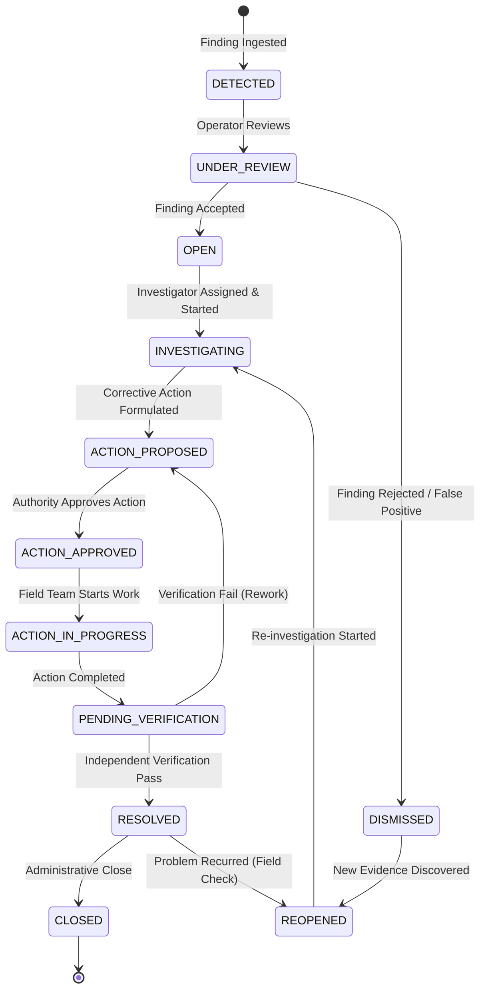

# Incident Lifecycle and Governance
# Yangiariq Aqua AI — Milestone 08.16

## 1. Lifecycle Overview

The water incident investigation lifecycle provides an immutable, deterministic progression from finding detection to verified closure.

---

## 2. Supported Incident States

| State | Name | Description | Responsible Role |
|---|---|---|---|
| **`DETECTED`** | Aniqlangan | Ingested from automated telemetry, water accounting, or manual report. Awaiting triage. | Automated System / Operator |
| **`UNDER_REVIEW`** | Koʻrib chiqilmoqda | Operator actively examining raw evidence to determine if a formal investigation is warranted. | Operator / Admin |
| **`OPEN`** | Ochiq | Confirmed operational discrepancy requiring formal investigation. Awaiting investigator assignment. | Operator / Admin |
| **`INVESTIGATING`** | Tekshirilmoqda | Assigned investigator or engineering specialist conducting root cause analysis and field diagnostics. | Assigned Investigator |
| **`ACTION_PROPOSED`** | Chora taklif etilgan | Corrective action plan submitted; pending managerial or administrative review. | Action Owner |
| **`ACTION_APPROVED`** | Chora tasdiqlangan | Plan authorized by water authority; execution permitted. | Authority / Approver |
| **`ACTION_IN_PROGRESS`** | Ijroda | Physical maintenance, sensor recalibration, or accounting adjustment actively being executed. | Action Owner / Field Team |
| **`PENDING_VERIFICATION`**| Tekshiruv kutilmoqda| Action completed by field team. Awaiting independent physical or statistical verification. | Independent Inspector |
| **`RESOLVED`** | Hal etilgan | Resolution independently verified; discrepancy eliminated within tolerance. | Independent Verifier |
| **`DISMISSED`** | Rad etilgan | Review determined finding was an acceptable loss, measurement artifact, or false positive. | Operator / Admin |
| **`REOPENED`** | Qayta ochilgan | Discrepancy recurred after resolution or new contradictory evidence emerged. | Operator / Admin |
| **`CLOSED`** | Yopilgan | Final archival state after retention period. | Administrator |

---

## 3. Strict State Transition Table

Arbitrary status jumps via REST requests are completely blocked. `IncidentStateMachine.isValidTransition(from, to)` enforces the following transition rules:

| Source State | Permitted Destination States | Required Actor / Condition |
|---|---|---|
| `DETECTED` | `UNDER_REVIEW`, `DISMISSED` | Operator / Admin |
| `UNDER_REVIEW` | `OPEN`, `DISMISSED` | Operator / Admin review note |
| `OPEN` | `INVESTIGATING`, `DISMISSED` | Investigator assignment |
| `INVESTIGATING` | `ACTION_PROPOSED`, `RESOLVED`, `DISMISSED` | Diagnostic notes recorded |
| `ACTION_PROPOSED` | `ACTION_APPROVED`, `INVESTIGATING` | Approving authority authorization |
| `ACTION_APPROVED` | `ACTION_IN_PROGRESS`, `ACTION_PROPOSED` | Action start event |
| `ACTION_IN_PROGRESS` | `PENDING_VERIFICATION`, `ACTION_APPROVED` | Completion notes recorded |
| `PENDING_VERIFICATION`| `RESOLVED`, `ACTION_PROPOSED`, `INVESTIGATING` | Independent verification report |
| `RESOLVED` | `REOPENED`, `CLOSED` | Recurrence check / Admin close |
| `DISMISSED` | `REOPENED` | New evidence / Justification |
| `REOPENED` | `INVESTIGATING`, `UNDER_REVIEW` | Re-investigation assignment |
| `CLOSED` | *Terminal* (no direct transitions) | None |

> [!IMPORTANT]
> **No Auto-Resolution Invariant:**
> Completing a corrective action (`CompleteCorrectiveActionUseCase`) moves the incident strictly to **`PENDING_VERIFICATION`**. It **never** automatically resolves the incident. Only an independent verification (`VerifyResolutionUseCase`) can transition the incident to `RESOLVED`.

---

## 4. Audit Trail & Immutability

Every state transition records an immutable `IncidentTimelineEntry`:
- **`fromStatus`** and **`toStatus`**
- **`actorId`** and **`actorName`** (extracted from authenticated Security Context)
- **`reason`** (mandatory explanation text)
- **`timestamp`** (UTC epoch timestamp)
- **`metadataJson`** (structured audit details, evidence links, or override flags)

Timeline entries are write-only and can never be updated or deleted.
