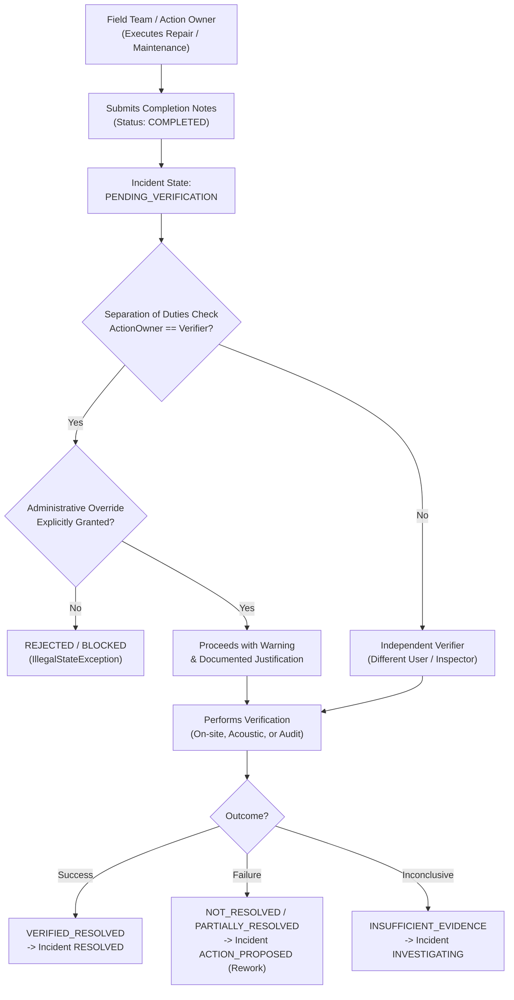

# Independent Verification and Separation of Duties
# Yangiariq Aqua AI — Milestone 08.16

## 1. Principles of Independent Verification

A core design tenet of **Milestone 08.16** is that operational integrity cannot rely on self-attestation. The individual, team, or contractor who executed a corrective action must never have the sole authority to declare the issue resolved.



---

## 2. Separation of Duties Rules

In `IndependentVerificationEngine`:

```java
public boolean isSeparationOfDutiesCompliant(
    String verifierId,
    List<String> actionOwnerIds,
    boolean administrativeOverride
) {
    if (verifierId == null || actionOwnerIds == null) {
        return false;
    }
    boolean isOwner = actionOwnerIds.contains(verifierId);
    if (isOwner && !administrativeOverride) {
        return false; // Strict block: action owner cannot self-verify
    }
    return true;
}
```

If an action owner attempts to verify their own action without setting `administrativeOverride = true`, the application service immediately aborts the transaction with `IllegalStateException("Separation of duties violation: Verifier cannot be the owner of the completed action without administrative override.")`.

### Administrative Override Workflow:
In emergency situations (e.g., night-time levee stabilization, emergency gate de-icing in severe freeze, single-operator remote duty post):
- The override checkbox must be selected in the UI.
- The inspector's identity is permanently recorded in the audit trail.
- The verification record flags `administrativeOverride = true`.
- The explanatory notes must articulate why an independent inspector could not be deployed.

---

## 3. Verification Methods

| Method Code | Method Name | Verification Criteria |
|---|---|---|
| **`ONSITE_PHYSICAL_INSPECTION`** | Joyida koʻrik | On-site visit by certified water inspector; visual inspection of canal lining, gate seals, and embankment integrity. |
| **`INDEPENDENT_ACOUSTIC_SURVEY`** | Mustaqil akustik oʻlchov | Secondary portable Doppler/acoustic transit-time survey conducted independently of permanent telemetry stations. |
| **`CROSS_SENSOR_CORROBORATION`** | Koʻp datchikli oʻzaro tekshiruv | Statistical validation correlating downstream water levels, upstream gate discharges, and neighboring parcel telemetry. |
| **`WATER_BALANCE_POST_AUDIT`** | Post-audit suv balansi | Reconciliation of mass-balance over the subsequent 48-hour delivery period to verify discrepancy elimination. |

---

## 4. Verification Outcomes & State Mapping

The `IndependentVerificationEngine.determineNextIncidentStatus` domain service maps outcomes deterministically:

1. **`VERIFIED_RESOLVED`**:
   - The original finding is resolved within acceptable tolerance limits.
   - Moves the incident to **`RESOLVED`**.
2. **`PARTIALLY_RESOLVED`**:
   - The problem has improved but remains outside operational tolerance.
   - Moves the incident back to **`ACTION_PROPOSED`** or **`INVESTIGATING`** for follow-up measures.
3. **`NOT_RESOLVED`**:
   - The corrective action failed to eliminate the discrepancy or safety risk.
   - Moves the incident to **`ACTION_PROPOSED`** with mandatory rework plan.
4. **`INSUFFICIENT_EVIDENCE`**:
   - The measurement conditions did not permit conclusive proof (e.g., zero canal flow during winter closure).
   - Moves the incident to **`INVESTIGATING`** requesting re-testing upon canal refilling.
