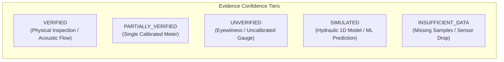

# Investigation and Evidence Management
# Yangiariq Aqua AI — Milestone 08.16

## 1. Incident Categories

The accountability context classifies operational findings into 10 deterministic categories:

1. **`WATER_BALANCE_DISCREPANCY`**: Net mass-balance imbalance exceeding tolerance at district or WUA boundary.
2. **`CONVEYANCE_LOSS`**: Unexplained transit loss between upstream and downstream acoustic gauges on a canal reach.
3. **`UNACCOUNTED_WITHDRAWAL`**: Water extraction detected without an active dispatch schedule or approved quota allocation.
4. **`ALLOCATION_EXCEEDED`**: Field or WUA cumulative consumption exceeding seasonal or ten-day allocated limit.
5. **`UNDER_DELIVERY`**: Contracted delivery volume not supplied to a downstream turnout, risking crop water stress.
6. **`DISTRIBUTION_DISPARITY`**: Systematic delivery inequality between head-end and tail-end canal branches ($CV > 0.25$).
7. **`HYDRAULIC_SAFETY`**: Freeboard violations, gate head surges, or structural risks threatening canal embankment stability.
8. **`SENSOR_DATA_QUALITY`**: Prolonged gauge dropouts, telemetry drift, frozen floats, or acoustic noise anomalies.
9. **`OPERATIONAL_NON_COMPLIANCE`**: Failure to execute scheduled gate maneuvers or log manual turnout gate operations.
10. **`OTHER`**: Miscellaneous operational findings requiring formal human review.

---

## 2. Deterministic Severity Model & SLA Horizons

Severity is strictly deterministic and based on operational risk, public safety, and water scarcity impact:

| Severity Level | Operational Priority | SLA Review Target | Escalation Threshold | Description |
|---|---|---|---|---|
| **`CRITICAL`** | Emergency Priority | **4 Hours** | Immediate (SMS / Alert) | Hydraulic safety violation, catastrophic levee breach risk, or massive main-canal diversion anomaly. |
| **`HIGH`** | High Operational Impact| **24 Hours** | At 18 Hours | Large-scale unmetered extraction, major reach conveyance loss (>25%), or seasonal allocation breach. |
| **`MEDIUM`** | Tactical Maintenance | **72 Hours** | At 48 Hours | Localized water balance discrepancy (5–15%), sensor calibration drift, or turnout delivery lag. |
| **`LOW`** | Routine Investigation | **168 Hours (7 Days)** | At 120 Hours | Minor tail-end disparity, small return flow variance, or non-urgent field gate adjustment. |
| **`INFORMATIONAL`**| Informational Notice | *No Mandatory SLA* | None | Statistical advisory or self-correcting transient telemetry variation. |

> [!NOTE]
> **Decoupling Severity from Evidence Confidence:**
> A critical incident supported by weak evidence retains `severity = CRITICAL` and `confidence = UNVERIFIED`. High impact never automatically promotes weak evidence to verified status, nor does weak evidence excuse an operator from investigating a potential hydraulic safety hazard.

---

## 3. Evidence Confidence Taxonomy & Provenance

Every evidence entry attached to an incident preserves its provenance and classification:

### Evidence Rules:
1. **Never Convert Simulated into Verified**:
   - Model outputs (e.g., Saint-Venant 1D, ML crop ET forecasts) remain `SIMULATED`.
   - Domain logic throws `IllegalArgumentException` if an attempt is made to mark simulation data as physical proof without field measurement.
2. **Data Lineage Tracking**:
   - Each evidence record stores `sourceSystem`, `sensorId`, `measurementValue`, `measurementUnit`, and `dataLineage` (e.g., `Sensor -> LoRaWAN -> TelemetryDB -> AnomalyFilter`).

---

## 4. Finding-to-Incident Deduplication

To prevent alert flooding, the `IncidentDeduplicationEngine` creates an idempotent deduplication key:

$$\text{DeduplicationKey} = \text{sourceModule} + \text{":"} + \text{sourceEntityType} + \text{":"} + \text{sourceEntityId}$$

If an active incident (in states `DETECTED`, `UNDER_REVIEW`, `OPEN`, `INVESTIGATING`, `ACTION_PROPOSED`, `ACTION_APPROVED`, `ACTION_IN_PROGRESS`, `PENDING_VERIFICATION`) already exists for the identical source entity within the deduplication window, the system:
1. Appends the new measurement as supporting evidence.
2. Updates `updatedAt`.
3. Skips creating a duplicate ticket.
4. If a previously `RESOLVED` or `DISMISSED` incident has a recurrence of the exact same anomaly, it increments `recurrenceCount` and reopens the case.
