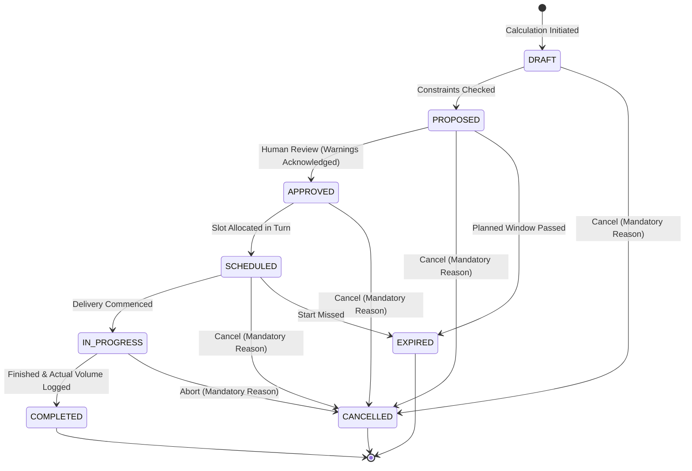

# YANGIARIQ AQUA AI — SMART IRRIGATION PLANNING & OPTIMIZATION

**Bounded Context:** `com.aquaai.irrigation`  
**Milestone:** 08.2  
**Status:** Implemented & Verified  

---

> [!IMPORTANT]
> **SAFETY & DECISION-SUPPORT BOUNDARY DISCLAIMER**  
> This milestone provides **irrigation planning and agronomic decision support**. It generates recommended irrigation timing, volumetric quotas, application durations, and operational constraints. It **does NOT autonomously control physical irrigation equipment, open valves, or start water pumps**. All plans remain subject to human operator review and explicit confirmation.

---

## 1. Executive Overview

The Smart Irrigation Planning system answers the primary agronomic operational question:

> *"When, where, how much, and for how long should irrigation occur, given available water and current field conditions?"*

### Architectural Pipeline
$$\text{Telemetry} \longrightarrow \text{Anomaly} \longrightarrow \text{Agronomic Recommendation} \longrightarrow \text{Water Budget} \longrightarrow \text{Irrigation Plan} \longrightarrow \text{Human Approval} \longrightarrow \text{Operational Schedule}$$

---

## 2. Domain Model & Entities

### 2.1 Core Aggregate: `SmartIrrigationPlan`
The aggregate root in `com.aquaai.irrigation.domain.model.SmartIrrigationPlan`:
- **Identity:** `UUID id`, `UUID fieldId`, `UUID waterAllocationId`
- **State:** `IrrigationPlanStatus status` (`DRAFT`, `PROPOSED`, `APPROVED`, `SCHEDULED`, `IN_PROGRESS`, `COMPLETED`, `CANCELLED`, `EXPIRED`)
- **Urgency:** `IrrigationPriority priority` (`CRITICAL`, `HIGH`, `MEDIUM`, `LOW`)
- **Dispatch Window:** `LocalDate plannedDate`, `Instant plannedStartAt`, `Instant plannedEndAt`
- **Volumetric Metrics:**
  - `BigDecimal recommendedVolumeM3`: Gross water required ($m^3$)
  - `int estimatedDurationMinutes`: Irrigation turn duration
  - `BigDecimal recommendedFlowRateM3H`: Delivery rate ($m^3/h$)
- **Agronomic Feedback:**
  - `BigDecimal targetMoisturePercent`: Optimal root-zone threshold (%)
  - `BigDecimal currentMoisturePercent`: Sensor reading (%)
  - `String confidenceLevel`, `BigDecimal confidenceScore` (0.00 - 1.00)
- **Safety Interlock:**
  - `boolean isBlocked`: True if hydraulic safety interlock tripped
  - `String blockedReason`: Explanation for block
- **Audit Tracking:**
  - `UUID approvedBy`, `Instant approvedAt`
  - `String cancellationReason` (mandatory when cancelling)
  - `Long version` (optimistic locking)
  - `List<PlanConstraint> constraints`, `List<PlanTradeoff> tradeoffs`

### 2.2 Lifecycle State Transitions



---

## 3. Calculation Engines & Formulas

### 3.1 Water Balance & Irrigation Requirement (`IrrigationRequirementCalculator`)

1. **Root Zone Depth ($Z_r$):**
   - Cotton: $0.80\text{ m}$
   - Wheat: $0.60\text{ m}$
   - Rice: $0.40\text{ m}$
   - Maize: $0.70\text{ m}$
   - Vegetables: $0.40\text{ m}$
   - Melons: $0.50\text{ m}$

2. **Soil Moisture Deficit Depth ($D_{\text{mm}}$):**
   $$D_{\text{mm}} = \max\left(0, \frac{\theta_{\text{target}} - \theta_{\text{current}}}{100} \times Z_r \times 1000\right)$$

3. **Effective Rainfall ($P_{\text{eff}}$):**
   $$P_{\text{eff}} = \max(0, (P_{\text{forecast}} - 5.0\text{ mm}) \times 0.8)$$

4. **Net Irrigation Requirement ($I_{\text{net}}$):**
   $$I_{\text{net}} (\text{mm}) = \max(0, D_{\text{mm}} + ET_c - P_{\text{eff}})$$
   Where $ET_c = K_c \times ET_0$ ($ET_0$ from Hargreaves-Samani model).

5. **Gross Volumetric Requirement ($V_{\text{gross}}$):**
   $$V_{\text{gross}} (m^3) = \frac{I_{\text{net}} (\text{mm}) \times 10 \times \text{Area (ha)}}{\eta}$$
   *(Note: $1\text{ mm} \times 1\text{ ha} = 10\text{ m}^3$)*

6. **Application Efficiency ($\eta$):**
   - Drip: $\eta = 0.90$
   - Sprinkler: $\eta = 0.75$
   - Furrow: $\eta = 0.60$
   - Canal / Ditch / Surface: $\eta = 0.50$

---

## 4. Priority Scoring & Constraint Hierarchy

### 4.1 Strict Constraint Precedence Hierarchy
```text
1. SAFETY (Hydraulic Safety Interlock)
   └── If SUSPECTED_PIPE_BURST or CRITICAL pressure drop: STRICTLY BLOCKED.
2. HARD WATER CONSTRAINTS
   └── Plan volume cannot exceed Remaining Available water budget.
3. INFRASTRUCTURE CONSTRAINTS
   └── Flow capacity limits and max 12h operational duration per turn.
4. AGRONOMIC REQUIREMENT
   └── Soil moisture deficit and crop critical growth stage demand.
5. WEATHER OPTIMIZATION
   └── Rain forecast delays; shift to nocturnal window if temp > 32°C.
6. FIELD PRIORITY
   └── Priority score ordering for regional turn dispatch.
7. AI EXPLANATION
   └── Natural language explanation and trade-off summary (cannot change limits).
```

### 4.2 Priority Scoring Engine (0 - 100 Points)
$$\text{Score} = S_{\text{moisture}} (0\text{-}40) + S_{\text{crop}} (0\text{-}25) + S_{\text{anomaly}} (0\text{-}15) + S_{\text{weather}} (0\text{-}10) + S_{\text{quota}} (0\text{-}10)$$
- **Score $\ge 80$**: `CRITICAL`
- **Score $\ge 60$**: `HIGH`
- **Score $\ge 35$**: `MEDIUM`
- **Score $< 35$**: `LOW`

---

## 5. Conflict Resolution Matrix

| Conflict Type | Detected Condition | System Action | Explainability Message |
|---|---|---|---|
| **SAFETY_BLOCK** | Active `SUSPECTED_PIPE_BURST` or critical pressure drop | Set `isBlocked = true`, volume set to 0 or blocked. Approval disabled. | "Hydraulic Safety Interlock: Pipe burst suspected. Pressurization blocked." |
| **WATER_SHORTAGE** | $V_{\text{gross}} > \text{Remaining Available}$ | Scale volume down to remaining quota; add `WATER_QUOTA` warning constraint. | "Water quota insufficient. Plan volume capped at remaining budget." |
| **WEATHER_RAIN** | Rain forecast $\ge 15\text{ mm}$ with probability $> 60\%$ | Net requirement offset; plan window deferred by 24h. | "Irrigation deferred due to forecast significant rainfall." |
| **HEAT_WIND** | Ambient temp $> 32^\circ\text{C}$ or high wind | Automatically shift start window to nocturnal slot (22:00 - 05:00). | "Nocturnal window scheduled to prevent excessive evaporative drift." |

---

## 6. Standardized Units

| Metric | Unit | Standard Representation |
|---|---|---|
| Water Volume | $m^3$ | `150.0 m³` |
| Flow Rate | $m^3/h$ | `37.5 m³/h` |
| Soil Moisture | $\%$ | `45.0%` |
| Pressure | $\text{bar}$ | `2.5 bar` |
| Salinity | $\text{dS/m}$ | `1.8 dS/m` |
| Evapotranspiration | $\text{mm/day}$ | `5.2 mm/day` |
| Field Area | $\text{ha}$ | `10.0 ha` |
| Duration | $\text{minutes / hours}$ | `240 min (4.0 hrs)` |
