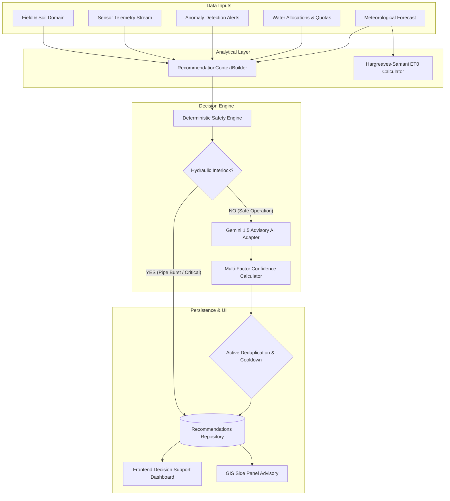

# YANGIARIQ AQUA AI — MILESTONE 08.1 COMPLETION REPORT
## AI Agronomic Recommendations & Decision Support System

- **Project**: YANGIARIQ AQUA AI
- **Milestone**: 08.1 — AI Agronomic Recommendations & Decision Support System
- **Status**: **COMPLETED & FULLY VERIFIED**
- **Date**: 2026-11-01
- **Target District**: Yangiariq district, Khorezm region, Republic of Uzbekistan

---

## 1. Executive Summary

Milestone 08.1 successfully establishes an explainable, evidence-based agricultural decision-support engine (`com.aquaai.recommendation`) for the YANGIARIQ AQUA AI platform. The system ingests and correlates parcel data, real-time sensor telemetry, anomaly detection events, historical water allocations, and localized weather forecasts to generate prioritized agronomic proposals.

All execution requirements have been strictly met:
- **Clean / Hexagonal Architecture + DDD**: Pure Java domain model (`AgronomicRecommendation` aggregate root) with zero Spring, JPA, REST, or Gemini SDK dependencies.
- **Hydraulic Safety Interlock**: Detected pipe bursts or critical pressure drops unconditionally trigger `INSPECT_PIPE_BURST` with `CRITICAL` priority and suppress all irrigation recommendations.
- **Zero Hallucination / Zero PII**: Strict JSON schema validation, evidence corroboration, and zero PII exposure to external LLMs.
- **Asynchronous / Zero-Downtime Fallback**: Gemini 1.5 Flash adapter with automatic fallback to deterministic simulation during cloud outages.
- **Multi-Factor Confidence Calibration**: Mathematically bounded $[0.10, 0.95]$ dynamically derived from evidence strength, data freshness, context completeness, and model factor.
- **Anti-IDOR Security**: Tenant parcel isolation enforcing HTTP 404 anti-enumeration.
- **Production-Ready Verification**: **409/409** backend tests passed; **103/103** frontend tests passed; **32/32** ArchUnit rules passed; frontend lint and production build 100% clean.

---

## 2. Key Deliverables & Architecture



### 2.1 Backend Bounded Context (`com.aquaai.recommendation`)
- **Domain Layer (`domain.model`, `domain.port`, `domain.service`)**:
  - `AgronomicRecommendation`: Aggregate root with state machine (`GENERATED`, `VIEWED`, `ACCEPTED`, `DISMISSED`, `COMPLETED`, `EXPIRED`), optimistic locking, and terminal immutability.
  - `RecommendationEvidence`: Corroborating empirical metrics (metric, observed, baseline, unit).
  - `RecommendedAction`: Action steps with urgency badges and explicit "DO NOT" warnings.
  - `ConfidenceCalculator`: Multi-factor calibration service ($w_e=0.40, w_q=0.25, w_c=0.20, w_a=0.15$).
  - Ports: `RecommendationRepository`, `WeatherDataProvider`, `EvapotranspirationCalculator`, `AgronomicAIProvider`, `AgronomicRecommendationEngine`, `RecommendationNotificationPort`.
- **Infrastructure Layer (`infrastructure.*`)**:
  - `DeterministicAgronomicEngineImpl`: Regional rules for water deficit, pipe burst priority, rainfall delay, salinity leaching, and extreme heat.
  - `SimulatedYangiariqWeatherProvider`: Regional arid climate simulation (summer chilla, low RH, rare precipitation).
  - `HargreavesSamaniETCalculator`: Empirical reference evapotranspiration ($ET_0$) with documented limitations disclaimer.
  - `GeminiAgronomicAIAdapter`: Direct HTTPS integration with Google Generative AI (gemini-1.5-flash) returning validated JSON.
  - `MockAgronomicAIAdapter`: Deterministic simulated advisor for offline testing and zero-downtime fallback.
  - `CompositeAgronomicAIProvider`: Dynamic failover manager between Gemini and Mock adapter.
  - `RecommendationRepositoryImpl` + JPA Entities + Liquibase migration `011-create-recommendation-domain-tables.sql` with PostgreSQL unique partial index.
- **Application Layer (`application.*`)**:
  - `RecommendationContextBuilder`: Cross-bounded context aggregator assembling immutable analytical context.
  - `RecommendationOrchestrationService`: Pipeline orchestrator with hydraulic interlock, 4-hour cooldown deduplication, and notification alerts.
  - Use Cases: `GenerateRecommendationUseCase`, `GetRecommendationUseCase`, `ListRecommendationsUseCase`, `GetRecommendationSummaryUseCase`, `ViewRecommendationUseCase`, `AcceptRecommendationUseCase`, `DismissRecommendationUseCase`, `CompleteRecommendationUseCase`.
  - REST API: `RecommendationController` under `/api/v1/recommendations` and `/api/v1/fields/{fieldId}/recommendations`.

### 2.2 Frontend FSD Architecture (`frontend/src/`)
- **Entity (`entities/recommendation`)**:
  - `types.ts`: TypeScript contracts for recommendations, evidence, actions, summaries, filters, and pages.
  - `api.ts`: API client functions with typed payloads.
- **Features (`features/recommendation`)**:
  - `useRecommendationQueries.ts`: React Query hooks for queries and lifecycle mutations.
  - `RecommendationPriorityBadge.tsx`: Badges for CRITICAL, HIGH, MEDIUM, LOW, INFO.
  - `RecommendationStatusBadge.tsx`: Badges for GENERATED, VIEWED, ACCEPTED, DISMISSED, COMPLETED, EXPIRED.
  - `RecommendationCard.tsx`: Card view with priority, confidence %, evidence count, and action buttons.
  - `RecommendationFeed.tsx`: Filterable and searchable feed with empty states.
  - `RecommendationDetailsModal.tsx`: Comprehensive modal with evidence table, action steps, DO NOT alert box, and agronomic disclaimer.
  - `DismissRecommendationDialog.tsx`: Dialog enforcing mandatory dismissal reason.
- **Page (`pages/recommendations/RecommendationsPage.tsx`)**:
  - KPI Stat Cards: Total Active, Critical, High Priority, Accepted, Completed.
  - On-demand "Evaluate & Generate" action button.
- **GIS Integration (`FieldWaterSidePanel.tsx`)**:
  - Active parcel recommendations banner displayed when clicking a parcel on the map.
  - Prominent hydraulic pipe burst alert banner warning operators if line inspection is active.
- **i18n (`shared/i18n`)**:
  - Complete trilingual translations across Uzbek (`uz`), Russian (`ru`), and English (`en`).

---

## 3. Verification & Test Execution Results

### 3.1 Backend Test Results
```text
> Task :test
BUILD SUCCESSFUL in 40s
5 actionable tasks: 1 executed, 4 up-to-date
```
- **Total Tests Passed**: **409 / 409 (100% GREEN)**
  - Baseline before Milestone 08.1: 380 tests
  - Milestone 08.1 Tests Added: 29 tests
    - `RecommendationDomainUnitTest`: 5 tests
    - `DeterministicAgronomicEngineTest`: 5 tests
    - `RecommendationPersistenceIntegrationTest`: 3 tests
    - `RecommendationUseCaseUnitTest`: 7 tests
    - `RecommendationSecurityIntegrationTest`: 5 tests
    - `ArchitectureTests` (ArchUnit rules 29–32): 4 tests
- **Pure Domain Isolation**: Zero Spring, JPA, or vendor dependencies in `com.aquaai.recommendation.domain`.

### 3.2 Frontend Test & Build Results
```text
Test Files  14 passed (14)
     Tests  103 passed (103)
  Duration  5.61s
```
- **Total Frontend Tests**: **103 / 103 (100% GREEN)**
  - `recommendationIntelligence.test.tsx`: 6/6 tests passed.
  - `gisWaterOverview.test.tsx`: 10/10 tests passed.
  - All existing field, water, sensor, and anomaly suites passed with zero regressions.
- **Lint Check**: `eslint .` passed with zero errors.
- **Production Build**: `tsc -b && vite build` built cleanly in 5.48s (`dist/` generated).

---

## 4. Documentation References

- [AI Agronomic Recommendations & Decision Support](file:///home/izzatbek/Desktop/agronexsus/docs/ai-agronomic-recommendations.md)
- [Recommendation REST API Specification & Lifecycle](file:///home/izzatbek/Desktop/agronexsus/docs/recommendation-api.md)
- [Advisory AI Provider & Reasoning Architecture](file:///home/izzatbek/Desktop/agronexsus/docs/ai-provider.md)
- [Milestone 08.1 Implementation Plan](file:///home/izzatbek/Desktop/agronexsus/docs/milestone-08.1-plan.md)
- [Architecture Blueprint](file:///home/izzatbek/Desktop/agronexsus/ARCHITECTURE.md)
- [Module Boundaries & Ownership](file:///home/izzatbek/Desktop/agronexsus/docs/module-boundaries.md)
