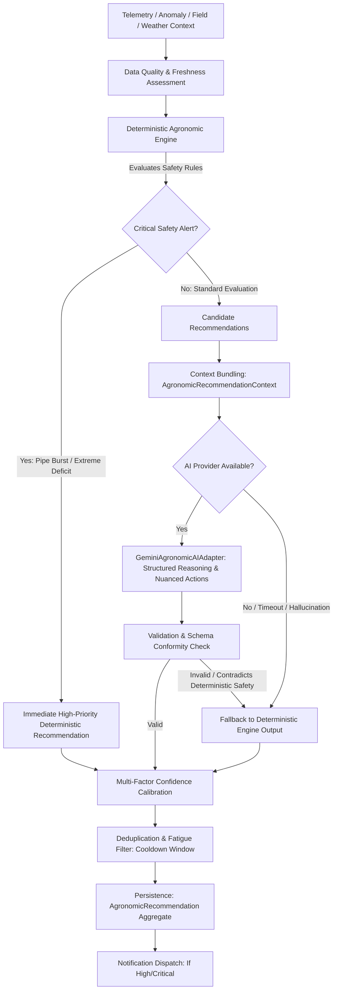
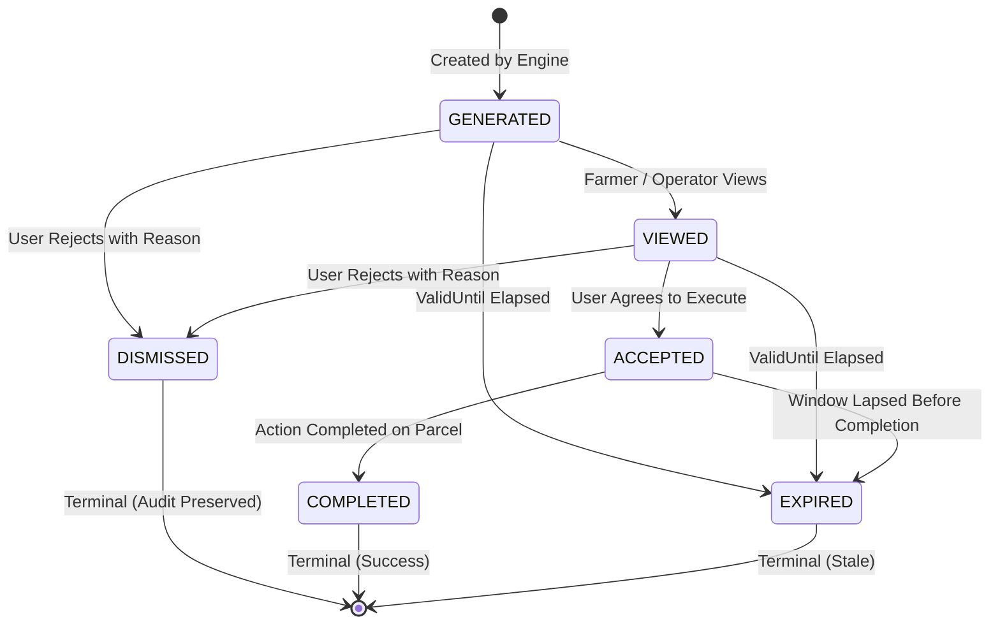

# YANGIARIQ AQUA AI — MILESTONE 08.1 IMPLEMENTATION PLAN
## AI AGRONOMIC RECOMMENDATIONS & DECISION SUPPORT SYSTEM

---

## 1. Executive Summary & Objective

The objective of Milestone 08.1 is to establish the **AI Agronomic Recommendations & Decision Support System** (`com.aquaai.recommendation`) for YANGIARIQ AQUA AI.

The system synthesizes field parameters, telemetry observations, hardware availability, active anomalies, scheduled irrigation plans, volumetric consumption, and weather forecasts into **explainable, evidence-based, confidence-calibrated, and actionable agricultural recommendations** for farmers and district water operators.

### Core Guiding Principle:
> "Given the current condition of this field, irrigation system, soil moisture, weather, anomalies, and historical telemetry, what should the farmer/operator do next?"

Recommendations are advisory decision support tools. The system **never** pretends an AI recommendation is guaranteed agronomic truth, never hallucinates measurements, and enforces strict deterministic safety guardrails.

---

## 2. Existing Reusable Components & Gap Analysis

### 2.1 Reusable Domain Components
| Bounded Context | Existing Reusable Elements | Utilization in Milestone 08.1 |
| :--- | :--- | :--- |
| **`com.aquaai.field`** | [`Field`](file:///home/izzatbek/Desktop/agronexsus/backend/src/main/java/com/aquaai/field/domain/model/Field.java), [`CropType`](file:///home/izzatbek/Desktop/agronexsus/backend/src/main/java/com/aquaai/field/domain/model/CropType.java), [`SoilType`](file:///home/izzatbek/Desktop/agronexsus/backend/src/main/java/com/aquaai/field/domain/model/SoilType.java), [`IrrigationMethod`](file:///home/izzatbek/Desktop/agronexsus/backend/src/main/java/com/aquaai/field/domain/model/IrrigationMethod.java), [`FieldOwnershipChecker`](file:///home/izzatbek/Desktop/agronexsus/backend/src/main/java/com/aquaai/field/application/security/FieldOwnershipChecker.java) | Provides parcel crop classification, soil hydraulics, area in hectares, and Anti-IDOR ownership isolation. |
| **`com.aquaai.sensor`** | [`SensorReadingRepository`](file:///home/izzatbek/Desktop/agronexsus/backend/src/main/java/com/aquaai/sensor/domain/repository/SensorReadingRepository.java), [`SensorAnalyticsRepository`](file:///home/izzatbek/Desktop/agronexsus/backend/src/main/java/com/aquaai/sensor/domain/repository/SensorAnalyticsRepository.java), [`SensorType`](file:///home/izzatbek/Desktop/agronexsus/backend/src/main/java/com/aquaai/sensor/domain/model/SensorType.java), [`ReadingQuality`](file:///home/izzatbek/Desktop/agronexsus/backend/src/main/java/com/aquaai/sensor/domain/model/ReadingQuality.java) | Provides real-time soil moisture %, water flow rate, line pressure, salinity, and ambient temperature, plus 24h moving averages and quality filtering. |
| **`com.aquaai.anomaly`** | [`Anomaly`](file:///home/izzatbek/Desktop/agronexsus/backend/src/main/java/com/aquaai/anomaly/domain/model/Anomaly.java), [`AnomalyRepository`](file:///home/izzatbek/Desktop/agronexsus/backend/src/main/java/com/aquaai/anomaly/domain/repository/AnomalyRepository.java), [`AnomalyType`](file:///home/izzatbek/Desktop/agronexsus/backend/src/main/java/com/aquaai/anomaly/domain/model/AnomalyType.java), [`AnomalySeverity`](file:///home/izzatbek/Desktop/agronexsus/backend/src/main/java/com/aquaai/anomaly/domain/model/AnomalySeverity.java) | Provides active anomaly alerts (e.g. `SUSPECTED_PIPE_BURST`, `SOIL_MOISTURE_CRITICAL`) that directly feed recommendation priorities and safety restrictions. |
| **`com.aquaai.water`** | [`IrrigationPlan`](file:///home/izzatbek/Desktop/agronexsus/backend/src/main/java/com/aquaai/water/domain/model/IrrigationPlan.java), [`WaterAllocation`](file:///home/izzatbek/Desktop/agronexsus/backend/src/main/java/com/aquaai/water/domain/model/WaterAllocation.java), [`WaterConsumptionQueryRepository`](file:///home/izzatbek/Desktop/agronexsus/backend/src/main/java/com/aquaai/water/domain/repository/WaterConsumptionQueryRepository.java) | Provides active delivery status, scheduled vs actual volume, and canal water availability. |
| **`com.aquaai.shared.security`** | [`CurrentUserProvider`](file:///home/izzatbek/Desktop/agronexsus/backend/src/main/java/com/aquaai/shared/security/CurrentUserProvider.java), [`UserRole`](file:///home/izzatbek/Desktop/agronexsus/backend/src/main/java/com/aquaai/shared/security/UserRole.java), [`SecurityContextHelper`](file:///home/izzatbek/Desktop/agronexsus/backend/src/main/java/com/aquaai/shared/security/SecurityContextHelper.java) | Standard RBAC authorization and tenant isolation. |

### 2.2 Missing Capabilities & Data Gaps
1. **Weather Data Provider**:
   - Currently, no external weather service or snapshot persistence exists in the project.
   - **Solution**: Define [`WeatherDataProvider`](file:///home/izzatbek/Desktop/agronexsus/backend/src/main/java/com/aquaai/recommendation/domain/port/WeatherDataProvider.java) port producing a strongly typed [`WeatherSnapshot`](file:///home/izzatbek/Desktop/agronexsus/backend/src/main/java/com/aquaai/recommendation/domain/model/WeatherSnapshot.java) (temperature, relative humidity, precipitation probability & mm, wind speed, atmospheric pressure, source, observation timestamp, freshness). Implement a realistic regional simulated provider for Yangiariq climate with an extension point for external APIs (e.g., OpenWeather/WeatherAPI).
2. **Evapotranspiration (ET0) Strategy**:
   - Scientific standard: FAO-56 Penman-Monteith requires solar net radiation ($R_n$), soil heat flux ($G$), wind speed at 2m height ($u_2$), saturation vapor pressure ($e_s$), and actual vapor pressure ($e_a$).
   - Current physical reality: Field sensors in Yangiariq measure soil moisture, canal flow, pressure, salinity, and ambient temperature/humidity. Solar pyranometers and 2m anemometers are not yet installed.
   - **Solution**: Define [`EvapotranspirationCalculator`](file:///home/izzatbek/Desktop/agronexsus/backend/src/main/java/com/aquaai/recommendation/domain/port/EvapotranspirationCalculator.java) port. Provide an initial temperature-radiation approximation (Hargreaves-Samani method) with explicit disclaimer of provisional accuracy, and clearly document the missing inputs required for full FAO-56 implementation.
3. **Structured AI Decision Adapter**:
   - The legacy `com.aquaai.ai` package contained only prototype mock strings.
   - **Solution**: Build a robust, schema-validated [`AgronomicAIProvider`](file:///home/izzatbek/Desktop/agronexsus/backend/src/main/java/com/aquaai/recommendation/domain/port/AgronomicAIProvider.java) port and [`GeminiAgronomicAIAdapter`](file:///home/izzatbek/Desktop/agronexsus/backend/src/main/java/com/aquaai/recommendation/infrastructure/ai/GeminiAgronomicAIAdapter.java) in the new `com.aquaai.recommendation` bounded context.

---

## 3. Architecture & Bounded Context Design

```
com.aquaai.recommendation
├── domain
│   ├── model
│   │   ├── AgronomicRecommendation.java         # Aggregate root with lifecycle state machine
│   │   ├── RecommendationType.java              # 11 distinct recommendation categories
│   │   ├── RecommendationPriority.java          # CRITICAL, HIGH, MEDIUM, LOW, INFO
│   │   ├── RecommendationStatus.java            # GENERATED, VIEWED, ACCEPTED, DISMISSED, EXPIRED, COMPLETED
│   │   ├── RecommendationEvidence.java          # Structured evidence supporting recommendation
│   │   ├── RecommendedAction.java               # Actionable step with sequence order
│   │   ├── ConfidenceLevel.java                 # HIGH, MODERATE, LOW
│   │   ├── RecommendationSource.java            # DETERMINISTIC_ENGINE, HYBRID_AI, MANUAL_OVERRIDE
│   │   ├── AgronomicRecommendationContext.java  # Input context bundle
│   │   └── WeatherSnapshot.java                 # Weather data model
│   ├── port
│   │   ├── AgronomicRecommendationEngine.java   # Deterministic engine port
│   │   ├── AgronomicAIProvider.java             # LLM provider port
│   │   ├── WeatherDataProvider.java             # Weather provider port
│   │   ├── EvapotranspirationCalculator.java    # ET0 calculation port
│   │   ├── RecommendationRepository.java        # Persistence port
│   │   └── RecommendationNotificationPort.java  # Notification dispatch port
│   └── service
│       └── ConfidenceCalculator.java            # Pure domain multi-factor confidence engine
├── application
│   ├── service
│   │   ├── RecommendationOrchestrationService.java # Hybrid workflow coordinator
│   │   ├── RecommendationSchedulerService.java     # Periodic generation & expiration
│   │   └── AgronomicPromptBuilder.java             # Schema-enforced safe prompt builder
│   └── usecase
│       ├── GenerateRecommendationUseCase.java
│       ├── GetRecommendationUseCase.java
│       ├── ListRecommendationsUseCase.java
│       ├── ViewRecommendationUseCase.java
│       ├── AcceptRecommendationUseCase.java
│       ├── DismissRecommendationUseCase.java
│       ├── CompleteRecommendationUseCase.java
│       └── GetRecommendationSummaryUseCase.java
├── infrastructure
│   ├── engine
│   │   └── DeterministicAgronomicEngineImpl.java   # Core deterministic rule suite
│   ├── weather
│   │   └── SimulatedYangiariqWeatherProvider.java  # Realistic regional climate provider
│   ├── et
│   │   └── HargreavesSamaniETCalculator.java       # Empirical ET0 calculator with limitations
│   ├── ai
│   │   ├── GeminiAgronomicAIAdapter.java           # Structured Gemini LLM caller with fallback
│   │   └── MockAgronomicAIAdapter.java             # Offline deterministic mock adapter
│   └── persistence
│       ├── RecommendationJpaEntity.java
│       ├── RecommendationEvidenceJpaEntity.java
│       ├── RecommendedActionJpaEntity.java
│       ├── RecommendationJpaMapper.java
│       ├── SpringDataRecommendationRepository.java
│       └── RecommendationRepositoryImpl.java
└── api
    ├── RecommendationController.java
    └── dto
        ├── RecommendationResponse.java
        ├── RecommendationEvidenceResponse.java
        ├── RecommendedActionResponse.java
        ├── RecommendationSummaryResponse.java
        ├── DismissRecommendationRequest.java
        └── GenerateRecommendationRequest.java
```

---

## 4. Hybrid Decision Architecture: Deterministic Safety First



### Deterministic Safety Rules
1. **Soil Moisture Deficit**:
   - $V \le 15.0\%$ volumetric moisture $\implies$ `IRRIGATE_NOW` (Priority: `CRITICAL` if $V \le 12\%$, else `HIGH`).
   - Falling rapidly ($> 3.0\%$/h) $\implies$ elevates priority and tightens recommended window.
2. **Moisture Saturation & Asphyxiation Prevention**:
   - $V \ge 35.0\%$ volumetric moisture (field capacity exceeded) $\implies$ `AVOID_IRRIGATION` (Priority: `MEDIUM`). "Do not irrigate; risk of root hypoxia and nitrogen leaching."
3. **Rainfall Influx**:
   - Expected rainfall $\ge 15.0\text{ mm}$ within 24h $\implies$ `DELAY_IRRIGATION` (Priority: `HIGH`). Saves water and avoids waterlogging.
4. **Hydraulic Infrastructure Protection (Zero Hallucination Guard)**:
   - Active `SUSPECTED_PIPE_BURST` or `WATER_PRESSURE_DROP` $\implies$ `INSPECT_PIPE_BURST` (Priority: `CRITICAL`).
   - Hard Rule: Under no circumstances will AI or deterministic engine recommend irrigation until hydraulic line integrity is resolved.
5. **Salinity Leaching (Sho'r yuvish)**:
   - Soil or intake water salinity $\ge 4.0\text{ dS/m}$ $\implies$ `MANAGE_SALINITY` (Priority: `HIGH`).

---

## 5. Structured AI Schema & Prompt Engineering

The LLM is treated as an advisory reasoning layer, **never** an authoritative source of physical telemetry.

### Explicit Instructions to Model:
1. "You are an agricultural decision-support assistant for Yangiariq district, Khorezm."
2. "Use ONLY the provided field, telemetry, anomaly, weather, and water context."
3. "NEVER invent sensor measurements, crop quotas, or biological thresholds."
4. "If data is missing (e.g. pressure unmeasured, soil depth unknown), state the limitation explicitly."
5. "Adhere strictly to the requested JSON response schema."

### Structured JSON Response Contract:
```json
{
  "recommendationType": "IRRIGATE_NOW",
  "priority": "HIGH",
  "title": "Tungi tomchilatib sug'orishni boshlash tavsiya etiladi",
  "summary": "Tuproq namligi 14.2% gacha pasaygan. Yaqin 48 soatda yog'ingarchilik kutilmaydi.",
  "explanation": "Bug'doy ekini gullash fazasida bo'lib, qumoq tuproqda namlik tanqisligi hosildorlikka salbiy ta'sir ko'rsatishi mumkin. Kechki soat 22:00 dan 04:00 gacha sug'orish bug'lanishni 20% ga qisqartiradi.",
  "actions": [
    { "order": 1, "action": "Tomchilatib sug'orish liniyasini 4 soat davomida ishga tushiring", "urgency": "IMMEDIATE" },
    { "order": 2, "action": "Sug'orishdan so'ng tuproq namligi datchigi 25% ga yetganligini tekshiring", "urgency": "WITHIN_24H" }
  ],
  "doNotActions": [
    "Kunduzgi quyosh tig'ida (11:00 - 17:00) sug'orishni amalga oshirmang",
    "Gidravlik bosim 2.5 bar dan oshishiga yo'l qo'ymang"
  ],
  "limitations": "Ildiz chuqurligi bo'yicha ko'p qatlamli datchiklar mavjud emas; hisob-kitob 30 sm qatlam ko'rsatkichiga asoslangan.",
  "confidenceScore": 0.85
}
```

---

## 6. Multi-Factor Confidence Calibration

Confidence is not an arbitrary number from the LLM; it is rigorously computed:

$$\text{Confidence} = \min(0.95, \max(0.15, w_e E + w_q Q + w_c C + w_a A))$$

Where:
- $E$ (Evidence Strength, $w_e = 0.40$): Number and agreement of corroborating physical readings.
- $Q$ (Data Freshness & Quality, $w_q = 0.25$): Evaluated based on age of telemetry ($< 1\text{h} = 1.0$, $1-3\text{h} = 0.8$, $> 6\text{h} = 0.4$) and `ReadingQuality.VALID`.
- $C$ (Context Completeness, $w_c = 0.20$): Are crop type, soil type, weather forecast, and water allocation present?
- $A$ (AI Self-Assessment, $w_a = 0.15$): Model's bounded assessment.

Levels:
- $\ge 0.80$: **High Confidence**
- $0.60 - 0.79$: **Moderate Confidence**
- $< 0.60$: **Low Confidence (Accompanied by explicit warning to verify field ground truth)**

---

## 7. Lifecycle State Machine & Expiry



- **Default Validity Window**: 24 hours (or shorter for rapid weather changes).
- **Scheduled Expiration**: `RecommendationSchedulerService` runs hourly and transitions stale recommendations to `EXPIRED`.
- **Deduplication Key**: `(fieldId, recommendationType)` in non-terminal states with a 4-hour cooldown.

---

## 8. Anti-IDOR Security & RBAC

- **Tenant Isolation**: Handled via [`FieldOwnershipChecker`](file:///home/izzatbek/Desktop/agronexsus/backend/src/main/java/com/aquaai/field/application/security/FieldOwnershipChecker.java).
- **Anti-Enumeration 404**: Unauthorized farmer requests to a recommendation belonging to another farmer's parcel return HTTP 404.
- **Operator & Admin**: Full district-wide visibility and on-demand recommendation generation.

---

## 9. Frontend Architecture (FSD)

```
frontend/src/
├── entities/recommendation/
│   ├── types.ts          # Strongly typed TS interfaces matching domain
│   ├── api.ts            # Client calls to /api/v1/recommendations
│   └── index.ts
├── features/recommendation/
│   ├── queries/
│   │   └── useRecommendationQueries.ts # TanStack Query hooks & mutations
│   └── components/
│       ├── RecommendationPriorityBadge.tsx
│       ├── RecommendationStatusBadge.tsx
│       ├── RecommendationCard.tsx
│       ├── RecommendationFeed.tsx
│       ├── RecommendationDetailsModal.tsx
│       └── RecommendationActionDialog.tsx
└── pages/recommendations/
    ├── RecommendationsPage.tsx # KPI summary, active feed, filter bar
    └── index.ts
```

- **GIS Integration**: Extends [`FieldWaterSidePanel.tsx`](file:///home/izzatbek/Desktop/agronexsus/frontend/src/features/water/gis/components/FieldWaterSidePanel.tsx) to display active high-priority recommendations when a field polygon is selected on the Leaflet map.
- **i18n**: Full localized dictionary in `frontend/src/shared/i18n/index.ts` across `uz`, `ru`, `en`.

---

## 10. Database Schema (Liquibase Changeset `011`)

```sql
CREATE TABLE recommendations (
    id UUID PRIMARY KEY,
    field_id UUID NOT NULL REFERENCES fields(id) ON DELETE CASCADE,
    recommendation_type VARCHAR(64) NOT NULL,
    priority VARCHAR(32) NOT NULL,
    status VARCHAR(32) NOT NULL DEFAULT 'GENERATED',
    title VARCHAR(255) NOT NULL,
    summary VARCHAR(500) NOT NULL,
    explanation TEXT NOT NULL,
    confidence NUMERIC(5, 4) NOT NULL,
    confidence_level VARCHAR(32) NOT NULL,
    valid_from TIMESTAMP WITH TIME ZONE NOT NULL,
    valid_until TIMESTAMP WITH TIME ZONE NOT NULL,
    generated_at TIMESTAMP WITH TIME ZONE NOT NULL,
    source VARCHAR(64) NOT NULL DEFAULT 'HYBRID_AI',
    limitations TEXT,
    is_simulated BOOLEAN NOT NULL DEFAULT FALSE,
    viewed_at TIMESTAMP WITH TIME ZONE,
    viewed_by UUID,
    accepted_at TIMESTAMP WITH TIME ZONE,
    accepted_by UUID,
    dismissed_at TIMESTAMP WITH TIME ZONE,
    dismissed_by UUID,
    dismissal_reason VARCHAR(500),
    completed_at TIMESTAMP WITH TIME ZONE,
    completed_by UUID,
    created_at TIMESTAMP WITH TIME ZONE NOT NULL,
    updated_at TIMESTAMP WITH TIME ZONE NOT NULL,
    version BIGINT NOT NULL DEFAULT 0
);

CREATE INDEX idx_recommendations_field_status ON recommendations(field_id, status);
CREATE INDEX idx_recommendations_priority ON recommendations(priority);
CREATE INDEX idx_recommendations_valid_until ON recommendations(valid_until);

CREATE TABLE recommendation_evidence (
    id UUID PRIMARY KEY,
    recommendation_id UUID NOT NULL REFERENCES recommendations(id) ON DELETE CASCADE,
    evidence_type VARCHAR(64) NOT NULL,
    metric VARCHAR(64) NOT NULL,
    observed_value NUMERIC(14, 4),
    baseline_value NUMERIC(14, 4),
    unit VARCHAR(32),
    summary VARCHAR(255) NOT NULL,
    source_reference VARCHAR(128),
    created_at TIMESTAMP WITH TIME ZONE NOT NULL
);

CREATE TABLE recommendation_actions (
    id UUID PRIMARY KEY,
    recommendation_id UUID NOT NULL REFERENCES recommendations(id) ON DELETE CASCADE,
    action_order INT NOT NULL,
    action_text VARCHAR(500) NOT NULL,
    urgency VARCHAR(32) NOT NULL DEFAULT 'NORMAL',
    is_negative_action BOOLEAN NOT NULL DEFAULT FALSE,
    created_at TIMESTAMP WITH TIME ZONE NOT NULL
);
```

---

## 11. Incremental Execution Roadmap

- **Phase 1**: Domain Model + Ports + Unit Tests (`com.aquaai.recommendation.domain`).
- **Phase 2**: Deterministic Recommendation Engine (`infrastructure.engine`).
- **Phase 3**: Persistence & Liquibase Migration (`011-create-recommendation-domain-tables.sql`).
- **Phase 4**: Context Building & Telemetry/Anomaly Integration.
- **Phase 5**: Weather & ET0 Abstraction (`WeatherDataProvider`, `EvapotranspirationCalculator`).
- **Phase 6**: AI Provider Abstraction (`AgronomicAIProvider`, `AgronomicPromptBuilder`).
- **Phase 7**: Gemini Adapter & Mock Adapter with Structured JSON Parsing.
- **Phase 8**: Multi-Factor Confidence Calibration & Graceful Fallback Engine.
- **Phase 9**: REST API (`/api/v1/recommendations`) + RBAC + Anti-IDOR Tests.
- **Phase 10**: Frontend Recommendation Feed, Details Modal, Action Dialogs, and i18n (`uz`, `ru`, `en`).
- **Phase 11**: GIS Map Side-Panel Integration.
- **Phase 12**: Complete Documentation Suite + Final End-to-End Verification (`./gradlew test --rerun`, `npm test -- --run`, `npm run build`).
