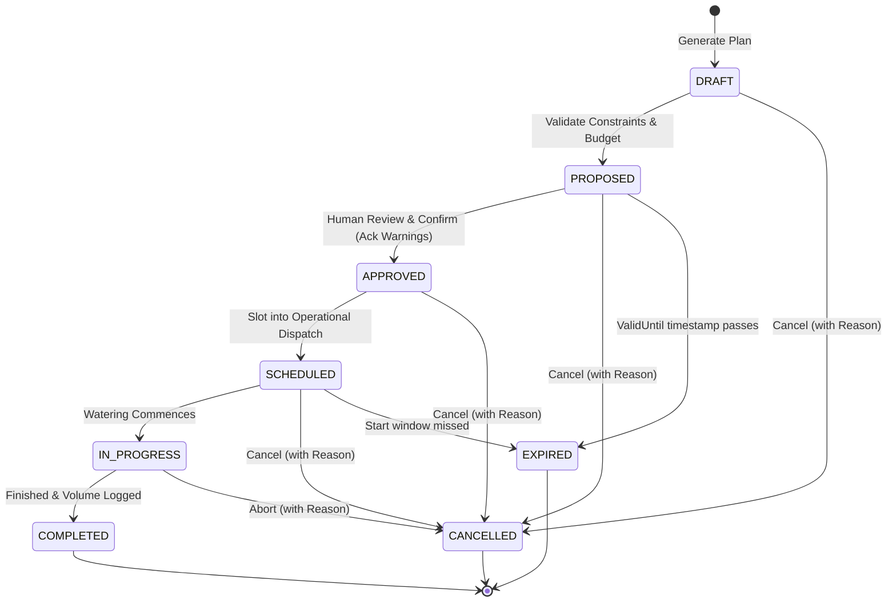

# YANGIARIQ AQUA AI — MILESTONE 08.2 IMPLEMENTATION PLAN
## SMART IRRIGATION PLANNING & WATER ALLOCATION OPTIMIZATION

**Document Version:** 1.0.0  
**Status:** Approved for Implementation  
**Target Milestone:** Milestone 08.2  
**Timestamp:** 2026-11-01  
**Project:** YANGIARIQ AQUA AI (Smart Agriculture & Water Management Platform)

---

## 1. Executive Summary & Purpose

The purpose of Milestone 08.2 is to transform telemetry, field parcel soil/crop conditions, water availability and regional quotas, anomalies, agronomic recommendations, weather forecasts, and irrigation infrastructure into a **safe, explainable, and operational irrigation planning system**.

The system answers the fundamental agricultural question:
> **"When, where, how much, and for how long should irrigation occur, given available water and current field conditions?"**

### Core Architectural Axiom:
$$\text{Telemetry} \longrightarrow \text{Anomaly} \longrightarrow \text{Agronomic Recommendation} \longrightarrow \text{Water Budget} \longrightarrow \text{Irrigation Plan} \longrightarrow \text{Human Approval} \longrightarrow \text{Operational Schedule}$$

### Critical Boundary & Non-Goals:
- **PLANNING ONLY (Decision Support)**: The system generates recommendations, water schedules, and constraints. It does **NOT** autonomously control physical actuators, open valves, or start water pumps.
- **Human In The Loop**: All plans require human review and explicit approval (with mandatory risk acknowledgement if warnings exist).
- **Strict Hard Constraint Precedence**: AI advisory models are purely explainers; they can never override safety interlocks (pipe bursts), water quotas, or hydraulic constraints.

---

## 2. Deep Repository Inspection & Existing Asset Audit

A comprehensive audit of the existing codebase confirms the verified foundation from Milestones 08.0 and 08.1:
- Backend: **409 / 409** unit & integration tests passing (`./gradlew test`).
- Frontend: **103 / 103** Vitest tests passing (`npm test -- --run`).
- ArchUnit: **32 / 32** architecture verification rules passing.
- Security: Role-Based Access Control (`FARMER`, `OPERATOR`, `ADMIN`) with strict anti-IDOR HTTP 404 parcel isolation.

### 2.1 Existing Water Module (`com.aquaai.water`)
| Asset | Current Capability | Reuse Strategy in Milestone 08.2 |
|---|---|---|
| `WaterAllocation` | Quotas per field & water source (`allocatedVolumeM3`, `periodStart`, `periodEnd`, `status`) | Reused as the source of seasonal water entitlements. |
| `WaterConsumptionQueryRepository` | Aggregate queries for actual consumption (`getConsumedVolumeByAllocationId`, batch lookups) | Reused to calculate historical and seasonal consumed volume. |
| `WaterSource` | Infrastructure points (`CANAL`, `WELL`, `RESERVOIR`) with GIS coordinates | Reused to check source status (`ACTIVE`/`MAINTENANCE`) and infrastructure links. |
| `IrrigationEvent` | Operational records of executed water events (`actualVolumeM3`, `status`) | Reused when plans transition to execution. |
| `IrrigationPlan` (basic) | Manual scheduling entity with basic status (`PLANNED`, `IN_PROGRESS`, `COMPLETED`, `CANCELLED`) | Preserved for backward compatibility. |

> [!IMPORTANT]
> **ArchUnit Boundary Rule 17 & 18**: The `water` module is strictly prohibited from depending on `ai` or `sensor` directly. Placing smart planning with sensor deficit calculators and AI explainers inside `com.aquaai.water` would violate these architecture rules. Therefore, a dedicated bounded context `com.aquaai.irrigation` is established.

### 2.2 Existing Field Module (`com.aquaai.field`)
- `Field`: Contains parcel geometry (`boundary`), centroid (`location`), parcel area (`areaHectares`), crop classification (`CropType`: `COTTON`, `WHEAT`, `RICE`, `MAIZE`, `VEGETABLE`, `MELON`), soil texture (`SoilType`: `SANDY`, `LOAM`, `CLAY`, `SANDY_LOAM`, `CLAY_LOAM`), and default irrigation technique (`IrrigationMethod`: `DRIP`, `SPRINKLER`, `FURROW`, `CANAL`, `DITCH`).
- `FieldOwnershipChecker`: Enforces farmer parcel ownership, throwing `ResourceNotFoundException("Field", fieldId)` (HTTP 404) for unauthorized access.

### 2.3 Existing Sensor & Telemetry Module (`com.aquaai.sensor`)
- `SensorReadingRepository.findLatestByFieldIdGroupedByType(fieldId)`: Retrieves real-time point-in-time telemetry:
  - `SOIL_MOISTURE` (%) + `ReadingQuality` (`GOOD`, `SUSPECT`, `DEGRADED`, `STALE`)
  - `WATER_FLOW` ($m^3/h$)
  - `PRESSURE` (bar)
  - `TEMPERATURE` ($^\circ\text{C}$)
  - `HUMIDITY` (%)
  - `SALINITY` (dS/m)

### 2.4 Existing Anomaly Module (`com.aquaai.anomaly`)
- Active anomalies per parcel (`AnomalyRepository.findAll(...)`).
- Critical types: `SUSPECTED_PIPE_BURST`, `WATER_PRESSURE_DROP`, `SOIL_MOISTURE_CRITICAL`, `WATER_FLOW_SPIKE`, `POSSIBLE_SENSOR_DRIFT`.

### 2.5 Existing Recommendation & Decision Support Module (`com.aquaai.recommendation`)
- `EvapotranspirationCalculator` & `HargreavesSamaniETCalculator`: Reference $ET_0$ calculator (mm/day).
- `WeatherDataProvider` & `WeatherSnapshot`: Temperature, humidity, precipitation probability, forecast rain (mm), wind speed (m/s), and freshness.
- `AgronomicAIProvider` & `CompositeAgronomicAIProvider`: Multi-model advisory provider (Gemini with fallback to mock/rule-based heuristics).

---

## 3. Bounded Context Architecture: `com.aquaai.irrigation`

In accordance with Domain-Driven Design (DDD) and Hexagonal Architecture:

```text
com.aquaai.irrigation
├── domain
│   ├── model
│   │   ├── SmartIrrigationPlan.java          (Aggregate Root)
│   │   ├── IrrigationPlanStatus.java         (DRAFT, PROPOSED, APPROVED, SCHEDULED, IN_PROGRESS, COMPLETED, CANCELLED, EXPIRED)
│   │   ├── IrrigationPriority.java           (CRITICAL, HIGH, MEDIUM, LOW)
│   │   ├── PlanConstraint.java               (SAFETY, WATER_QUOTA, INFRASTRUCTURE, WEATHER, AGRONOMIC)
│   │   ├── ConstraintStatus.java             (SATISFIED, VIOLATED, WARNING, BLOCKED)
│   │   ├── WaterBudget.java                  (Total, Consumed, Committed, Reserved, Remaining)
│   │   ├── IrrigationRequirement.java        (Deficit, Net mm, Gross m³, Duration, Flow rate)
│   │   ├── IrrigationWindow.java             (Start, End, Duration, Nocturnal flag)
│   │   └── DataQualityGate.java              (SUFFICIENT, PARTIAL, INSUFFICIENT, UNSAFE)
│   ├── service
│   │   ├── IrrigationRequirementCalculator.java
│   │   ├── IrrigationPriorityCalculator.java
│   │   ├── HydraulicSafetyInterlock.java
│   │   └── IrrigationSchedulingEngine.java
│   └── port
│       ├── IrrigationPlanRepository.java
│       ├── WaterBudgetDataPort.java
│       ├── FieldDataPort.java
│       ├── TelemetryDataPort.java
│       ├── AnomalyDataPort.java
│       ├── AgronomicContextPort.java
│       └── IrrigationAIExplanationPort.java
├── application
│   ├── usecase
│   │   ├── GenerateIrrigationPlanUseCase.java
│   │   ├── ApproveIrrigationPlanUseCase.java
│   │   ├── CancelIrrigationPlanUseCase.java
│   │   ├── CompleteIrrigationPlanUseCase.java
│   │   ├── GetIrrigationPlanUseCase.java
│   │   ├── ListIrrigationPlansUseCase.java
│   │   ├── GetFieldWaterBudgetUseCase.java
│   │   └── InvalidateOutdatedPlansUseCase.java
│   └── service
│       └── IrrigationPlanningOrchestrator.java
├── infrastructure
│   ├── persistence
│   │   ├── SmartIrrigationPlanJpaEntity.java
│   │   ├── PlanConstraintJpaEntity.java
│   │   ├── SpringDataSmartIrrigationPlanRepository.java
│   │   ├── IrrigationPlanRepositoryImpl.java
│   │   └── SmartIrrigationPlanJpaMapper.java
│   ├── adapter
│   │   ├── WaterBudgetDataAdapter.java
│   │   ├── FieldDataAdapter.java
│   │   ├── TelemetryDataAdapter.java
│   │   ├── AnomalyDataAdapter.java
│   │   ├── AgronomicContextAdapter.java
│   │   └── IrrigationAIExplanationAdapter.java
└── api
    ├── IrrigationPlanController.java
    ├── WaterBudgetController.java
    └── dto
        ├── SmartIrrigationPlanResponse.java
        ├── GenerateIrrigationPlanRequest.java
        ├── ApproveIrrigationPlanRequest.java
        ├── CancelIrrigationPlanRequest.java
        ├── WaterBudgetResponse.java
        └── IrrigationScheduleTimelineResponse.java
```

---

## 4. Domain Model & Lifecycle State Machine

### 4.1 Aggregate Root: `SmartIrrigationPlan`
- Invariants:
  - `fieldId` cannot be null.
  - `recommendedVolumeM3` must be $\ge 0$.
  - Planned window `plannedStartAt` must be strictly before `plannedEndAt`.
  - State transitions are strictly validated.
  - Once `COMPLETED` or `CANCELLED`, the plan is immutable except for audit tracking.
  - Cancellation strictly requires a non-blank reason.

### 4.2 Lifecycle State Transitions



---

## 5. Mathematical & Agronomic Calculation Engines

### 5.1 Water Budget Accounting Model
For any field parcel $F$ with active water allocations:
$$\text{Total Allocated} = \sum \text{AllocatedVolumeM3 of ACTIVE allocations in period}$$
$$\text{Consumed} = \sum \text{ActualVolumeM3 of COMPLETED irrigation events}$$
$$\text{Committed} = \sum \text{PlannedVolumeM3 of SCHEDULED and IN\_PROGRESS plans}$$
$$\text{Reserved} = \sum \text{PlannedVolumeM3 of APPROVED and PROPOSED plans}$$
$$\text{Remaining Available} = \text{Total Allocated} - \text{Consumed} - \text{Committed} - \text{Reserved}$$

### 5.2 Soil Moisture Deficit & Net Requirement ($I_{\text{net}}$)
Let:
- $\theta_{\text{target}}$: Optimal target soil moisture (%) based on crop and soil texture (default 70% of Field Capacity).
- $\theta_{\text{current}}$: Current root-zone soil moisture reading (%).
- $Z_r$: Effective root zone depth (m) (Cotton: 0.8m, Wheat: 0.6m, Rice: 0.4m, Maize: 0.7m, Vegetables: 0.4m, Melons: 0.5m).
- $ET_c = K_c \times ET_0$: Crop evapotranspiration (mm/day).
- $P_{\text{eff}}$: Effective rainfall forecast (mm) ($P_{\text{eff}} = \max(0, (P_{\text{forecast}} - 5\text{mm}) \times 0.8)$).

$$\text{Deficit Depth (mm)} = \max\left(0, \frac{\theta_{\text{target}} - \theta_{\text{current}}}{100} \times Z_r \times 1000\right)$$
$$I_{\text{net}} (\text{mm}) = \max\left(0, \text{Deficit Depth} + ET_c - P_{\text{eff}}\right)$$

### 5.3 Gross Volumetric Requirement ($V_{\text{gross}}$)
Factoring in irrigation application efficiency $\eta$:
- Drip: $\eta = 0.90$
- Sprinkler: $\eta = 0.75$
- Furrow: $\eta = 0.60$
- Canal/Ditch/Surface: $\eta = 0.50$

$$V_{\text{gross}} (m^3) = \frac{I_{\text{net}} (\text{mm}) \times 10 \times \text{Area (ha)}}{\eta}$$
*(Note: $1\text{ mm} \times 1\text{ ha} = 10\text{ m}^3$)*

### 5.4 Duration and Flow Rate
$$\text{Estimated Duration (hours)} = \frac{V_{\text{gross}}}{Q_{\text{nominal}}}$$
Where $Q_{\text{nominal}}$ ($m^3/h$) is the infrastructure capacity or method-specific flow limit.

---

## 6. Priority Engine & Hard Constraint Hierarchy

### 6.1 Strict Constraint Precedence (Prompt Section 41)
```text
1. SAFETY (Hydraulic Interlock)
   └── If SUSPECTED_PIPE_BURST or CRITICAL pressure drop exists: BLOCKED.
2. HARD WATER CONSTRAINTS
   └── Plan volume cannot exceed Remaining Available water budget.
3. INFRASTRUCTURE CONSTRAINTS
   └── Max flow rate, operating window (max 12h continuous).
4. AGRONOMIC REQUIREMENT
   └── Soil moisture deficit, crop stage critical water demand.
5. WEATHER OPTIMIZATION
   └── Rain forecast delays, extreme heat nocturnal window.
6. FIELD PRIORITY
   └── Priority score ordering for turn distribution.
7. AI EXPLANATION
   └── Explainability, trade-off analysis, advisory suggestions.
```
> [!CAUTION]
> AI advisory engines (e.g. Gemini) can NEVER override levels 1 through 6. For instance, if remaining water budget is $500\text{ m}^3$, the AI cannot recommend an approved plan for $700\text{ m}^3$.

### 6.2 Deterministic Priority Scoring (0 - 100 points)
$$\text{Score} = S_{\text{moisture}} (0\text{-}40) + S_{\text{crop\_sensitivity}} (0\text{-}25) + S_{\text{anomalies}} (0\text{-}15) + S_{\text{weather}} (0\text{-}10) + S_{\text{quota\_headroom}} (0\text{-}10)$$
- **Score $\ge 80$**: `CRITICAL`
- **Score $\ge 60$**: `HIGH`
- **Score $\ge 35$**: `MEDIUM`
- **Score $< 35$**: `LOW`

---

## 7. Conflict Detection Matrix

| Conflict Type | Condition | System Action | Explainability Message |
|---|---|---|---|
| **SAFETY_BLOCK** | Active `SUSPECTED_PIPE_BURST` or critical pressure drop | Status `BLOCKED`. Volume set to 0 or marked blocked. Cannot approve. | "Irrigation blocked due to suspected pipe burst anomaly on distribution line." |
| **WATER_SHORTAGE** | Required $V_{\text{gross}} > \text{Remaining Available}$ | Constrain to remaining quota or flag deficit shortage. | "Water quota insufficient. Required: $X\text{ m}^3$, Available: $Y\text{ m}^3$. Plan scaled down to available quota." |
| **WEATHER_CONFLICT** | Rain forecast $\ge 15\text{ mm}$ within 24h with prob $> 60\%$ | Delay planned start window by 24h-48h. | "Irrigation delayed: substantial rainfall ($Z\text{ mm}$) forecast within next 24 hours." |
| **HEAT_WIND_WINDOW** | Ambient temp $> 38^\circ\text{C}$ or wind $> 8\text{ m/s}$ (sprinkler) | Shift window to nocturnal slot (22:00 - 05:00). | "Nocturnal irrigation recommended to avoid excessive evaporative loss and spray drift." |
| **SCHEDULE_CLASH** | Same water source exceeding capacity at scheduled time | Stagger irrigation windows across parcels. | "Irrigation window staggered to avoid canal capacity bottleneck." |

---

## 8. Database Schema & Liquibase Migrations

File: `backend/src/main/resources/db/changelog/changes/012-create-smart-irrigation-planning-tables.sql`

```sql
-- liquibase formatted sql

-- changeset aqua-ai:025-create-smart-irrigation-plans-table
CREATE TABLE IF NOT EXISTS smart_irrigation_plans (
    id UUID PRIMARY KEY,
    field_id UUID NOT NULL,
    water_allocation_id UUID,
    status VARCHAR(32) NOT NULL DEFAULT 'DRAFT',
    priority VARCHAR(32) NOT NULL DEFAULT 'MEDIUM',
    planned_date DATE NOT NULL,
    planned_start_at TIMESTAMP WITH TIME ZONE NOT NULL,
    planned_end_at TIMESTAMP WITH TIME ZONE NOT NULL,
    recommended_volume_m3 NUMERIC(14, 4) NOT NULL,
    estimated_duration_minutes INT NOT NULL,
    recommended_flow_rate_m3_h NUMERIC(10, 2),
    target_moisture_percent NUMERIC(5, 2),
    current_moisture_percent NUMERIC(5, 2),
    confidence_level VARCHAR(32) NOT NULL DEFAULT 'MEDIUM',
    confidence_score NUMERIC(5, 4),
    reason TEXT NOT NULL,
    reasoning_summary TEXT,
    cancellation_reason VARCHAR(500),
    is_blocked BOOLEAN NOT NULL DEFAULT FALSE,
    blocked_reason VARCHAR(500),
    approved_by UUID,
    approved_at TIMESTAMP WITH TIME ZONE,
    source VARCHAR(64) NOT NULL DEFAULT 'RULE_ENGINE',
    created_at TIMESTAMP WITH TIME ZONE NOT NULL DEFAULT CURRENT_TIMESTAMP,
    updated_at TIMESTAMP WITH TIME ZONE NOT NULL DEFAULT CURRENT_TIMESTAMP,
    version BIGINT DEFAULT 0,
    CONSTRAINT fk_smart_irrigation_field FOREIGN KEY (field_id) REFERENCES fields(id) ON DELETE RESTRICT,
    CONSTRAINT fk_smart_irrigation_allocation FOREIGN KEY (water_allocation_id) REFERENCES water_allocations(id) ON DELETE SET NULL,
    CONSTRAINT chk_smart_irrigation_volume CHECK (recommended_volume_m3 >= 0),
    CONSTRAINT chk_smart_irrigation_period CHECK (planned_start_at < planned_end_at)
);

CREATE INDEX IF NOT EXISTS idx_smart_irrigation_field ON smart_irrigation_plans(field_id);
CREATE INDEX IF NOT EXISTS idx_smart_irrigation_status ON smart_irrigation_plans(status);
CREATE INDEX IF NOT EXISTS idx_smart_irrigation_planned_date ON smart_irrigation_plans(planned_date);
CREATE INDEX IF NOT EXISTS idx_smart_irrigation_field_status ON smart_irrigation_plans(field_id, status);

-- changeset aqua-ai:026-create-irrigation-plan-constraints-table
CREATE TABLE IF NOT EXISTS smart_irrigation_plan_constraints (
    id UUID PRIMARY KEY,
    plan_id UUID NOT NULL,
    constraint_type VARCHAR(64) NOT NULL,
    status VARCHAR(32) NOT NULL,
    message VARCHAR(500) NOT NULL,
    details TEXT,
    created_at TIMESTAMP WITH TIME ZONE NOT NULL DEFAULT CURRENT_TIMESTAMP,
    CONSTRAINT fk_plan_constraints_plan FOREIGN KEY (plan_id) REFERENCES smart_irrigation_plans(id) ON DELETE CASCADE
);

CREATE INDEX IF NOT EXISTS idx_plan_constraints_plan ON smart_irrigation_plan_constraints(plan_id);

-- changeset aqua-ai:027-create-irrigation-plan-tradeoffs-table
CREATE TABLE IF NOT EXISTS smart_irrigation_plan_tradeoffs (
    id UUID PRIMARY KEY,
    plan_id UUID NOT NULL,
    category VARCHAR(64) NOT NULL,
    description TEXT NOT NULL,
    created_at TIMESTAMP WITH TIME ZONE NOT NULL DEFAULT CURRENT_TIMESTAMP,
    CONSTRAINT fk_plan_tradeoffs_plan FOREIGN KEY (plan_id) REFERENCES smart_irrigation_plans(id) ON DELETE CASCADE
);

CREATE INDEX IF NOT EXISTS idx_plan_tradeoffs_plan ON smart_irrigation_plan_tradeoffs(plan_id);
```

---

## 9. REST API & Anti-IDOR Security

### 9.1 Endpoints
- `GET /api/v1/irrigation/plans` — Paginated list with filters (`fieldId`, `status`, `priority`, `dateFrom`, `dateTo`).
- `GET /api/v1/irrigation/plans/{id}` — Single plan detail with constraints, trade-offs, and explainability.
- `GET /api/v1/fields/{fieldId}/irrigation/plans` — Plans for specific parcel.
- `GET /api/v1/fields/{fieldId}/irrigation/plans/active` — Currently active (`PROPOSED`, `APPROVED`, `SCHEDULED`, `IN_PROGRESS`) plan.
- `POST /api/v1/fields/{fieldId}/irrigation/plans/generate` — On-demand smart plan calculation & proposal.
- `POST /api/v1/irrigation/plans/{id}/approve` — Human approval. Accepts optional acknowledgment of warnings.
- `POST /api/v1/irrigation/plans/{id}/cancel` — Cancel plan with mandatory reason string.
- `POST /api/v1/irrigation/plans/{id}/complete` — Mark completed with optional actual volume delivered.
- `GET /api/v1/water-budget` — Aggregated water budget across parcels.
- `GET /api/v1/fields/{fieldId}/water-budget` — Field-specific water budget (allocated, consumed, committed, reserved, remaining).

### 9.2 Security & RBAC
- `FARMER`: Can only view, generate, approve, and cancel plans for parcels they own. If querying another farmer's parcel, returns **HTTP 404** (via `FieldOwnershipChecker`).
- `OPERATOR` & `ADMIN`: District-level visibility, can view all plans and water budgets, approve operational schedules.

---

## 10. Frontend Architecture (FSD) & User Experience

### 10.1 Components & State
- `entities/irrigation`: Types, API query hooks, status badges.
- `features/irrigation-planning`:
  - `SmartPlanCard`: Plan details, water volume, flow rate, priority badge, constraints list.
  - `PlanApprovalDialog`: Confirmation modal showing field, crop, date, start, duration, volume, quota impact, warnings, and mandatory checkbox acknowledgment for critical warnings.
  - `PlanCancelDialog`: Reason input modal.
  - `ScheduleTimeline`: Calendar/timeline showing scheduled windows (e.g. 06:00 Field 1, 10:00 Field 2).
  - `WaterBudgetKpiCards`: Cards for Total Allocated, Consumed, Committed, Reserved, Remaining.
- `pages/irrigation/IrrigationPage.tsx`: Enhanced with a top tab bar toggle between **"Smart Planning & Schedule"** and **"Operations & Records"**.
- `features/water/gis/components/FieldWaterSidePanel.tsx`: Enhanced with active plan badge, recommended volume, water budget summary, and direct link to smart planner.

### 10.2 Trilingual Internationalization (UZ / RU / EN)
All labels, confirmation messages, conflict warnings, and tooltips are localized in `frontend/src/shared/i18n/index.ts`.

---

## 11. Scientific Assumptions & Operational Limitations

1. **Reference Evapotranspiration ($ET_0$)**: Calculated via the Hargreaves-Samani temperature-radiation model. While robust for data-sparse arid regions, it is an empirical approximation compared to full FAO-56 Penman-Monteith.
2. **Crop Coefficients ($K_c$)**: Configurable defaults calibrated for the Khorezm Aral basin (Cotton: 0.85-1.15; Wheat: 0.70-1.10; Rice: 1.05-1.20).
3. **Application Efficiency ($\eta$)**: Drip (90%), Sprinkler (75%), Furrow (60%), Canal (50%). Assumes maintained field infrastructure.
4. **Hydraulic Interlock**: Deterministically prevents watering if pipe bursts or pressure drops are detected. Relies on sensor telemetry quality.
5. **No Autonomous Actuation**: System provides planning decision support only. Physical valves/pumps must be operated by human farm staff.

---

## 12. Verification Strategy

1. **Domain Unit Tests**:
   - `SmartIrrigationPlanLifecycleTest`: All valid and invalid transitions, cancellation reason requirement, immutability of terminal states.
   - `IrrigationRequirementCalculatorTest`: Low moisture, target satisfied, rain forecast deduction, method efficiency scaling.
   - `HydraulicSafetyInterlockTest`: Suspicious pipe burst $\implies$ plan blocked.
   - `IrrigationSchedulingEngineTest`: Multi-field priority, quota limit enforcement, nocturnal temperature window shifting.
2. **Integration Tests**:
   - Database persistence with Testcontainers/PostgreSQL.
   - Idempotent generation and deduplication.
3. **Security Tests**:
   - Anti-IDOR: Farmer accessing other farmer's plan $\implies$ HTTP 404.
4. **ArchUnit Tests**:
   - Verify `irrigation.domain` contains pure Java with zero JPA/Spring dependencies.
5. **Frontend Tests**:
   - Vitest tests for KPI cards, approval confirmation modal, timeline schedule, and GIS panel integration.
   - `npm run lint` and `npm run build` verification.
