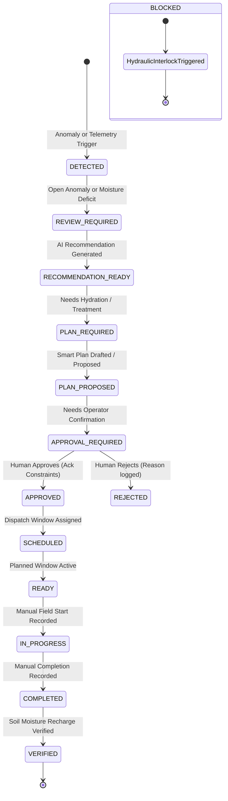
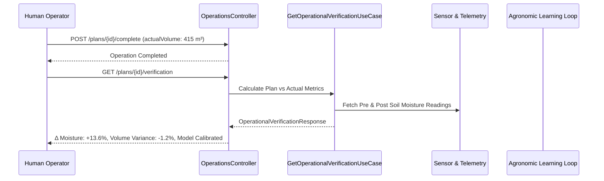

# Yangiariq Aqua AI — Decision-to-Action Operational Workflow Architecture

**Document Version:** 1.0.0  
**Milestone:** 08.5  
**Scope:** `com.aquaai.operations`, Unified Operations Workspace, Operational Workflow State Derivation, Closed-Loop Verification.

---

## 1. Executive Summary & Core Principle

In earlier milestones, Yangiariq Aqua AI developed specialized bounded contexts:
- Telemetry & Sensor Fleet (`com.aquaai.sensor`)
- Agronomic Anomaly Intelligence (`com.aquaai.anomaly`)
- AI Agronomic Recommendations (`com.aquaai.recommendation`)
- Volumetric Water Allocation & Quotas (`com.aquaai.water`)
- Smart Irrigation Planning & Scheduling (`com.aquaai.irrigation`)
- Unified Farm Intelligence Dashboard (`com.aquaai.dashboard`)

Before Milestone 08.5, an operational user navigating the platform had to perform fragmented multi-screen hops:
`Dashboard → Field List → Agronomic Recommendation → Water Quota → Plan Preparation → Plan Approval → Dispatch Schedule → Irrigation Event Log → Manual Soil Moisture Verification`.

Milestone 08.5 introduces the **Decision-to-Action Operations Center** and **Workflow Orchestration Layer** (`com.aquaai.operations`). The core principle is:
> **Workflow Orchestration + UX Layer without Domain Duplication.**  
> Existing bounded contexts remain 100% authoritative. The operations module coordinates domain aggregates into a continuous, safe, fast, and transparent workflow where a farmer or operator can move from **problem detected** to **verified field action** within a single contextual workspace.

```text
Existing Authoritative Domains
(Field, Water, Sensor, Anomaly, Recommendation, SmartPlan, IrrigationEvent)
                              │
                              ▼
        Operations Workflow Orchestration Layer
           (com.aquaai.operations - Zero N+1 Aggregator)
                              │
                              ▼
    Decision-to-Action Operations Center (Frontend UX)
  (Timeline, Telemetry, Agronomy, Constraints, Approval, Execution, Loop)
```

---

## 2. Operational Workflow State Model

The operational state is **deterministically derived** from the underlying aggregate states rather than stored in a duplicative database state machine. This preserves aggregate boundaries and guarantees zero data desynchronization.

### 2.1 State Hierarchy & Derivations



| Derived State | Authoritative Condition / Source aggregate | Allowed Contextual Action |
| :--- | :--- | :--- |
| `BLOCKED` | Hydraulic safety interlock active (`SUSPECTED_PIPE_BURST`, `WATER_PRESSURE_DROP`, or manual canal lockout). Overrides all states. | `INVESTIGATE_SAFETY` |
| `DETECTED` | Critical moisture deficit ($<15\%$) or active anomaly detected; no recommendation yet. | `REQUEST_ASSESSMENT` |
| `REVIEW_REQUIRED` | Active anomaly or telemetry staleness requiring agronomist review. | `REVIEW_ANOMALY` |
| `RECOMMENDATION_READY` | `AgronomicRecommendation` in `ACTIVE` status exists for parcel. | `PREPARE_PLAN` |
| `PLAN_REQUIRED` | Recommendation accepted or moisture deficit requires watering, but no plan prepared. | `PREPARE_PLAN` |
| `PLAN_PROPOSED` | `SmartIrrigationPlan` in `PROPOSED` status. | `APPROVE_PLAN`, `REJECT_PLAN` |
| `APPROVAL_REQUIRED` | `SmartIrrigationPlan` in `PROPOSED` status awaiting human confirmation. | `APPROVE_PLAN`, `REJECT_PLAN` |
| `APPROVED` | `SmartIrrigationPlan` in `APPROVED` status, unscheduled. | `SCHEDULE_PLAN` |
| `SCHEDULED` | `SmartIrrigationPlan` in `SCHEDULED` status, dispatch window future. | `START_OPERATION` |
| `READY` | Scheduled execution date/window is current today. | `START_OPERATION` |
| `IN_PROGRESS` | `SmartIrrigationPlan` in `IN_PROGRESS` and `IrrigationEvent` running. | `COMPLETE_OPERATION` |
| `COMPLETED` | `SmartIrrigationPlan` in `COMPLETED`, awaiting post-irrigation sensor verification. | `VERIFY_RESULT` |
| `VERIFIED` | Post-irrigation sensor readings confirm root-zone moisture recharge. | `MONITOR` |
| `REJECTED` | Proposed plan cancelled by human decision with mandatory logged reason. | `PREPARE_PLAN` |

---

## 3. Seven-Step Operational Timeline

The timeline is surfaced in both API DTOs (`WorkflowStepDto`) and UI components (`OperationalWorkflowTimeline`):

```text
┌─────────────────┐     ┌──────────────────────┐     ┌─────────────────────┐
│ 1. DETECTED     │ ──> │ 2. RECOMMENDATION    │ ──> │ 3. PLAN PROPOSED    │
│ Telemetry Deficit│     │ Root-Zone Advisory   │     │ Smart 420 m³ Plan   │
└─────────────────┘     └──────────────────────┘     └─────────────────────┘
                                                                │
                                                                ▼
┌─────────────────┐     ┌──────────────────────┐     ┌─────────────────────┐
│ 6. IN_PROGRESS  │ <── │ 5. SCHEDULED         │ <── │ 4. HUMAN APPROVAL   │
│ Manual Operation│     │ Canal Window 22:00   │     │ Mandatory Ack Check │
└─────────────────┘     └──────────────────────┘     └─────────────────────┘
         │
         ▼
┌─────────────────┐
│ 7. VERIFIED     │
│ Δ Moit: +13.6%  │
│ Learning Loop   │
└─────────────────┘
```

Each step includes:
- `stepKey`: Distinct step identifier.
- `title`: Trilingual human title (`uz`, `ru`, `en`).
- `status`: `COMPLETED`, `CURRENT`, `UPCOMING`, `BLOCKED`, `SKIPPED`, `REJECTED`.
- `timestamp`: UTC ISO timestamp of aggregate transition.
- `actor`: System engine, AI Advisor, or operator name.
- `reason`: Rationale or operational constraint evidence.
- `availableAction`: Contextual next action button trigger.

---

## 4. Precedence Constraints & Safety Interlocks

Before any plan can be prepared, approved, or scheduled, the workflow orchestrator verifies domain precedence rules in strict hierarchical order:

1. **Rule 1: Hydraulic Safety Interlock (Highest Precedence)**
   - If an active critical anomaly (`SUSPECTED_PIPE_BURST`, `WATER_PRESSURE_DROP`, or canal gate maintenance) exists on the field, the entire workflow enters `BLOCKED`.
   - Dispatch and approval actions are hard-disabled server-side and client-side.
   - Requires operator resolution of the physical hydraulic condition.

2. **Rule 2: Volumetric Water Budget Quota**
   - The parcel's seasonal water allocation quota is re-evaluated.
   - If `waterBudgetRemainingM3 < recommendedVolumeM3`, plan preparation and approval throw `BusinessRuleException` (HTTP 422: `WATER_BUDGET_EXHAUSTED`).
   - Overdrafts are strictly prevented.

3. **Rule 3: Channel Dispatch & Overlapping Window Conflict Detection**
   - Channel capacity and concurrent field dispatch are checked by `ScheduleConflictDetectionService`.
   - If another parcel on the same secondary canal is scheduled for the same time window, a `ScheduleConflict` alert is raised with automated time adjustment suggestions (e.g., shift window to 11:00 or nighttime 22:00–06:00).

---

## 5. Human Decision Guardrail (No Autonomous Actuators)

Yangiariq Aqua AI strictly implements **Decision Support and Operational Recording Only**:
- **Zero Autonomous Actuation:** The platform contains NO physical motor, valve, or actuator triggers. It never automatically opens or closes water gates.
- **Mandatory Operational Acknowledgement:**
  To approve a plan, the operator must explicitly tick the mandatory acknowledgment checkbox:
  > *"I have reviewed all operational constraints, hydraulic safety interlocks, and seasonal water limits, and I confirm the execution of this irrigation event."*
  Server-side validation enforces `@AssertTrue` on `acknowledgeConstraints`. Submissions without it are rejected with HTTP 400.
- **Rejection Accountability:**
  Rejecting a plan requires a non-blank explanation of at least 3 characters (`@NotBlank @Size(min=3, max=500)`). The cancellation reason is stored in the audit trail.
- **Manual Execution Confirmation:**
  Field starts and completions are recorded manually by the farmer or canal operator with timestamps and actual delivered volumes.

---

## 6. Closed-Loop Post-Irrigation Verification & Learning Loop

Once irrigation completes, the system closes the loop between recommendation, planned execution, and real-world results:



### Verification Metrics Computed:
- **Volume Variance:** $\Delta V = V_{actual} - V_{planned}$ and percentage variance $\frac{V_{actual} - V_{planned}}{V_{planned}} \times 100\%$.
- **Duration Variance:** $\Delta T = T_{actual} - T_{planned}$.
- **Root-Zone Moisture Delta:** $\Delta M = M_{after} - M_{before}$.
- **Recharge Success Flag:** `isRechargeSuccessful = true` if soil moisture moved into target range without exceeding field capacity.
- **Learning Evidence:** Records soil infiltration performance for model re-calibration on the parcel's specific soil texture.

---

## 7. Tenancy & Anti-IDOR Security

All operational endpoints enforce strict anti-IDOR authorization:

| Role | Permitted Operational Scope | Anti-IDOR Behavior |
| :--- | :--- | :--- |
| `ROLE_FARMER` | Parcels owned by the authenticated farmer. | Attempting to access or execute on a non-owned parcel returns **HTTP 404 Not Found** (anti-enumeration protection). |
| `ROLE_OPERATOR` | Parcels located within the operator's assigned district (`district = "Yangiariq"`). | Cross-district access returns HTTP 403 Forbidden. |
| `ROLE_ADMIN` | Global platform scope across all districts and parcels. | Full operational visibility and override audit logging. |

---

## 8. Summary of API Endpoints

| HTTP Method | Path | Description | Access Role |
| :--- | :--- | :--- | :--- |
| `GET` | `/api/v1/operations/{fieldId}/context` | Comprehensive operational context (Situation, Anomaly, Recommendation, Active Plan, Workflow Timeline, Actions) in a single zero N+1 query. | Farmer (owner), Operator, Admin |
| `POST` | `/api/v1/operations/{fieldId}/prepare-plan` | Prepares a new Smart Plan from recommendation with custom volume/date options. | Farmer (owner), Operator, Admin |
| `POST` | `/api/v1/operations/plans/{planId}/approve` | Approves plan with server-side constraint verification and mandatory checkbox. | Farmer (owner), Operator, Admin |
| `POST` | `/api/v1/operations/plans/{planId}/reject` | Rejects plan with mandatory cancellation reason. | Farmer (owner), Operator, Admin |
| `POST` | `/api/v1/operations/plans/{planId}/schedule` | Assigns hydraulic channel dispatch window with conflict detection. | Operator, Admin |
| `POST` | `/api/v1/operations/plans/{planId}/start` | Manually records start of field watering in `IrrigationEvent`. | Farmer (owner), Operator, Admin |
| `POST` | `/api/v1/operations/plans/{planId}/complete` | Manually records completion and actual delivered volume; completes recommendation. | Farmer (owner), Operator, Admin |
| `GET` | `/api/v1/operations/plans/{planId}/verification` | Returns planned vs actual metrics, moisture recharge $\Delta\%$, and learning evidence. | Farmer (owner), Operator, Admin |
