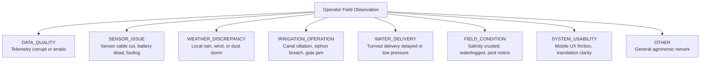
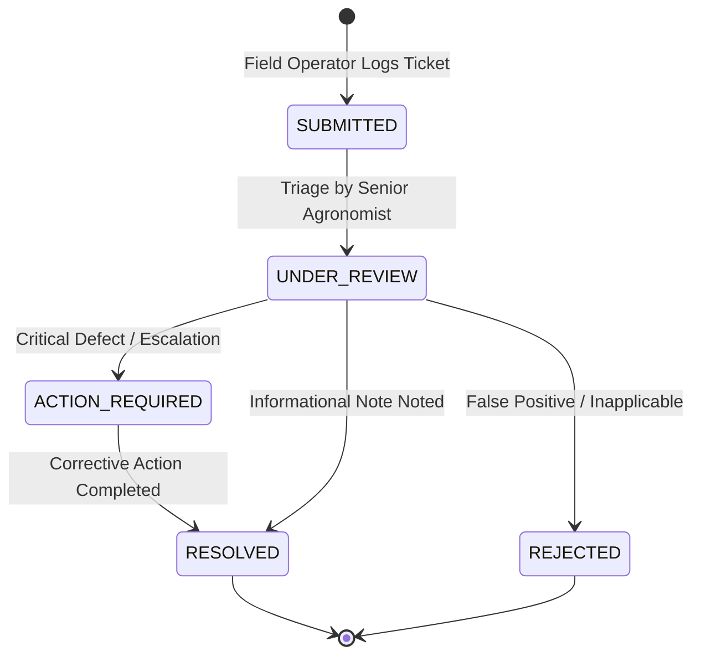

# Operator Feedback & Field Observations Workflow (Milestone 08.20)

## 1. Qualitative Intelligence in Agricultural Operations

Automated sensors and satellite models cannot detect all physical realities in Khorezm fields:
- Silt accumulation obstructing turnout headwalls.
- Salt crusting on soil surfaces misleading optical probes.
- Unscheduled canal diversions by upstream users.
- Localized microclimate convective showers missed by regional weather grids.

The **Operator Feedback & Field Observations** subsystem provides a structured channel for field operators, agronomists, and ditch riders to record empirical field conditions, operational anomalies, and system usability observations.

---

## 2. Structured Feedback Taxonomy

### Feedback Attribute Structure:
- **`id`** (`UUID`): Unique record ID.
- **`pilotId`** (`UUID`): Enrolled pilot program.
- **`farmId` / `fieldId`** (`UUID`, optional): Spatial reference to affected parcel.
- **`sensorId` / `dataSourceId`** (`UUID`, optional): Reference to specific instrument or telemetry source.
- **`incidentId`** (`UUID`, optional): Link to an existing incident in `com.aquaai.accountability`.
- **`category`** (`OperatorFeedbackCategory`): Selected taxonomy category.
- **`title`** (`VARCHAR(255)`): Concise summary.
- **`description`** (`TEXT`): Detailed qualitative observation.
- **`status`** (`OperatorFeedbackStatus`): Operational state.
- **`submittedBy`** (`UUID`): Submitting operator/farmer.
- **`assignedTo`** (`UUID`, optional): Assigned investigator/agronomist.
- **`resolutionNotes`** (`TEXT`, optional): Resolution narrative.

---

## 3. Feedback Lifecycle & Incident Escalation

### Escalation Path to Incident Governance:
When feedback indicates a systemic discrepancy (e.g., *Sensor reads 45% moisture while field soil is bone dry, causing over-irrigation recommendations*):
1. The agronomist updates feedback status to `ACTION_REQUIRED`.
2. A formal investigation incident is spawned in `com.aquaai.accountability` referencing `feedbackId`.
3. An assigned water technician inspects the sensor, logs root causes (e.g., probe detached from soil matrix), and tracks corrective action to resolution.
4. The feedback ticket is linked to the incident ID and closed with `resolutionNotes`.

---

## 4. Human-in-the-Loop Operational Constraint

Feedback submissions **never directly actuate physical machinery or alter water ledger quotas**:
- Operational allocations cannot be automatically modified by feedback text.
- Pump motors, canal gates, and solenoid valves cannot be commanded.
- All recommendations require human review and confirmation by authorized operators.
