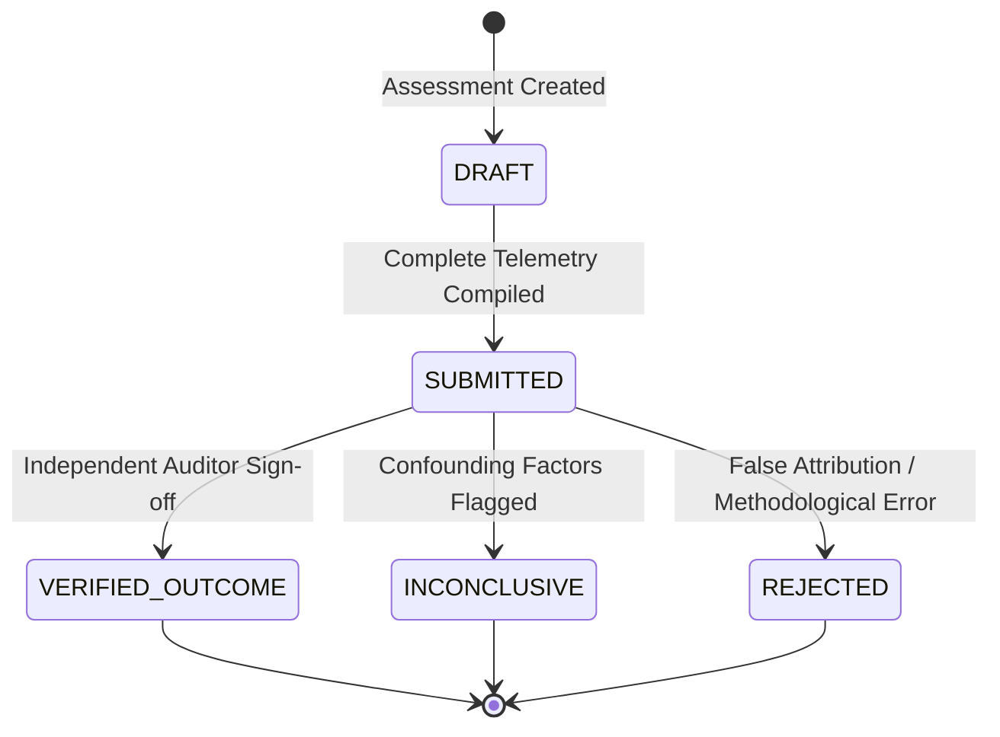

# Outcome and Evidence-Based Impact Assessment

## 1. The Attribution Hierarchy

In water resources management, attributing a beneficial change (such as reduced conveyance loss or improved crop water access) to a specific intervention (such as canal relining or dispatch rescheduling) requires rigorous causal inference.

The platform defines five conservative attribution levels in `AttributionLevel`:

| Attribution Level | Criteria & Necessary Evidence | Permissible Claims |
| :--- | :--- | :--- |
| **`DIRECTLY_VERIFIED`** | Direct physical observation; counterfactual verified baseline; known confounding variables (rainfall, upstream discharge) measured and ruled out; independent on-site audit signed. | "The concrete relining of reach PK4-PK8 caused a verified 7.3% reduction in percolation loss." |
| **`STRONGLY_ASSOCIATED`** | High temporal and physical correlation; verified baseline; some minor confounding factors unmeasured but unlikely to account for the magnitude of change. | "Optimized schedule dispatch strongly correlates with a 6.8% increase in tail-end delivery fulfillment." |
| **`ASSOCIATED`** | Positive outcome observed after intervention, but baseline was estimated or climatic variation (e.g., unusual precipitation) could explain part of the change. | "A 12% drop in canal water draw coincided with the smart irrigation alert deployment." |
| **`INCONCLUSIVE`** | Post-intervention metrics improved, but contradictory sensor readings, missing periods, or severe unmeasured confounding events occurred. | "Data inconclusive; river intake fluctuated wildly during the assessment period." |
| **`NOT_ASSESSABLE`** | Baseline missing, data quality below minimum threshold, or post-intervention observation period was too short. | "Cannot assess; fewer than 10 days of valid telemetry recorded." |

---

## 2. Invariant Attribution Constraints

The `ImpactAttributionEngine` enforces mathematical and domain invariants:

1. **Simulated Baseline Constraint**:
   If `baselineQuality == SIMULATED_BASELINE` or `ESTIMATED_BASELINE`, the attribution level is automatically capped at `ASSOCIATED` or `INCONCLUSIVE`. It can **NEVER** be classified as `DIRECTLY_VERIFIED`.

2. **Simulated Post-Intervention Telemetry Constraint**:
   If post-intervention evidence is `SIMULATED` (e.g., from an ML model rather than ultrasonic flow meters), the assessment cannot claim verified regional impact.

3. **Confounder Disclosure**:
   The `confoundingFactors` field is mandatory when significant weather anomalies (rainfall $> 10\ mm/day$, extreme heat waves) occur during the evaluation window.

---

## 3. Independent Audit & Verification Lifecycle

To maintain separation of duties:
- An operator or field technician cannot approve their own proposed impact assessment.
- `ReviewImpactAssessmentUseCase` requires authorization, immutable reviewer recording, and mandatory review notes.
