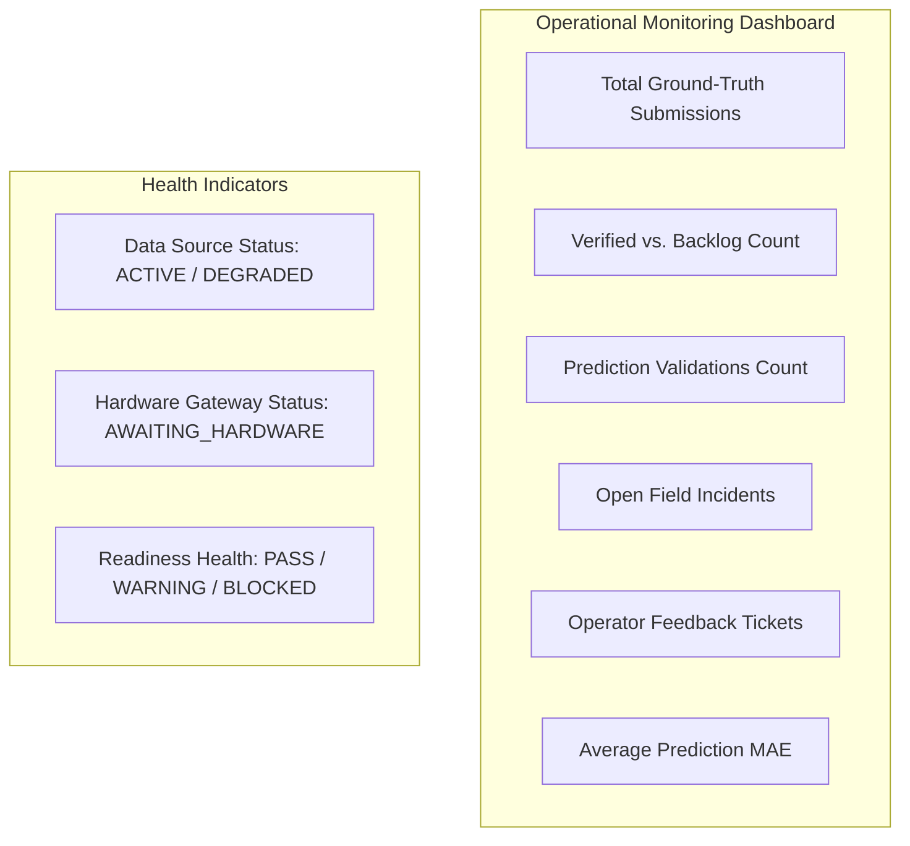

# Pilot Operational Monitoring & Telemetry Health (Milestone 08.20)

## 1. Architectural Purpose & Module Reuse

The **Pilot Operational Monitoring** subsystem provides operators and water managers with continuous visibility into the operational health, data flow, and verification velocity of active field pilots.

Rather than creating a isolated telemetry pipeline, the pilot monitoring layer synthesizes signals from:
- **`com.aquaai.integration`**: External weather client latency, HTTP sensor gateway health, CSV batch statuses, data quality rules.
- **`com.aquaai.pilot`**: Ground-truth submission rates, four-eyes verification backlog, prediction matching rates.
- **`com.aquaai.accountability`**: Pilot-linked incidents, root cause analyses, and SLA compliance.
- **`com.aquaai.risk`**: Field stress anomalies and hydraulic distribution alerts.

---

## 2. Core Operational Metrics & KPIs



### 2.1 Monitored Indicators Specification

| Indicator | Definition | Calculation Method | Evidence Class | Known Limitations |
| :--- | :--- | :--- | :--- | :--- |
| **`totalGroundTruthMeasurements`** | Count of all physical ground-truth records registered for the pilot. | `COUNT(*) FROM ground_truth_validations WHERE pilot_id = :id` | `OBSERVED` | Reflects manual submission activity; unverified entries await review. |
| **`verifiedGroundTruths`** | Count of ground-truth measurements verified under the four-eyes rule. | `COUNT(*) WHERE verification_status = 'VERIFIED'` | `VERIFIED` | Subject to reviewer availability. |
| **`verificationBacklog`** | Count of submitted readings pending independent review. | `COUNT(*) WHERE verification_status = 'SUBMITTED'` | `OBSERVED` | High backlog indicates reviewer bottleneck. |
| **`totalPredictionValidations`** | Count of paired forecast vs verified actual comparisons. | `COUNT(*) FROM pilot_prediction_validations WHERE pilot_id = :id` | `VERIFIED` | Requires matching temporal horizon and verified GT. |
| **`averagePredictionMae`** | Aggregate Mean Absolute Error across all paired predictions. | `AVG(absolute_error) FROM pilot_prediction_validations` | `VERIFIED` | Skewed if sample size is small ($N < 10$). |
| **`openIncidentsCount`** | Active anomalies, equipment failures, or discrepancies linked to pilot parcels. | `COUNT(*) FROM incidents WHERE status IN ('OPEN', 'INVESTIGATING')` | `OBSERVED` | Relies on manual or automated trigger detection. |
| **`operatorFeedbackCount`** | Qualitative feedback and field notes submitted by operators. | `COUNT(*) FROM pilot_operator_feedback WHERE pilot_id = :id` | `OBSERVED` | Subjective observations by field personnel. |

---

## 3. Strict Evidence Transparency & Classifications

Every monitoring surface and KPI card in **YANGIARIQ AQUA AI** displays explicit evidence tags to prevent data misinterpretation:

1. **`OBSERVED`**: Real-world raw submission, log entry, or qualitative ticket recorded by an identified user.
2. **`VERIFIED`**: Independently attested by a secondary user with accompanying physical evidence or calibration record.
3. **`ESTIMATED` / `CALCULATED`**: Algorithmic derivative (e.g., Penman-Monteith ET₀, canal conveyance loss estimate).
4. **`SIMULATED`**: Synthetic generation. **Strictly excluded from pilot reliability scoring.**

---

## 4. REST API Endpoint

### `GET /api/v1/pilot-evaluations/pilot/{pilotId}/monitoring`
Returns operational metrics and active counts:
```json
{
  "success": true,
  "data": {
    "pilotId": "b134887a-a4a9-467f-9be1-08191f630800",
    "totalGroundTruthMeasurements": 24,
    "verifiedGroundTruths": 22,
    "totalPredictionValidations": 18,
    "averagePredictionMae": 2.14,
    "openIncidents": 1,
    "operatorFeedbackCount": 5,
    "pilotStatus": "ACTIVE"
  },
  "timestamp": "2026-11-09T11:45:00Z"
}
```
