# Evidence-Based Pilot Outcome & Impact Evaluation (Milestone 08.20)

## 1. Executive Mandate for Defensible Evaluation

A central tenet of **YANGIARIQ AQUA AI** is scientific and operational integrity: **A successful software deployment is not proof of agricultural water savings or yield improvement.**

In commercial agriculture, unsubstantiated claims of water conservation or productivity gains undermine trust with water basin authorities, irrigation engineers, and farming cooperatives. 

The **Pilot Outcome & Impact Evaluation** engine creates immutable, auditable **Evaluation Snapshots** that synthesize verified field data while explicitly separating directly observed realities from mathematical models, unmeasured variables, and known technical limitations.

---

## 2. The Four Pillars of Pilot Evaluation

```mermaid
graph TD
    PES[Pilot Evaluation Snapshot]

    subgraph 1. Data Performance
        DP1[Measurement Completeness]
        DP2[Data Quality Pass Rate]
        DP3[Provider Availability %]
        DP4[Four-Eyes Verification Coverage]
    end

    subgraph 2. Prediction Performance
        PP1[Mean Absolute Error MAE]
        PP2[Root Mean Square Error RMSE]
        PP3[Forecast Bias MBE]
        PP4[Sample Size Sufficiency N >= 30]
    end

    subgraph 3. Operational Performance
        OP1[Mean Incident Resolution Time]
        OP2[Operator Feedback Volume]
        OP3[Corrective Action Completion Rate]
        OP4[Audit Trail Compliance]
    end

    subgraph 4. Water Management Outcomes
        WO1[Verified Water Deliveries m3]
        WO2[Allocation Quota Adherence %]
        WO3[Conveyance Efficiency Indicators]
        WO4[Distribution Equity Coefficients]
    end

    PES --> DP1 & DP2 & DP3 & DP4
    PES --> PP1 & PP2 & PP3 & PP4
    PES --> OP1 & OP2 & OP3 & OP4
    PES --> WO1 & WO2 & WO3 & WO4
```

### 2.1 Data Performance Indicators
- **Measurement Completeness**: Percentage of scheduled sampling intervals where real measurements were recorded.
- **Verification Coverage**: Ratio of ground-truth measurements verified under the four-eyes rule:
  $$\text{Coverage} = \frac{N_{\text{verified}}}{N_{\text{submitted}}} \times 100\%$$
- **Provider Availability**: Percentage of successful calls to registered weather APIs or gateway endpoints without timeout or fallback.

### 2.2 Prediction Performance Indicators
- Evaluates operational models against four-eyes verified actuals.
- Documents sample size $N$. If $N < 30$, flags: `INSUFFICIENT_SAMPLE_SIZE: Statistical significance cannot be inferred`.
- Compares champion model error with baseline climatology.

### 2.3 Operational Performance Indicators
- Response time from operator feedback submission to agronomist review.
- Number of pilot-related incidents resolved vs outstanding.
- Operator protocol compliance (sampling on schedule, complete evidence notes).

### 2.4 Water Management Outcomes
- Synthesizes water accounting ledger figures (`com.aquaai.wateraccounting`).
- Quota compliance: Compares actual delivered volume against approved seasonal water allocation.
- Turnout distribution equity (Gini coefficient / Theil index) across participating canals.

---

## 3. Strict Separation of Evidence Tiers (Non-Negotiable)

To prevent marketing exaggerations or false claims, evaluation reports must categorize all outcome claims into five distinct evidentiary tiers:

| Tier | Category | Definition | Example in Report |
| :---: | :--- | :--- | :--- |
| **I** | **Directly Observed** | Physically measured with calibrated instruments under four-eyes verification. | *Turnout #3 delivered 4,200 m³ over 4 irrigation turns as measured by ultrasonic flow meter (CERT-881).* |
| **II** | **Calculated Indicator** | Deterministic mathematical formulas applied strictly to verified Tier I observations. | *Specific water consumption was calculated as 680 m³/ha across the 6.2 ha enrolled drip parcel.* |
| **III** | **Estimated Outcome** | Inferences derived from empirical agronomic or hydrological models. | *Model estimated crop ET at 4.2 mm/day based on FAO-56 Penman-Monteith equation.* |
| **IV** | **Simulated Scenario** | Synthetic or counter-factual scenarios (*"What would have happened under conventional furrow?"*). | *Simulated counterfactual indicates furrow irrigation would have consumed ~5,100 m³.* |
| **V** | **Unmeasured Outcome** | Agronomic or financial factors not measured during the pilot. | *Crop yield impact at harvest: UNMEASURED (pilot concluded prior to mechanical harvest).* |

---

## 4. Truthful Claims Governance

1. **No Water Savings Claims Without Baseline**: The platform **prohibits** claiming water savings unless:
   - A verified historical baseline for the exact same parcel exists; OR
   - A concurrent side-by-side control parcel was monitored under identical weather conditions.
2. **No Yield Improvement Claims Without Field Evidence**: The platform **prohibits** claiming crop yield increases without physical weighbridge receipts, harvest sampling, or certified farmer harvest declarations.
3. **Mandatory Limitations Disclosure**: Every evaluation snapshot requires an explicit `limitationsText` narrative detailing missing sensors, network drops, small sample sizes, or weather anomalies.
