# Pilot Readiness Assessment Framework (Milestone 08.20)

## 1. Executive Purpose & Scope

The **Pilot Readiness Assessment** acts as an automated multi-dimensional gatekeeper that evaluates the operational feasibility and systemic integrity of a pilot program before it can be activated in the field.

In operational agriculture, initiating a field evaluation without adequate operator coverage, verified physical instrumentation, or administrative sign-off introduces critical risks:
- Unverified manual data entries compromising machine learning baselines.
- Operator confusion regarding four-eyes attestation roles.
- Hardware absence masking as network outages.
- Lack of emergency escalation pathways during canal breaches or acute crop water stress.

To prevent these hazards, **YANGIARIQ AQUA AI** rejects simplistic percentage readiness scores. Instead, every readiness evaluation analyzes concrete criteria across four foundational categories, producing explicit statuses (`PASS`, `WARNING`, `BLOCKED`, `NOT_ASSESSED`) backed by auditable evidence.

---

## 2. Readiness Categories & Evaluation Criteria

```mermaid
graph TD
    PRA[Pilot Readiness Assessment]
    
    subgraph 1. Infrastructure Readiness
        IR1[Backend API Availability]
        IR2[PostgreSQL DB Connectivity]
        IR3[Liquibase Schema Integrity]
        IR4[Production Backup Readiness]
        IR5[Observability & Health Probes]
    end

    subgraph 2. Data Readiness
        DR1[External Data Sources Enrolled]
        DR2[Weather Provider / Fallback Status]
        DR3[Sensor Gateway Contract & HW State]
        DR4[Manual Measurement Workflow]
        DR5[Data Quality & Provenance Tracking]
    end

    subgraph 3. Operational Readiness
        OR1[Responsible Field Operators Assigned]
        OR2[Participating Field Polygons Mapped]
        OR3[Measurement Protocols Specified]
        OR4[Four-Eyes Verifiers Designated]
        OR5[Incident Escalation SLA Configured]
    end

    subgraph 4. Governance Readiness
        GR1[Administrative Approval Logged]
        GR2[Participant Consent & RBAC Boundaries]
        GR3[Independent Verification Enforced]
        GR4[Human Oversight Boundary Guaranteed]
    end

    PRA --> IR1 & IR2 & IR3 & IR4 & IR5
    PRA --> DR1 & DR2 & DR3 & DR4 & DR5
    PRA --> OR1 & OR2 & OR3 & OR4 & OR5
    PRA --> GR1 & GR2 & GR3 & GR4
```



### 2.1 Infrastructure Readiness (`INFRASTRUCTURE`)
| Check Item | Evaluation Method | Mandatory | Expected Result |
| :--- | :--- | :---: | :--- |
| **Backend REST API** | Actuator `/actuator/health` probe check. | Yes | `PASS` if status is `UP`. |
| **PostgreSQL Database** | Validates connection pool and read/write execution against core schemas. | Yes | `PASS` if query latency < 100ms. |
| **Liquibase Migration State** | Inspects `DATABASECHANGELOG` up to changeset `027`. | Yes | `PASS` if all changesets applied. |
| **Backup & Recovery Verification** | Inspects presence of verified database backup procedures (`backups/`). | No | `PASS` if backup verified within 24h, else `WARNING`. |
| **Observability Telemetry** | Verifies Micrometer metrics and SLF4J structured logging. | No | `PASS` if metrics registry active. |

### 2.2 Data Readiness (`DATA`)
| Check Item | Evaluation Method | Mandatory | Expected Result |
| :--- | :--- | :---: | :--- |
| **Data Sources Registry** | Checks if at least one ingestion source is registered in `data_sources`. | Yes | `PASS` if count >= 1; `BLOCKED` if 0. |
| **Weather Adapter Readiness** | Checks external Open-Meteo client or configured fallback adapter. | No | `PASS` if active; `WARNING` if operating on synthetic fallback. |
| **IoT Sensor Gateway** | Evaluates HTTP gateway state for registered sensors. | No | `PASS` if real IoT gateway connected; `WARNING` with status `AWAITING_HARDWARE` if physical sensors are pending installation. |
| **Manual Measurement Pipeline** | Verifies `manual_measurements` ingestion tables and API endpoints are functional. | Yes | `PASS` when endpoints return HTTP 200. |
| **Data Quality Monitoring** | Checks whether freshness and range validation rules are active. | Yes | `PASS` if data quality validator runs without exceptions. |

### 2.3 Operational Readiness (`OPERATIONAL`)
| Check Item | Evaluation Method | Mandatory | Expected Result |
| :--- | :--- | :---: | :--- |
| **Operator Assignment** | Verifies at least one user with role `OPERATOR` or `AGRONOMIST` is enrolled in `pilot_participants`. | Yes | `PASS` if count >= 1; `BLOCKED` if 0 operators assigned. |
| **Field Parcels Enrolled** | Verifies at least one valid parcel is enrolled in `pilot_fields`. | Yes | `PASS` if count >= 1; `BLOCKED` if 0 fields enrolled. |
| **Measurement Plan Defined** | Inspects `pilot_fields.measurement_plan` to ensure non-empty instructions exist. | Yes | `PASS` if all fields have defined plans; `BLOCKED` if empty. |
| **Independent Verifier Assigned** | Verifies at least two distinct users are enrolled so the four-eyes principle can be satisfied. | Yes | `PASS` if >= 2 distinct participants; `BLOCKED` if only 1 user enrolled. |
| **Incident Escalation SLA** | Checks `accountability` module SLA and escalation routing. | No | `PASS` if SLA rules configured; else `WARNING`. |

### 2.4 Governance Readiness (`GOVERNANCE`)
| Check Item | Evaluation Method | Mandatory | Expected Result |
| :--- | :--- | :---: | :--- |
| **Program Approval** | Verifies `pilot_programs.approved_by` is not null and status is `APPROVED` or higher. | Yes | `PASS` if approved; `BLOCKED` if status is `DRAFT` or `PLANNED`. |
| **RBAC Isolation** | Verifies farmer role tenancy and security context isolation. | Yes | `PASS` if security rules enforce tenant boundaries. |
| **Four-Eyes Enforcement** | Validates domain rule prohibiting submitters from verifying their own measurements. | Yes | `PASS` if domain unit test confirms rule. |
| **No-Actuation Guarantee** | Confirms no physical valve/pump actuator libraries are linked in classpath. | Yes | `PASS` if ArchUnit rule 118 passes. |

---

## 3. Assessment Decision Logic & Aggregation Rules

The evaluation result is aggregated deterministically by `PilotReadinessAssessment.evaluate()`:

```java
public static PilotReadinessAssessment evaluate(
        UUID pilotId,
        UUID assessedBy,
        List<PilotReadinessCheck> checks
) {
    boolean hasMandatoryBlocked = checks.stream()
            .anyMatch(c -> c.isMandatory() && c.getResult() == ReadinessResult.BLOCKED);

    boolean hasAnyWarning = checks.stream()
            .anyMatch(c -> c.getResult() == ReadinessResult.WARNING);

    ReadinessResult overallStatus;
    if (hasMandatoryBlocked) {
        overallStatus = ReadinessResult.BLOCKED;
    } else if (hasAnyWarning) {
        overallStatus = ReadinessResult.WARNING;
    } else {
        overallStatus = ReadinessResult.PASS;
    }

    // Category aggregations...
    return new PilotReadinessAssessment(
            UUID.randomUUID(),
            pilotId,
            overallStatus,
            infraStatus,
            dataStatus,
            opStatus,
            govStatus,
            checks,
            assessedBy,
            Instant.now()
    );
}
```

### Gatekeeper Rules:
1. **`BLOCKED` on Any Mandatory Check**: The pilot program cannot transition to `READY` or `ACTIVE`. Any attempt to call `/api/v1/pilot-programs/{id}/activate` throws `IllegalStateException`.
2. **`WARNING` on Non-Mandatory Check**: Allowed to proceed if documented with explicit rationale (e.g., *Operating via manual TDR sampling while IoT hardware is awaiting installation*).
3. **Audit Trail**: Every assessment execution stores who assessed it (`assessedBy`), exact timestamp (`assessedAt`), and complete serialized JSON payload of all individual checks in `pilot_readiness_assessments`.
