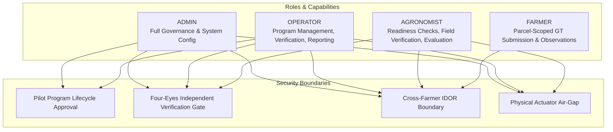

# Pilot Security, Access Governance & Four-Eyes Integrity (Milestone 08.20)

## 1. Security Architecture & Role-Based Authorization

The **Pilot Governance Architecture** operates within the Spring Security JWT framework, enforcing strict separation of duties, role-based authorization, and parcel-level tenancy isolation across all pilot operations.



---

## 2. Role-Based Permissions Matrix

| Pilot Operation | Endpoint | Permitted Roles | Security Rule / Constraint |
| :--- | :--- | :--- | :--- |
| **List Pilot Programs** | `GET /api/v1/pilot-programs` | Authenticated | Available to all authenticated users. |
| **Create Pilot Program** | `POST /api/v1/pilot-programs` | `OPERATOR`, `ADMIN`, `AGRONOMIST` | Creates program in `DRAFT` status; records `ownerId`. |
| **Approve Pilot Program** | `POST /api/v1/pilot-programs/{id}/approve` | `OPERATOR`, `ADMIN` | Requires authorized sign-off; transitions to `APPROVED`. |
| **Activate Pilot Program** | `POST /api/v1/pilot-programs/{id}/activate` | `OPERATOR`, `ADMIN` | Fails if mandatory readiness checks are `BLOCKED`. |
| **Assess Readiness** | `POST /api/v1/pilot-readiness/{id}/assess` | `OPERATOR`, `ADMIN`, `AGRONOMIST` | Runs multi-dimensional evaluation; records assessor. |
| **Submit Ground Truth** | `POST /api/v1/pilot-ground-truth/pilot/{id}` | `OPERATOR`, `ADMIN`, `AGRONOMIST`, `FARMER` | Farmers can only submit for fields they own/lease. |
| **Review Ground Truth** | `POST /api/v1/pilot-ground-truth/{id}/review` | `OPERATOR`, `ADMIN`, `AGRONOMIST` | **Four-Eyes rule: Verifier ID != Submitter ID.** |
| **Evaluate Prediction** | `POST /api/v1/pilot-validation/pilot/{id}` | `OPERATOR`, `ADMIN`, `AGRONOMIST` | Links verified ground truth to forecast horizons. |
| **Submit Feedback** | `POST /api/v1/pilot-feedback/pilot/{id}` | `OPERATOR`, `ADMIN`, `AGRONOMIST`, `FARMER` | Farmers can only submit for fields they own/lease. |
| **Generate Report Snapshot**| `POST /api/v1/pilot-evaluations/pilot/{id}/report`| `OPERATOR`, `ADMIN` | Creates immutable evaluation snapshot in database. |

---

## 3. Four-Eyes Verification Governance

The four-eyes principle prevents data tampering, accidental self-attestation, and single-operator bias:

1. **Domain Layer Guard**:
   In `GroundTruthMeasurement.java`:
   ```java
   if (Objects.equals(this.submittedBy, verifierId)) {
       throw new IllegalArgumentException(
           "Four-Eyes Principle Violation: Submitter cannot verify their own measurement"
       );
   }
   ```
2. **API Layer Exception Handling**:
   Self-verification attempts return HTTP 400 Bad Request with an explicit error payload, preventing the transaction from committing.
3. **Audit Trail**:
   Both `submittedBy` and `verifierId` are foreign keys to the `users` table, accompanied by timestamps (`submittedAt`, `verifiedAt`) and audit notes.

---

## 4. Tenant Isolation & IDOR Protection

1. **Farmer Scoped Access**: Users with the `FARMER` role are strictly restricted to field parcels mapped to their ownership ID (`com.aquaai.field`).
2. **Cross-Farmer IDOR Prevention**: Attempting to submit ground-truth readings or operator feedback against a parcel owned by another farmer is rejected with HTTP 403 Forbidden.
3. **Pilot Program Boundary**: Only participants enrolled in `pilot_participants` have operational authority to submit or review measurements within that pilot.

---

## 5. Architectural Actuator Air-Gap

The platform strictly disallows physical actuator control:
- **Zero Actuation Libraries**: Classpath is audited via ArchUnit Rule 118:
  ```java
  @Test
  @DisplayName("118. Pilot module must not depend on physical actuation SDKs")
  void pilotMustNotDependOnActuation() {
      noClasses()
          .that().resideInAPackage("..pilot..")
          .should().dependOnClassesThat().resideInAnyPackage("com.pi4j..", "com.fazecast.jSerialComm..")
          .check(importedClasses);
  }
  ```
- All platform outputs remain **advisory decision support** for human water managers and farmers.
