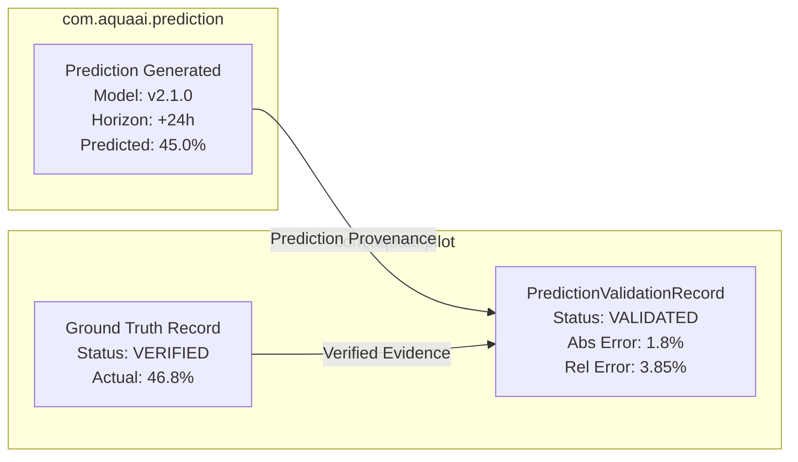

# Prediction vs. Actual Outcome Validation (Milestone 08.20)

## 1. Architectural Purpose & Module Reuse

In prior milestones (08.07–08.11), **YANGIARIQ AQUA AI** built an extensive predictive intelligence pipeline with model governance, versioning, backtesting, and challenger model comparison (`com.aquaai.prediction`).

Milestone 08.20 **extends this existing architecture** specifically for field pilots by linking machine-generated predictions directly with **four-eyes verified ground-truth observations** collected in the pilot parcels.

---

## 2. Quantitative Error Metrics & Calculation Standards

Prediction validation compares continuous agronomic or hydraulic variables (e.g., soil moisture, evapotranspiration, canal discharge rate):

### 2.1 Single Observation Metrics
- **Absolute Error ($AE$)**:
  $$AE = |y_{\text{actual}} - \hat{y}_{\text{pred}}|$$
- **Relative Error Percentage ($RE\%$)**:
  $$RE\% = \frac{|y_{\text{actual}} - \hat{y}_{\text{pred}}|}{|y_{\text{actual}}|} \times 100\% \quad (y_{\text{actual}} \neq 0)$$

### 2.2 Aggregated Pilot Dataset Metrics
For a cohort of $N$ verified comparisons:
- **Mean Absolute Error (MAE)**:
  $$\text{MAE} = \frac{1}{N} \sum_{i=1}^N |y_i - \hat{y}_i|$$
- **Root Mean Squared Error (RMSE)**:
  $$\text{RMSE} = \sqrt{\frac{1}{N} \sum_{i=1}^N (y_i - \hat{y}_i)^2}$$
- **Mean Bias Error (MBE)**:
  $$\text{MBE} = \frac{1}{N} \sum_{i=1}^N (\hat{y}_i - y_i)$$
  *(Positive indicates systematic over-prediction; negative indicates under-prediction)*.

---

## 3. Evaluation Statuses & Decision States

Every comparison record is classified into an explicit operational state:

| Status | Meaning | Operational Consequence |
| :--- | :--- | :--- |
| **`VALIDATED`** | Valid pairing between model prediction and an independently verified ground-truth record. | Error metrics computed and ingested into pilot statistical aggregates. |
| **`VALIDATION_PENDING`** | Prediction registered and awaiting field ground-truth verification. | Pending four-eyes attestation of the field sample. |
| **`INSUFFICIENT_DATA`** | Field observation sample size is below statistical significance ($N < 10$). | Error calculated for single point, but flagged as insufficient for model governance decisions. |
| **`INVALID_COMPARISON`** | Mismatch in temporal horizon (e.g., comparing a 24h forecast with a 7-day observation) or differing spatial parcel. | Excluded from pilot evaluation metrics; discrepancy logged. |

---

## 4. Strict Validation Governance Rules

1. **Exclusion of Simulated Data**: Under no circumstances may synthetic telemetry from `SimulatedSensorProvider` be passed as the `actualValue` in `EvaluatePredictionRequest`. Comparisons must cite an authentic `groundTruthId` in `VERIFIED` status.
2. **Temporal Alignment**: The actual measurement timestamp must fall within the prediction horizon window:
   $$|t_{\text{measured}} - (t_{\text{predicted}} + \Delta t_{\text{horizon}})| \le \text{tolerance (e.g., 2 hours)}$$
3. **Spatial Integrity**: Forecasts generated for Parcel A cannot be evaluated against ground-truth readings collected in Parcel B.
4. **No Automated Model Promotion**: Even if a challenger model demonstrates a lower MAE across 15 pilot points, the system **never automatically promotes** the challenger model to champion in production. Model promotion requires formal agronomic committee sign-off, full seasonal backtesting, and minimum sample size thresholds ($N \ge 50$).
