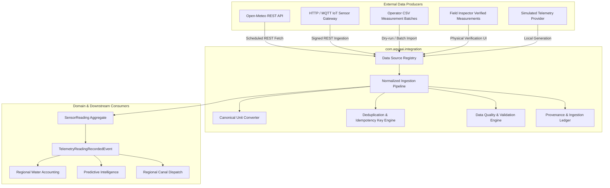

# Real-World Data Integration Architecture & Strategy

## 1. Overview & Vision
YANGIARIQ AQUA AI is an agricultural water intelligence and regional water management platform operating across Khorezm, Uzbekistan. Milestone 08.19 establishes a production-grade external data integration foundation that receives, validates, normalizes, stores, monitors, and traces incoming telemetry and environmental data from real-world sources.

The platform provides a controlled transition path from initial simulated inputs toward physically verified real-world data without breaking existing predictive intelligence, water accounting, canal network dispatch, risk evaluation, or operational governance modules.

## 2. Core Architectural Principles
1. **Clean Architecture Isolation**: All data acquisition, normalization, gateway connectors, and CSV parsers reside in the `com.aquaai.integration` bounded context.
2. **Provenance Preservation**: Every single measurement persists an audit-grade `IngestedProvenance` record capturing source ID, idempotency key, raw values, canonical units, quality status, and explicit evidence classification.
3. **No Phantom Observations**: Simulated data is explicitly labeled `SIMULATED` and will **never** automatically graduate to `OBSERVED` or `VERIFIED` without physical operator proof.
4. **Resilient Fail-Safe Execution**: External API outages (e.g., weather timeouts, rate limits) fail gracefully with circuit breaker isolation, falling back without crashing domain services or corrupting data ledgers.
5. **No Actuation Safeguard**: YANGIARIQ AQUA AI provides water intelligence, distribution equity, and irrigation planning. It does **not** perform autonomous pump, valve, or canal gate actuation.

## 3. Technology Stack & Integration Topology
- **Backend Framework**: Spring Boot 3.3.4, Java 21, Spring Security (JWT / RBAC).
- **Database**: PostgreSQL 16 with Liquibase migration changelog `026-create-data-integration-tables.sql`.
- **Deduplication Engine**: SHA-256 / formatted natural idempotency keys (`sourceCode:externalRecordId` or `sourceCode:fieldId:sensorType:timestamp`).
- **Frontend Stack**: Vite 5.4, React 18, TypeScript, Tailwind CSS, TanStack Query v5, Lucide Icons.
- **Languages**: Uzbek (`uz`), Russian (`ru`), and English (`en`).
