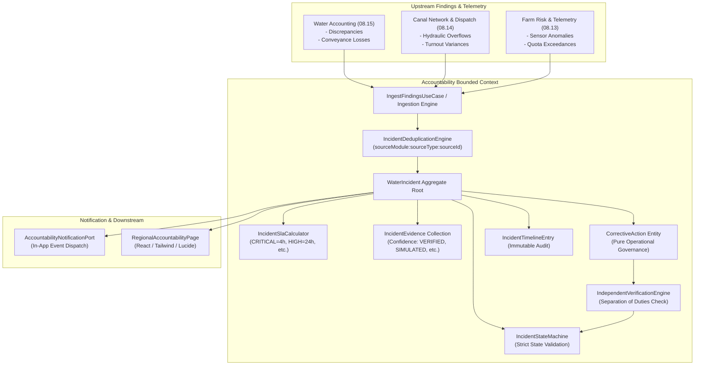

# Regional Water Accountability Architecture
# Yangiariq Aqua AI — Milestone 08.16

## 1. System Context & Bounded Context

The **Regional Water Accountability, Incident Investigation & Corrective Action Governance** bounded context (`com.aquaai.accountability`) introduces an evidence-based operational governance layer on top of the existing **YANGIARIQ AQUA AI** platform.

It does **not** duplicate predictive models, canal hydraulics, water accounting, or general task management. Instead, it serves as the operational accountability bridge that converts suspected or verified findings (water balance discrepancies, conveyance losses, quota over-allocations, hydraulic limit exceedances, and telemetry sensor drifts) into auditable investigations, structured corrective actions, and independently verified resolutions.



---

## 2. Core Architectural Principles

1. **Evidence-Based, Non-Accusatory Governance**:
   - The platform never automatically accuses a person, Water User Association (WUA), farm, or operator of wrongdoing or water theft.
   - Discrepancies and losses are treated as *physical and operational observations* until proven otherwise through field investigation.
   - Physical evidence, independent inspections, and acoustic flow cross-checks form the only basis for formal findings.

2. **Strict Separation of Duties (Four-Eyes Principle)**:
   - The owner or implementer of a corrective action cannot verify or sign off on their own work.
   - `IndependentVerificationEngine` strictly enforces `!actionOwnerId.equals(verifierId)`.
   - The only exception is an explicitly documented administrative override (`administrativeOverride = true`) containing mandatory emergency justification.

3. **Non-Actuation (Zero Physical Gate Manipulation)**:
   - The accountability module governs human operational workflows, investigation notes, and repair verification.
   - It possesses **zero** direct physical control, actuator manipulation, or pump telemetry triggering capability, strictly adhering to safety boundary rules.

4. **Preservation of Evidence Lineage**:
   - Data classifications (`VERIFIED`, `PARTIALLY_VERIFIED`, `UNVERIFIED`, `SIMULATED`, `INSUFFICIENT_DATA`) are immutable.
   - Simulated or estimated data (e.g., Saint-Venant 1D hydraulics) can never be promoted to `VERIFIED` without physical on-site sensor or manual measurements.

5. **Clean Hexagonal Architecture**:
   - Domain layer (`com.aquaai.accountability.domain`) has zero framework dependencies (pure Java, record types, immutable data models).
   - Domain ports decouple application logic from persistence, messaging, and upstream bounded contexts.

---

## 3. Package Structure

```
com.aquaai.accountability/
├── domain/
│   ├── IncidentCategory.java
│   ├── IncidentSeverity.java
│   ├── EvidenceConfidence.java
│   ├── IncidentStatus.java
│   ├── ActionStatus.java
│   ├── VerificationOutcome.java
│   ├── WaterIncident.java
│   ├── IncidentEvidence.java
│   ├── CorrectiveAction.java
│   ├── IncidentVerification.java
│   ├── IncidentTimelineEntry.java
│   ├── IncidentStateMachine.java
│   ├── IncidentSlaCalculator.java
│   ├── IndependentVerificationEngine.java
│   ├── IncidentDeduplicationEngine.java
│   └── port/
│       ├── IncidentRepository.java
│       ├── IncidentEvidenceRepository.java
│       ├── CorrectiveActionRepository.java
│       ├── IncidentVerificationRepository.java
│       ├── IncidentTimelineRepository.java
│       ├── AccountabilityNotificationPort.java
│       ├── AccountabilityNetworkPort.java
│       ├── AccountabilityFieldPort.java
│       └── AccountabilityWaterAccountingPort.java
├── application/
│   ├── CreateIncidentCommand.java
│   ├── ReviewIncidentCommand.java
│   ├── AssignInvestigatorCommand.java
│   ├── RecordInvestigationCommand.java
│   ├── AttachEvidenceCommand.java
│   ├── ProposeActionCommand.java
│   ├── ApproveActionCommand.java
│   ├── CompleteActionCommand.java
│   ├── VerifyResolutionCommand.java
│   ├── ReopenIncidentCommand.java
│   ├── IncidentDetailsDto.java
│   ├── AccountabilityDashboardSummary.java
│   └── usecase/
│       ├── CreateIncidentUseCase.java
│       ├── ReviewIncidentUseCase.java
│       ├── AssignInvestigatorUseCase.java
│       ├── RecordInvestigationFindingsUseCase.java
│       ├── AttachEvidenceUseCase.java
│       ├── ProposeCorrectiveActionUseCase.java
│       ├── ApproveCorrectiveActionUseCase.java
│       ├── CompleteCorrectiveActionUseCase.java
│       ├── VerifyResolutionUseCase.java
│       ├── ReopenIncidentUseCase.java
│       ├── GetIncidentDetailsUseCase.java
│       ├── ListIncidentsUseCase.java
│       ├── GetAccountabilityDashboardUseCase.java
│       ├── GetOverdueIncidentsUseCase.java
│       └── IngestFindingsUseCase.java
├── infrastructure/
│   ├── persistence/
│   │   ├── WaterIncidentJpaEntity.java
│   │   ├── IncidentEvidenceJpaEntity.java
│   │   ├── CorrectiveActionJpaEntity.java
│   │   ├── IncidentVerificationJpaEntity.java
│   │   ├── IncidentTimelineJpaEntity.java
│   │   ├── SpringDataWaterIncidentRepository.java
│   │   ├── SpringDataIncidentEvidenceRepository.java
│   │   ├── SpringDataCorrectiveActionRepository.java
│   │   ├── SpringDataIncidentVerificationRepository.java
│   │   ├── SpringDataIncidentTimelineRepository.java
│   │   ├── AccountabilityJpaMapper.java
│   │   ├── IncidentRepositoryImpl.java
│   │   ├── IncidentEvidenceRepositoryImpl.java
│   │   ├── CorrectiveActionRepositoryImpl.java
│   │   ├── IncidentVerificationRepositoryImpl.java
│   │   └── IncidentTimelineRepositoryImpl.java
│   ├── adapter/
│   │   ├── InAppAccountabilityNotificationAdapter.java
│   │   ├── AccountabilityNetworkAdapter.java
│   │   ├── AccountabilityFieldAdapter.java
│   │   └── AccountabilityWaterAccountingAdapter.java
│   ├── config/
│   │   ├── AccountabilityDomainConfig.java
│   │   └── AccountabilityDataInitializer.java
└── api/
    └── AccountabilityController.java
```

---

## 4. Integration with Existing Milestones

- **Milestone 08.15 (Water Accounting)**:
  - Discrepancies flagged by `WaterReconciliationRepository` are automatically ingested as `WATER_BALANCE_DISCREPANCY`.
  - Unaccounted conveyance losses from `ConveyanceLossRepository` are ingested as `CONVEYANCE_LOSS`.
- **Milestone 08.14 (Regional Network Resilience & Dispatch)**:
  - Turnout variances and flow threshold alerts trigger `HYDRAULIC_SAFETY` and `UNDER_DELIVERY` investigations.
- **Milestone 08.13 (Farm Risk Intelligence)**:
  - Persistent soil moisture anomalies or meter drop-outs trigger `SENSOR_DATA_QUALITY` investigations.
- **Security & Authorization**:
  - Reuses `SecurityContextHelper` and standard role-based access control (`ROLE_OPERATOR`, `ROLE_ADMIN`, `ROLE_FARMER`).
  - Farmers are strictly restricted to field-level incidents they own (anti-IDOR via `AccountabilityFieldPort.isFieldOwnedBy(fieldId, userId)`).
