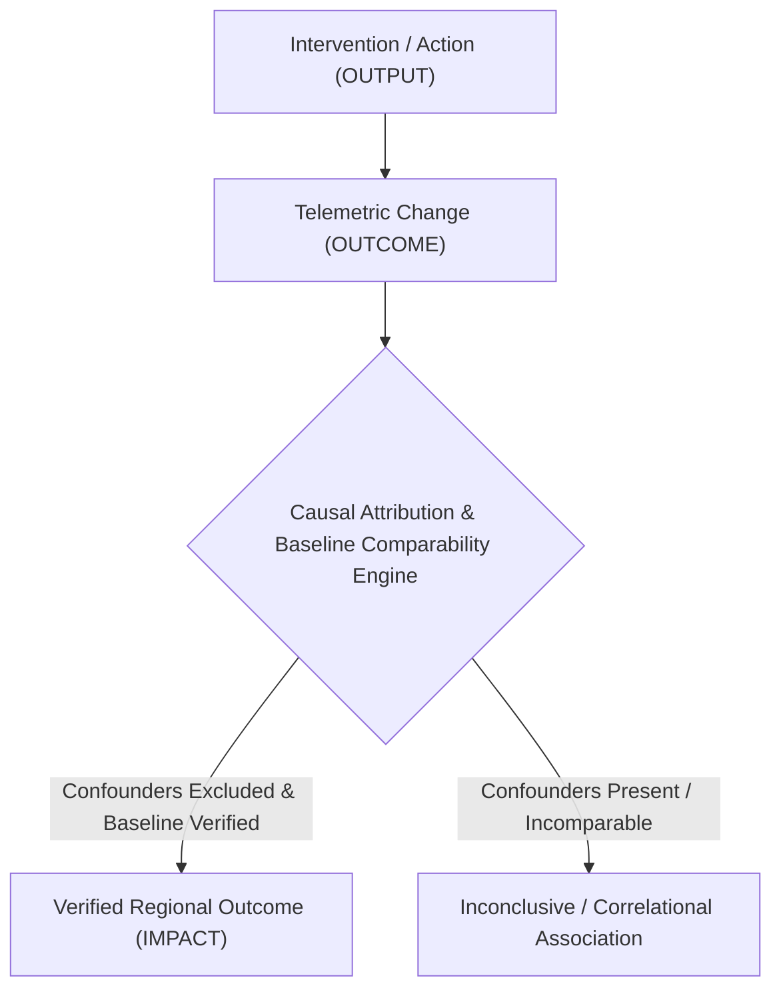

# Regional Water Operations Performance Architecture

## 1. Executive Overview

Milestone 08.17 introduces an **Evidence-Based Performance Measurement and Outcome Impact Assessment Layer** to the YANGIARIQ AQUA AI platform.

The primary objective of this bounded context (`com.aquaai.performance`) is to measure whether operational decisions, dispatch schedules, water conservation initiatives, and corrective actions produce verifiable, reproducible, and measurable outcomes in the physical world.

Crucially, the system formalizes a strict tripartite separation of concerns:
- **OUTPUT**: What the system or human operators produced (e.g., dispatch schedules created, canal inspections performed, corrective actions proposed).
- **OUTCOME**: What measurably changed in operational telemetry following the activity (e.g., delivery fulfillment improved, measured conveyance loss decreased, incident resolved).
- **IMPACT**: Measurable regional improvement that can reasonably and conservatively be attributed to the intervention after controlling for confounding factors and validating against comparable baselines.



> [!IMPORTANT]
> **Fundamental Operational Law**: Never treat an output as proof of a positive outcome. Never treat correlation as proof of causation.

---

## 2. Bounded Context & Hexagonal Architecture

The performance domain strictly adheres to Clean/Hexagonal Architecture:
```
backend/src/main/java/com/aquaai/performance/
├── domain/
│   ├── model/
│   │   ├── PerformanceIndicator.java
│   │   ├── PerformanceBaseline.java
│   │   ├── PerformanceTarget.java
│   │   ├── PerformanceEvaluation.java
│   │   ├── ImpactAssessment.java
│   │   ├── PerformanceDataQuality.java
│   │   ├── ComparabilityResult.java
│   │   └── enums/
│   │       ├── IndicatorCategory.java
│   │       ├── MeasurementUnit.java
│   │       ├── AggregationMethod.java
│   │       ├── GeographicScopeType.java
│   │       ├── EvidenceClassification.java
│   │       ├── BaselineQuality.java
│   │       ├── AttributionLevel.java
│   │       ├── TargetType.java
│   │       ├── TargetCategory.java
│   │       ├── TargetStatus.java
│   │       ├── TargetComplianceStatus.java
│   │       ├── PerformanceTrend.java
│   │       ├── AssessmentReviewStatus.java
│   │       └── ChangeDirection.java
│   ├── service/
│   │   ├── IndicatorCalculationEngine.java
│   │   ├── BaselineComparabilityEngine.java
│   │   ├── ImpactAttributionEngine.java
│   │   └── PerformanceEvaluationEngine.java
│   └── port/
│       ├── PerformanceIndicatorRepository.java
│       ├── PerformanceBaselineRepository.java
│       ├── PerformanceTargetRepository.java
│       ├── PerformanceEvaluationRepository.java
│       ├── ImpactAssessmentRepository.java
│       ├── PerformanceWaterAccountingPort.java
│       ├── PerformanceNetworkPort.java
│       ├── PerformanceAccountabilityPort.java
│       ├── PerformanceSensorPort.java
│       ├── PerformanceIrrigationPort.java
│       ├── PerformancePredictionPort.java
│       └── PerformanceFieldPort.java
├── infrastructure/
│   ├── persistence/
│   │   ├── entity/ (JPA Entities)
│   │   ├── repository/ (Spring Data Interfaces)
│   │   └── mapper/PerformanceJpaMapper.java
│   ├── adapter/
│   │   ├── PerformanceWaterAccountingAdapter.java
│   │   ├── PerformanceNetworkAdapter.java
│   │   ├── PerformanceAccountabilityAdapter.java
│   │   ├── PerformanceSensorAdapter.java
│   │   ├── PerformanceIrrigationAdapter.java
│   │   ├── PerformancePredictionAdapter.java
│   │   └── PerformanceFieldAdapter.java
│   ├── init/PerformanceDataInitializer.java
│   └── config/PerformanceDomainConfig.java
├── application/
│   ├── dto/
│   └── usecase/
│       ├── GetPerformanceOverviewUseCase.java
│       ├── ListPerformanceIndicatorsUseCase.java
│       ├── GetPerformanceIndicatorDetailUseCase.java
│       ├── ListPerformanceBaselinesUseCase.java
│       ├── CreatePerformanceBaselineUseCase.java
│       ├── ListPerformanceTargetsUseCase.java
│       ├── CreatePerformanceTargetUseCase.java
│       ├── RunPerformanceEvaluationUseCase.java
│       ├── GetPerformanceEvaluationDetailUseCase.java
│       ├── ListImpactAssessmentsUseCase.java
│       ├── CreateImpactAssessmentUseCase.java
│       ├── ReviewImpactAssessmentUseCase.java
│       ├── GetPerformanceTrendUseCase.java
│       └── GeneratePerformanceReportUseCase.java
└── api/
    ├── PerformanceController.java
    └── dto/
```

---

## 3. Evidence Classification & Quality Taxonomy

All measurements and evaluations carry an explicit `EvidenceClassification`:
1. `OBSERVED`: Direct physical measurement from ultrasonic flow meters, telemetry sensors, or certified field inspection acts.
2. `CALCULATED`: Deterministic mathematical derivation using mass-balance equations between verified upstream and downstream points.
3. `ESTIMATED`: Statistical extrapolation where certain intermediate observations were missing.
4. `SIMULATED`: Generated by ML regression models or 1D Saint-Venant hydraulic simulations. Simulated data can NEVER be presented as observed performance.
5. `MISSING`: Telemetry outage or unrecorded time period.

### Baseline Quality Invariant
The `BaselineQuality` classification enforces strict integrity constraints:
- `VERIFIED_BASELINE`
- `PARTIALLY_VERIFIED_BASELINE`
- `ESTIMATED_BASELINE`
- `SIMULATED_BASELINE`
- `INSUFFICIENT_BASELINE`

> [!WARNING]
> Under `ImpactAttributionEngine`, if the baseline quality is `SIMULATED_BASELINE` or `ESTIMATED_BASELINE`, the outcome can **NEVER** achieve `DIRECTLY_VERIFIED`. It is automatically capped at `ASSOCIATED` or `INCONCLUSIVE`.

---

## 4. Multi-Tenant Security & Anti-IDOR Protections

1. **Role-Based Access Control**:
   - `ADMIN` & `OPERATOR`: Full regional evaluation, baseline management, target definition, impact assessment creation, and review.
   - `FARMER`: Read access strictly restricted to parcels owned by the authenticated user principal.
2. **Anti-IDOR Enforcement**:
   - All field-level queries invoke `performanceFieldPort.isFieldOwnedBy(fieldId, userId)` before releasing evaluation snapshots or historical trends.
3. **Audit Trail**:
   - All baseline approvals, target updates, and impact reviews record immutable timestamps, reviewer IDs, and rationale notes.

---

## 5. Non-Actuation Guarantee

Milestone 08.17 provides purely observational and evaluative capabilities. It contains:
- ZERO hardware actuation commands;
- ZERO automated gate opening/closing triggers;
- ZERO autonomous pump commands.
All operational changes must be executed by human operators through standard, authorized governance procedures.
