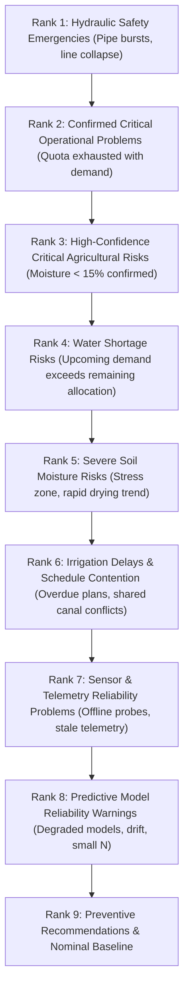

# Risk Assessment Rules & Prioritization Formulas

> **Milestone 08.13 — Deterministic Agricultural & Hydraulic Risk Evaluation Specification**  
> *Governing calculations, threshold limits, composite scoring, and the 9-tier deterministic prioritization hierarchy.*

---

## 1. Core Principles

The Yangiariq Aqua AI Risk Assessment Engine (`RiskAssessmentEngine.java`) executes deterministic, explainable rules. It eliminates "black-box" opaque scoring by enforcing three principles:
1. **Identifiable Trigger Evidence**: Every risk factor and recommendation must cite specific observed metrics, threshold comparisons, and units.
2. **Safety Dominance**: Hydraulic pipeline integrity and canal rupture interlocks hold absolute priority over all agronomic optimizations.
3. **Transparent Uncertainty**: Missing sensor telemetry or degraded ML models must never be interpreted as a healthy baseline.

---

## 2. Risk Factor Rules by Domain

All calculations utilize `BigDecimal` with explicit scale and rounding mode (`RoundingMode.HALF_UP`).

### 2.1 Hydraulic Safety Rules

| Condition | Threshold Criteria | Assigned Severity | Assigned Confidence | Contribution Score | Action Triggered |
| :--- | :--- | :--- | :--- | :--- | :--- |
| **Suspected Pipe Burst** | `anomalyPort.hasSuspectedPipeBurst(fieldId) == true` | `CRITICAL` | `HIGH` | $100.00$ | Activates hydraulic interlock; blocks line pressurization; creates technician dispatch recommendation. |
| **Critical Pressure Drop** | `anomalyPort.hasCriticalPressureDrop(fieldId) == true` OR $P_{line} < 0.50$ bar | `CRITICAL` | `HIGH` | $90.00$ | Activates hydraulic interlock; flags pump manifold check. |
| **Sub-optimal Pressure** | $0.50 \text{ bar} \le P_{line} < 1.20 \text{ bar}$ | `MEDIUM` | `HIGH` | $40.00$ | Warns about drip application depth non-uniformity; recommends valve adjustment. |

### 2.2 Water Availability Rules

| Condition | Threshold Criteria | Assigned Severity | Assigned Confidence | Contribution Score | Action Triggered |
| :--- | :--- | :--- | :--- | :--- | :--- |
| **Missing Seasonal Allocation** | `hasActiveWaterAllocation == false` | `HIGH` | `HIGH` | $65.00$ | Flags missing legal quota warning; recommends filing allocation request. |
| **Quota Exhausted** | $V_{remaining} \le 0 \text{ m}^3$ AND ($V_{committed} > 0$ OR $V_{upcoming} > 0$) | `CRITICAL` | `HIGH` | $85.00$ | Prevents unallocated draws; prompts emergency quota transfer or deficit protocol. |
| **Upcoming Volume Deficit** | $V_{upcoming} > 0$ AND $V_{remaining} < V_{upcoming}$ | `HIGH` | `HIGH` | $70.00$ | Warns that pending plans exceed quota by $(V_{upcoming} - V_{remaining})\text{ m}^3$; deep-links to Operations. |
| **High Utilization** | $(V_{consumed} / V_{allocated}) \times 100 \ge 90.0\%$ | `MEDIUM` | `HIGH` | $40.00$ | Recommends conservation drip runs to protect late-season crop maturation. |

### 2.3 Soil Moisture Rules

| Condition | Threshold Criteria | Assigned Severity | Assigned Confidence | Contribution Score | Action Triggered |
| :--- | :--- | :--- | :--- | :--- | :--- |
| **Telemetry Missing** | Latest soil moisture reading is `null` | `HIGH` | `INSUFFICIENT_DATA` | $60.00$ | Flags missing data warning; prompts manual core sample test and probe inspection. |
| **Critical Moisture Deficit** | $\text{Moisture} < 15.0\%$ (Permanent Wilting Point) | `CRITICAL` | Gated by freshness/quality | $80.00$ | Recommends immediate emergency irrigation plan approval in Operations Workflow. |
| **Rapid Drying Trend** | $15.0\% \le \text{Moisture} < 20.0\%$ AND Rate of change $< -0.15\%/\text{hr}$ | `HIGH` | Gated by freshness/quality | $65.00$ | Alerts that permanent wilting threshold will be crossed within 12–24h; prepares irrigation. |
| **Moderate Moisture Deficit**| $15.0\% \le \text{Moisture} < 20.0\%$ | `MEDIUM` | Gated by freshness/quality | $45.00$ | Proposes scheduling next routine irrigation event. |
| **Waterlogging / Saturation**| $\text{Moisture} > 35.0\%$ | `MEDIUM` | Gated by freshness/quality | $35.00$ | Warns of root hypoxia and nutrient leaching; advises withholding irrigation and checking drains. |
| **24h Forecasted Deficit** | $\text{PredictedMoisture}_{24h} < 15.0\%$ AND $\text{CurrentMoisture} \ge 20.0\%$ | `HIGH` | `MEDIUM` | $50.00$ | Identifies forward-looking risk without presenting prediction as an observed event. |

### 2.4 Irrigation Operational Rules

| Condition | Threshold Criteria | Assigned Severity | Assigned Confidence | Contribution Score | Action Triggered |
| :--- | :--- | :--- | :--- | :--- | :--- |
| **Canal Schedule Contention** | `hasScheduleConflict == true` (Shared secondary canal) | `HIGH` | `HIGH` | $55.00$ | Recommends staggering start times to prevent canal discharge velocity collapse. |
| **Overdue Irrigation Run** | Plan status $\in \{\text{SCHEDULED}, \text{APPROVED}\}$ AND $T_{planned} < T_{today}$ | `HIGH` | `HIGH` | $50.00$ | Prompts operator/farmer to execute plan immediately or update scheduled delivery window. |

### 2.5 Sensor and Data Reliability Rules

| Condition | Threshold Criteria | Assigned Severity | Assigned Confidence | Contribution Score | Action Triggered |
| :--- | :--- | :--- | :--- | :--- | :--- |
| **No Sensors Configured** | `fieldSensors.isEmpty() == true` | `HIGH` | `INSUFFICIENT_DATA` | $50.00$ | Discloses monitoring blindspot; prompts IoT hardware provisioning. |
| **Offline Sensors ($\ge 2$)** | Count of sensors in `OFFLINE` or `MAINTENANCE` $\ge 2$ | `HIGH` | `HIGH` | $50.00$ | Recommends inspecting solar charge, LoRaWAN gateway, or node cabling. |
| **Offline Sensors ($= 1$)** | Count of sensors in `OFFLINE` or `MAINTENANCE` $= 1$ | `MEDIUM` | `HIGH` | $30.00$ | Flags hardware check in Sensors module. |
| **Stale Telemetry** | Time since last transmission $> 6\text{ hours}$ | `MEDIUM` | `LOW` | $25.00$ | Lowers moisture confidence; alerts to inspect transmission intervals. |

### 2.6 Predictive Model Reliability Rules

| Condition | Threshold Criteria | Assigned Severity | Assigned Confidence | Contribution Score | Action Triggered |
| :--- | :--- | :--- | :--- | :--- | :--- |
| **Model Health Degraded** | `predictionModelHealth == DEGRADED` | `HIGH` | `MEDIUM` | $35.00$ | Marks predictions as advisory; prompts review in Model Governance Center. |
| **Model Drift Active** | `predictionModelDrift == true` | `MEDIUM` | `MEDIUM` | $25.00$ | Identifies seasonal concept drift; prompts evaluation of candidate challenger models. |
| **Insufficient Samples** | $0 < N_{samples} < 30$ historical ground-truth pairs | `LOW` | `LOW` | $15.00$ | Discloses sample limitation; advises gathering post-irrigation verification outcomes. |

---

## 3. Composite Risk Score Calculation

The platform computes a normalized composite score $S_{composite} \in [0.00, 100.00]$ using a multi-factor non-linear weighting formula:

$$\begin{aligned}
\text{If } & \text{isHydraulicBlocked} == \text{true} \implies S_{composite} = 100.00 \\
\text{Else if } & \text{factors.isEmpty()} \implies S_{composite} = 0.00 \\
\text{Else } & S_{composite} = \min\left(100.00, \; S_{\max} \times 0.70 + \sum_{i \neq \max} S_{i} \times 0.15\right)
\end{aligned}$$

Where:
- $S_{\max}$ is the highest individual contribution score among all active factors.
- $\sum_{i \neq \max} S_{i}$ is the sum of all remaining secondary risk factor contribution scores.
- This formulation ensures the single dominant risk dictates the baseline while multiple compound risks amplify the composite urgency without exceeding $100.00$.

---

## 4. Deterministic 9-Tier Prioritization Hierarchy

When ranking parcels across the farm or sorting recommendations, the system strictly follows a deterministic hierarchy. Numerical risk scores **never** override this precedence order.

### Explanatory Rationale Strings

Each rank outputs a clear human-readable explanation:
- **Rank 1**: *"Rank 1: Hydraulic safety emergency. Pipeline rupture or line pressure collapse detected. Pressurization strictly blocked."*
- **Rank 2**: *"Rank 2: Confirmed critical operational problem. Seasonal water quota exhausted while pending delivery exists."*
- **Rank 3**: *"Rank 3: High-confidence critical agricultural risk. Soil moisture below 15% confirmed by fresh telemetry."*
- **Rank 4**: *"Rank 4: Water shortage risk. Upcoming irrigation requirements exceed remaining allocation balance."*
- **Rank 5**: *"Rank 5: Severe soil moisture risk. Root-zone drying trend indicates imminent deficit."*
- **Rank 6**: *"Rank 6: Irrigation delay or secondary canal contention detected in Operations Workflow."*
- **Rank 7**: *"Rank 7: Telemetry reliability problem. Hardware sensor offline or reading missing (>24h)."*
- **Rank 8**: *"Rank 8: Predictive model reliability warning. Forecasting error variance elevated."*
- **Rank 9**: *"Rank 9: Nominal agricultural and operational baseline."*
