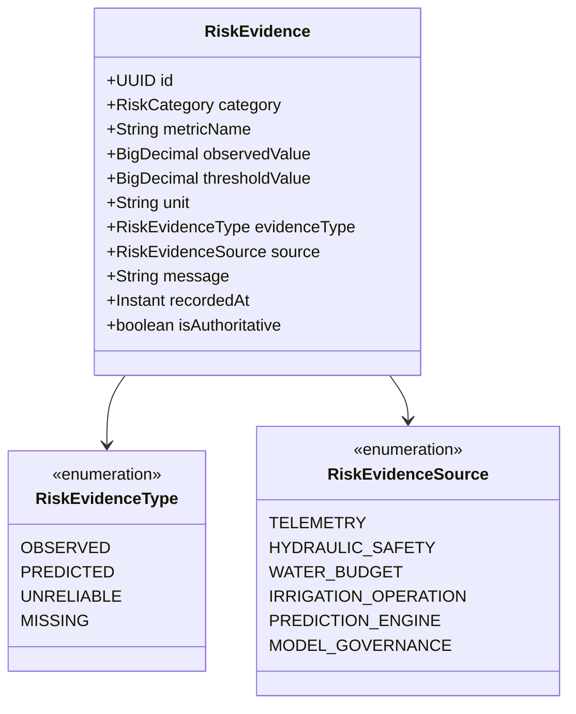

# Risk Confidence & Evidence Model

> **Milestone 08.13 — Evidence Normalization, Confidence Gating & Explainability Specification**  
> *Establishing empirical rigor, model uncertainty quantification, and human-verifiable audit trails.*

---

## 1. Core Architectural Mandate

In agricultural operations, confusing a **forecast** with an **observation**, or mistaking **missing data** for a **safe condition**, leads to catastrophic operational failures—such as letting crops wilt because an offline sensor was presumed healthy, or pressurizing a ruptured canal line because an AI model forecasted high water demand.

Yangiariq Aqua AI enforces three non-negotiable data trust principles:
1. **Never present an uncertain prediction as a confirmed real-world event.**
2. **Missing data must never be interpreted as a healthy condition.**
3. **Severity and Confidence are strictly orthogonal dimensions.**

---

## 2. Evidence Taxonomy

Every risk assessment derives from an unmodifiable collection of `RiskEvidence` items:



### 2.1 Evidence Types

| Evidence Type | Operational Semantics | Example in Yangiariq Aqua AI |
| :--- | :--- | :--- |
| `OBSERVED` | Confirmed physical measurement or administrative database state. Authoritative ground truth. | Direct sensor reading: soil moisture $= 13.8\%$ recorded 15 mins ago; pipeline pressure $= 0.35$ bar. |
| `PREDICTED` | Forward-looking mathematical or machine learning forecast. Strictly non-authoritative. | ML Ridge model projection: moisture dropping to $14.2\%$ in 24 hours under forecasted weather. |
| `UNRELIABLE` | Data received from a degraded sensor, suspect reading quality, stale feed ($> 6\text{h}$), or drifting model. | Soil moisture reading marked `SUSPECT` due to rapid erratic volatility or offline telemetry node. |
| `MISSING` | Required agronomic, volumetric, or hardware baseline data is absent from the system. | Parcel has no active seasonal water quota recorded; no soil moisture probe configured. |

---

## 3. Severity vs. Confidence Orthogonality

A critical risk with low confidence is fundamentally different from a critical risk backed by high-confidence ground truth:

```
                          RISK SEVERITY
              LOW          MEDIUM          HIGH          CRITICAL
         ┌─────────────┬─────────────┬─────────────┬─────────────────┐
    HIGH │ Nominal     │ Standard    │ Immediate   │ EMERGENCY:      │
         │ Operation   │ Monitoring  │ Action Plan │ Physical Safety │
C        ├─────────────┼─────────────┼─────────────┼─────────────────┤
O MEDIUM │ Advisory    │ Advisory    │ Review      │ High-Priority   │
N        │ Notice      │ Inspection  │ Verification│ Verification    │
F        ├─────────────┼─────────────┼─────────────┼─────────────────┤
I    LOW │ Low-Value   │ Model Drift │ Sensor      │ Unconfirmed     │
D        │ Telemetry   │ Notice      │ Stale Feed  │ Critical Alarm  │
E        ├─────────────┼─────────────┼─────────────┼─────────────────┤
N INSUF. │ Telemetry   │ Sensor      │ Unmonitored │ Blindspot:      │
  DATA   │ Gap         │ Gap         │ Crop Stress │ Interlock Block │
         └─────────────┴─────────────┴─────────────┴─────────────────┘
```

### 3.1 Severity Levels
- `CRITICAL`: Immediate threat to hydraulic infrastructure (burst pipe) or crop survival (moisture $< 15\%$, budget exhausted).
- `HIGH`: Severe operational constraint or impending agronomic deficit (water quota shortage, overdue run, schedule contention).
- `MEDIUM`: Sub-optimal operational parameters (minor pressure drops, approaching quota threshold $>90\%$, soil moisture $15-20\%$).
- `LOW`: Nominal baseline operations or minor statistical cautions.
- `UNKNOWN`: Unassessed initial state.

### 3.2 Confidence Levels
- `HIGH`: Confirmed by fresh, validated physical telemetry or authoritative operational registries.
- `MEDIUM`: Supported by predictive models in healthy status, or telemetry older than 2 hours but under 6 hours.
- `LOW`: Supported by degraded models, stale telemetry ($> 6\text{h}$), or single uncorroborated suspect readings.
- `INSUFFICIENT_DATA`: Critical inputs are absent (e.g., zero sensors, missing quota). Triggers explicit warnings in UI.

---

## 4. Missing Data & Gating Rules

When essential telemetry or domain baselines are absent:
1. **Soil Moisture Reading Missing**:
   - Severity is set to `HIGH`.
   - Confidence is set to `INSUFFICIENT_DATA`.
   - Warning generated: *"Missing root-zone moisture telemetry prevents automated stress detection."*
   - Recommendation dispatched: *"Verify Soil Moisture Manually & Restore Telemetry"*.
2. **Seasonal Water Allocation Quota Missing**:
   - Severity is set to `HIGH`.
   - Warning generated: *"Missing seasonal water allocation quota for parcel."*
   - Recommendation dispatched: *"Register Seasonal Water Allocation"*.
3. **No Sensor Hardware Configured**:
   - Discloses monitoring blindspot.
   - Restricts automated irrigation approvals until physical probes or manual inspections are recorded.

---

## 5. Model Uncertainty Integration (Milestones 08.8–08.12)

The risk engine directly inspects the health and evaluation outcomes of upstream prediction models:
- **Model Health `DEGRADED`**:
  - Automatically caps prediction confidence to `MEDIUM` or `LOW`.
  - Discloses model degradation in the factor explanation: *"Forecasting model error variance exceeds governed quality threshold. Treat predictions as advisory."*
  - Generates recommendation linking to `/predictions?tab=governance`.
- **Model Drift Detected**:
  - Discloses seasonal or contextual shift in accuracy.
  - Promotes human review of candidate champion-challenger models.
- **Limited Ground-Truth Outcomes ($N < 30$)**:
  - Sets factor severity to `LOW` and confidence to `LOW`.
  - Informs the user: *"Evaluation relies on only N verified outcomes (< 30 required for full statistical significance)."*

---

## 6. End-to-End Auditability & Human Lifecycle

Risk assessments are persistent historical records supporting a six-state human lifecycle:
- `OPEN`: Initial automated assessment state.
- `ACKNOWLEDGED`: Farmer or operator has reviewed the finding and noted awareness.
- `ACTION_REQUIRED`: Formal human operational intervention is queued in the Action Center.
- `MITIGATED`: Preventative step initiated (e.g., valve closed, quota transfer filed).
- `RESOLVED`: Farmer/operator marks assessment closed with mandatory remedial audit notes (`resolutionNotes`).
- `EXPIRED`: Assessment superseded by newer temporal evaluation.
