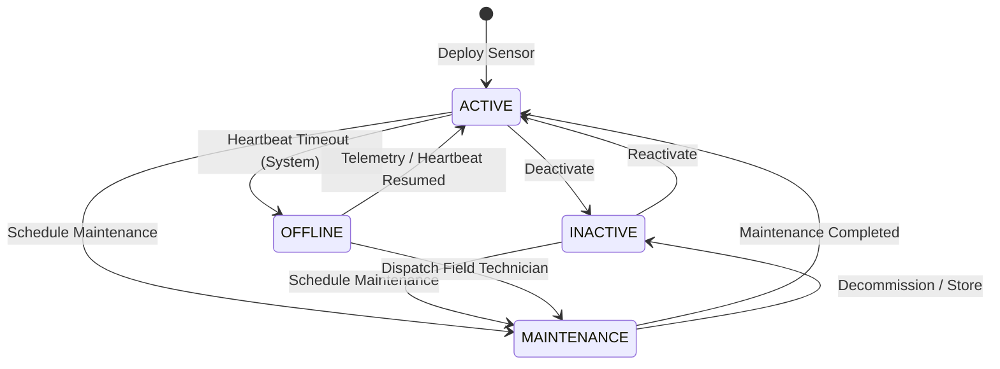

# Sensor Domain & Telemetry Foundation Blueprint (`docs/sensor-domain.md`)

## 1. Domain Purpose & Overview

The **Sensor & Telemetry (`com.aquaai.sensor`)** domain provides the physical observational foundation for the YANGIARIQ AQUA AI platform. It captures, validates, and manages environmental and hydraulic telemetry across agricultural parcels in Yangiariq district (Khorezm Region, Uzbekistan).

In the operational progression of YANGIARIQ AQUA AI:

```text
Farmer
   ↓
Field Parcel
   ↓
Water Allocation & Irrigation Plan
   ↓
Actual Water Consumption
   ↓
Sensor Devices (Hardware & Telemetry Foundation)
   ↓
Telemetry Observations (Drift-simulated & IoT-ready)
   ↓ (Future Milestone 07.2 / 08.0)
Telemetry Pipeline Ingestion → Anomaly Detection → AI Agronomic Advisory
```

### Architectural Role & Boundaries
- **Strict Decoupling**: The domain layer (`com.aquaai.sensor.domain`) is completely pure Java (Java 21). It contains zero dependencies on Spring Framework, Spring Boot, Spring Data, Jakarta Persistence (JPA), Hibernate, PostgreSQL, or any external IoT protocols (MQTT, Kafka, LoRaWAN, HTTP clients, Gemini/AI SDKs).
- **DDD Aggregate Root**: `Sensor` aggregate root encapsulates device identity, type, physical configuration, operational lifecycle state transitions, and last heartbeat timestamps.
- **Value Objects / Observations**: `SensorReading` represents an immutable point-in-time observation with physical measurement constraints, unit compatibility, and data quality flags.
- **Provider SPI (Service Provider Interface)**: `SensorProvider` port defines the contract for reading or ingesting device data. The foundational implementation is `SimulatedSensorProvider`, which models realistic physical drift based on Yangiariq agronomic conditions without requiring physical hardware.
- **Anti-IDOR Ownership Derivation**: Sensors are strictly attached to field parcels (`fieldId: UUID`). A sensor does not store redundant `ownerId`; parcel tenancy and ownership are securely derived and verified via `FieldOwnershipChecker` and `Field.ownerId`.

---

## 2. Sensor Aggregate Root (`Sensor`)

`Sensor` represents a telemetry-gathering physical or virtual device deployed on an agricultural parcel in Yangiariq district.

### Attributes & Invariants

| Attribute | Type | Description | Invariants & Rules |
| :--- | :--- | :--- | :--- |
| `id` | `UUID` | Unique device identifier in the platform | Immutable, non-null |
| `fieldId` | `UUID` | Associated field parcel | Non-null, must reference an existing active `Field` |
| `name` | `String` | Human-readable sensor moniker | Non-blank, max 128 characters, sanitized |
| `deviceIdentifier` | `String` | Physical serial number or hardware EUI | Non-blank, max 64 characters, globally unique across system |
| `type` | `SensorType` | Telemetry modality | Non-null, immutable once deployed |
| `status` | `SensorStatus` | Operational lifecycle state | Non-null, default `ACTIVE`. Transition governed by state machine |
| `provider` | `String` | Ingestion source driver moniker | Non-null, default `SIMULATED` (e.g. `SIMULATED`, `MANUAL`, `MODBUS`) |
| `description` | `String` | Physical mounting position / depth note | Optional, max 500 characters |
| `installedAt` | `Instant` | Physical field deployment timestamp | Non-null, cannot be in future |
| `lastSeenAt` | `Instant` | Timestamp of latest reading or heartbeat | Updated on incoming reading or explicit heartbeat |
| `createdAt` | `Instant` | Audited system creation timestamp | Immutable |
| `updatedAt` | `Instant` | Audited system update timestamp | Maintained automatically |
| `version` | `Long` | Optimistic locking token | Managed by persistence layer |

### Lifecycle State Machine (`SensorStatus`)

The sensor lifecycle adheres to strict state transition invariants:



#### Transition Rules:
1. `ACTIVE`: Sensor is operational and actively streaming telemetry. Can transition to `INACTIVE`, `MAINTENANCE`, or `OFFLINE`.
2. `INACTIVE`: Sensor is intentionally turned off or decommissioned. Can transition to `ACTIVE` or `MAINTENANCE`.
3. `MAINTENANCE`: Sensor is undergoing physical calibration, cleaning, or sensor head replacement. Can transition to `ACTIVE` or `INACTIVE`.
4. `OFFLINE`: Sensor has missed expected telemetry windows or failed heartbeats. Automatically transitions back to `ACTIVE` upon receiving valid telemetry, or manually to `MAINTENANCE`.
5. Invalid transitions (e.g. transitioning to the identical state or illegal jumps) throw domain `DomainValidationException`.

---

## 3. Sensor Modalities & Physical Boundaries (`SensorType`)

Each `SensorType` defines its compatible `MeasurementUnit` set, default engineering unit, and physical realistic boundaries for Yangiariq agricultural conditions:

| Sensor Type | Description | Default Unit | Allowed Units | Physical Range |
| :--- | :--- | :--- | :--- | :--- |
| `SOIL_MOISTURE` | Volumetric soil water content (VWC) | `PERCENT` | `PERCENT` | `[0.0, 100.0] %` |
| `WATER_FLOW` | Irrigation pipe or flume discharge rate | `CUBIC_METER_PER_HOUR` | `CUBIC_METER_PER_HOUR`, `LITERS_PER_SECOND` | `[0.0, 5000.0] m³/h`, `[0.0, 1500.0] L/s` |
| `TEMPERATURE` | Ambient or soil temperature | `CELSIUS` | `CELSIUS` | `[-40.0, 70.0] °C` |
| `HUMIDITY` | Ambient relative air humidity | `PERCENT` | `PERCENT` | `[0.0, 100.0] %` |
| `WATER_LEVEL` | Canal water depth or borehole water table | `METERS` | `METERS` | `[0.0, 50.0] m` |
| `PRESSURE` | Drip / sprinkler network line pressure | `BAR` | `BAR`, `MILLIBAR` | `[0.0, 25.0] bar`, `[0.0, 25000.0] mbar` |
| `RAINFALL` | Precipitation gauge accumulation / rate | `MILLIMETERS` | `MILLIMETERS` | `[0.0, 500.0] mm` |
| `SALINITY` | Soil salinity / electrical conductivity (EC) | `DECISIEMENS_PER_METER` | `DECISIEMENS_PER_METER` | `[0.0, 30.0] dS/m` |

---

## 4. Telemetry Observation Model (`SensorReading`)

`SensorReading` is an immutable domain model representing a verified measurement taken at a specific moment in time.

### Invariants:
1. **Sensor & Field Reference**: Non-null `sensorId` and `fieldId`.
2. **Physical Boundary Validation**: The reading value must fall within the physical limits of the given `SensorType` (e.g., negative soil moisture or >100% relative humidity is rejected with `DomainValidationException`).
3. **Unit Compatibility**: The `MeasurementUnit` must be explicitly listed in `SensorType.getAllowedUnits()`. Unit mismatch throws `DomainValidationException`.
4. **Temporal Consistency**: `measuredAt` cannot be in the future (allowing up to 5 minutes for clock skew between remote IoT gateways and the server).
5. **Quality Categorization (`ReadingQuality`)**:
   - `VALID`: Conforms to expected physical boundaries and variance limits.
   - `SUSPECT`: Extreme spike or anomalous drift detected; flagged for review.
   - `INVALID`: Hardware error code or physical sensor boundary failure.
6. **Numeric Precision**: Stored as high-precision `BigDecimal` mapping to `NUMERIC(14, 4)` in PostgreSQL.

---

## 5. Provider SPI & Simulation Architecture

### `SensorProvider` Port
The domain defines a clean provider port:
```java
public interface SensorProvider {
    SensorReading read(Sensor sensor);
    String getProviderType();
    boolean isAvailable();
}
```

### `SimulatedSensorProvider` Implementation
To support end-to-end development, testing, and operational demonstrations before hardware installation, `SimulatedSensorProvider` implements a **bounded random-walk drift sequence**:
- It maintains stateful historical continuity per sensor identifier using a thread-safe cache (`ConcurrentHashMap`).
- Instead of random noise spikes, consecutive readings drift smoothly by bounded deltas:
  - `SOIL_MOISTURE`: Baseline ~48.0%, drift step ±1.5%.
  - `TEMPERATURE`: Baseline ~28.0°C, drift step ±0.8°C.
  - `HUMIDITY`: Baseline ~42.0%, drift step ±2.0%.
  - `WATER_FLOW`: Baseline ~120.0 m³/h, drift step ±5.0 m³/h.
  - `WATER_LEVEL`: Baseline ~1.8 m, drift step ±0.05 m.
  - `PRESSURE`: Baseline ~2.5 bar, drift step ±0.1 bar.
  - `RAINFALL`: Baseline 0.0 mm, drift step 0.0 to 0.2 mm.
  - `SALINITY`: Baseline ~2.4 dS/m, drift step ±0.05 dS/m.
- Values are clamped to physical simulation bounds, guaranteeing realistic agronomic datasets.

---

## 6. Security & Multi-Tenancy (Anti-IDOR)

Sensors are physical assets of agricultural land parcels. Strict multi-tenant isolation is enforced at the Application Layer:

1. **Farmer Role**:
   - May view, register, configure, and simulate sensors on parcels they own.
   - Access to sensors or telemetry belonging to parcels owned by other farmers results in `404 Not Found` (anti-enumeration security).
2. **Operator Role**:
   - Read-only district-wide surveillance access to all sensors and telemetry in Yangiariq district.
   - Mutation attempts (creation, updates, deletions) are rejected with `403 Forbidden`.
3. **Admin Role**:
   - Full read/write management across all district sensors and telemetry.

Tenancy verification is performed using the existing `FieldOwnershipChecker`:
```java
fieldOwnershipChecker.verifyFieldOwnership(sensor.getFieldId(), currentUser);
```

---

## 7. Persistence Schema & TimescaleDB Roadmap

### Relational Schema (`sensor_devices`)
```sql
CREATE TABLE sensor_devices (
    id UUID DEFAULT gen_random_uuid() PRIMARY KEY,
    field_id UUID NOT NULL,
    name VARCHAR(128) NOT NULL,
    device_identifier VARCHAR(64) NOT NULL,
    type VARCHAR(32) NOT NULL,
    status VARCHAR(32) NOT NULL DEFAULT 'ACTIVE',
    provider VARCHAR(64) NOT NULL DEFAULT 'SIMULATED',
    description VARCHAR(500),
    installed_at TIMESTAMP WITH TIME ZONE NOT NULL DEFAULT CURRENT_TIMESTAMP,
    last_seen_at TIMESTAMP WITH TIME ZONE,
    created_at TIMESTAMP WITH TIME ZONE NOT NULL DEFAULT CURRENT_TIMESTAMP,
    updated_at TIMESTAMP WITH TIME ZONE NOT NULL DEFAULT CURRENT_TIMESTAMP,
    version BIGINT DEFAULT 0,
    CONSTRAINT fk_sensor_devices_field FOREIGN KEY (field_id) REFERENCES fields(id) ON DELETE RESTRICT,
    CONSTRAINT uq_sensor_device_identifier UNIQUE (device_identifier)
);
```

### Relational Schema (`sensor_readings`)
```sql
CREATE TABLE sensor_readings (
    id UUID DEFAULT gen_random_uuid() PRIMARY KEY,
    sensor_id UUID NOT NULL,
    field_id UUID NOT NULL,
    type VARCHAR(32) NOT NULL,
    "value" NUMERIC(14, 4) NOT NULL,
    unit VARCHAR(32) NOT NULL,
    quality VARCHAR(16) NOT NULL DEFAULT 'VALID',
    source VARCHAR(64) NOT NULL,
    measured_at TIMESTAMP WITH TIME ZONE NOT NULL,
    created_at TIMESTAMP WITH TIME ZONE NOT NULL DEFAULT CURRENT_TIMESTAMP,
    CONSTRAINT fk_sensor_readings_sensor FOREIGN KEY (sensor_id) REFERENCES sensor_devices(id) ON DELETE CASCADE,
    CONSTRAINT fk_sensor_readings_field FOREIGN KEY (field_id) REFERENCES fields(id) ON DELETE RESTRICT
);
```

### Database Indexes
- `idx_sensor_devices_field_id`: Accelerates parcel sensor queries.
- `idx_sensor_devices_status`: Accelerates active sensor health sweeps.
- `idx_sensor_devices_type`: Filters devices by modality.
- `idx_sensor_readings_sensor_time`: Compound index `(sensor_id, measured_at DESC)` for high-frequency sensor time-series retrieval.
- `idx_sensor_readings_field_time`: Compound index `(field_id, measured_at DESC)` for parcel telemetry feeds.
- `idx_sensor_readings_field_type_time`: Compound index `(field_id, type, measured_at DESC)` for parcel telemetry summaries by sensor type.

### TimescaleDB & Time-Series Scaling Strategy
As device count and streaming frequency increase (e.g. 5-minute sampling across 50,000 hectares):
1. **Hypertables**: Convert `sensor_readings` into a TimescaleDB hypertable partitioned by `measured_at` (7-day chunk intervals).
2. **Compression Policy**: Enable TimescaleDB columnstore compression after 14 days, reducing telemetry disk footprint by 90-95%.
3. **Continuous Aggregates**: Pre-aggregate hourly and daily mean, min, and max values (e.g. `hourly_soil_moisture`) for instant reporting.
4. **Data Retention**: Drop raw readings older than 365 days while preserving continuous hourly/daily aggregates indefinitely.

---

## 8. Extensibility & Future IoT Roadmap

The architecture is prepared for seamless drop-in integrations in future milestones:
- **MQTT / LoRaWAN Gateways**: Create an MQTT adapter implementing `SensorReadingIngestionPort` in `sensor.infrastructure.mqtt` that pushes readings directly into `RecordSensorReadingUseCase`.
- **Modbus / RS-485 Agricultural Sensors**: Industrial water flow meters and SDI-12 soil moisture probes can connect via field edge gateways.
- **Out-of-Order Readings**: The temporal index and `findLatestBySensorId` logic correctly preserve chronological ordering even when telemetry arrives delayed or batched.
