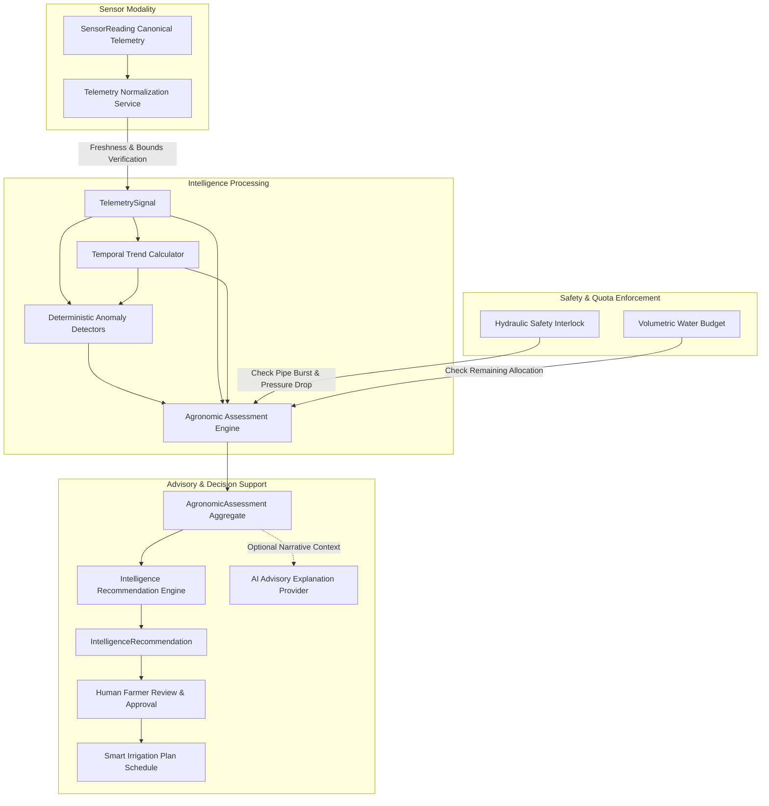

# Telemetry Intelligence & Deterministic Agronomic Recommendations (`docs/telemetry-intelligence.md`)

## 1. Architectural Overview & Intelligence Chain

Milestone 08.3 introduces the unified **Telemetry Intelligence & Agronomic Assessment** bounded context (`com.aquaai.intelligence`) for the Yangiariq Aqua AI platform.

The core objective is to synthesize raw physical sensor observations into deterministic, explainable, and safety-verified agricultural recommendations **strictly for human decision support**. Autonomous hardware actuation (e.g., direct valve manipulation or pump dispatch) is **strictly prohibited**.

---

## 2. Telemetry Normalization & Data Quality Invariants

The platform maintains strict quality gating:
- **Canonical Model**: Physical observations are preserved without alteration in `com.aquaai.sensor.domain.model.SensorReading`.
- **Quality Gating**:
  - `INVALID`: Disqualified from driving agronomic recommendations. Emits warning signals (`NO_RECENT_TELEMETRY` with disqualified flag) and forces degraded confidence.
  - `SUSPECT`: May serve as corroborating context, but systematically lowers recommendation confidence (`LOW` or `MEDIUM`) with explicit warning tags.
  - `VALID`: Meets physical boundary and plausibility constraints, driving normal deterministic evaluation.

---

## 3. Telemetry Freshness Policies

Telemetry recency is evaluated against strict physical SLA intervals:

| Modality | Fresh SLA | Stale Window | Missing Threshold |
| :--- | :--- | :--- | :--- |
| **Soil Moisture** | $\le 6$ hours | $6 - 24$ hours | $> 24$ hours or absent |
| **Temperature / Humidity** | $\le 2$ hours | $2 - 12$ hours | $> 12$ hours or absent |
| **Pressure / Water Flow** | $\le 30$ minutes | $30 - 120$ minutes | $> 120$ minutes or absent |
| **Water Level / Salinity** | $\le 6$ hours | $6 - 24$ hours | $> 24$ hours or absent |

**Policy Impacts**:
- Telemetry marked as `STALE` triggers an automatic confidence penalty.
- Missing critical telemetry (e.g., absent soil moisture) prevents confident irrigation dispatch and generates an `INSPECT_SENSOR` advisory.

---

## 4. Temporal Trend Analysis

A single telemetry point is vulnerable to localized noise. The `TemporalTrendCalculator` evaluates chronological sequences of readings:
$$\Delta \text{value} / \Delta t = \frac{v_{\text{latest}} - v_{\text{earliest}}}{\Delta \text{hours}} \quad (\%/\text{hour})$$

- **Directional Classification**:
  - `INCREASING`: $\text{rate} > +0.20\%/\text{h}$ (Soil wetting or rehydration)
  - `DECREASING`: $\text{rate} < -0.20\%/\text{h}$ (Active crop transpiration and evapotranspiration)
  - `STABLE`: $|\text{rate}| \le 0.20\%/\text{h}$
- All mathematical evaluations use `BigDecimal` with `RoundingMode.HALF_UP` to prevent IEEE-754 precision drift.

---

## 5. Agronomic Assessment Engine (`AgronomicAssessmentEngine`)

The deterministic assessment engine produces an `AgronomicAssessment` aggregate capturing parcel health:

### Deterministic Agricultural Rules:
1. **Critical Moisture Deficit**:
   - Soil moisture $< 15.0\% \implies$ `SOIL_TOO_DRY` (`CRITICAL`), urgent irrigation recommended.
2. **Moderate Moisture Deficit**:
   - Soil moisture $15.0\% - 20.0\% \implies$ `SOIL_TOO_DRY` (`HIGH`), irrigation within 24 hours.
3. **Soil Saturation / Hypoxia Precaution**:
   - Soil moisture $> 35.0\% \implies$ `SOIL_TOO_WET` (`MEDIUM`), withhold irrigation to protect root respiration.
4. **Atmospheric Heat Stress (Garmsel)**:
   - Ambient temperature $> 40.0^\circ\text{C}$ or relative humidity $< 18.0\% \implies$ `HIGH_TEMPERATURE` / `LOW_HUMIDITY`, night cooling hydration recommended; avoid 11:00–17:00 sprinkling.
5. **Frost Hazard**:
   - Ambient temperature $< 2.0^\circ\text{C} \implies$ `LOW_TEMPERATURE` (`HIGH`), freeze protection precautions.

---

## 6. Authoritative Safety Hierarchy

Safety constraints strictly supersede agronomic convenience and AI suggestions:

$$\text{SAFETY} \longrightarrow \text{QUOTA} \longrightarrow \text{INFRASTRUCTURE} \longrightarrow \text{AGRONOMIC} \longrightarrow \text{WEATHER} \longrightarrow \text{PRIORITY} \longrightarrow \text{AI}$$

1. **Hydraulic Interlock**: If `HydraulicSafetyInterlock` detects pipe burst risk or critical mainline pressure drop ($< 1.2\text{ bar}$), irrigation is **BLOCKED**. AI or user heuristics cannot override this block.
2. **Water Budget Quota**: If remaining available allocation $\le 0\text{ m}^3$, the recommendation is marked `IRRIGATION_RESTRICTED` to prevent statutory quota violations.

---

## 7. Transparent Confidence Model

The platform avoids artificial percentage claims and computes bounded, explainable confidence scores:
- **Base Score**: $0.85$
- **Penalties**:
  - Missing soil moisture: $-0.35$
  - Invalid reading quality: $-0.40$
  - Suspect reading quality: $-0.20$
  - Stale sensor reading: $-0.15$
- **Bonuses**:
  - Consistent temporal trend ($\ge 3$ points): $+0.05$
  - Corroborating ambient sensors: $+0.05$
- **Bounding**: Strictly clamped in $[0.10, 0.95]$.
- **Classification**:
  - $\ge 0.80 \implies$ `HIGH`
  - $0.55 - 0.79 \implies$ `MEDIUM`
  - $< 0.55 \implies$ `LOW`

---

## 8. REST API Endpoints

All endpoints require JWT authentication and enforce strict anti-IDOR checks (Farmer foreign field access returns `HTTP 404 Not Found` anti-enumeration):

| Method | Endpoint | Description | Role Scope |
| :--- | :--- | :--- | :--- |
| `POST` | `/api/v1/fields/{fieldId}/intelligence/evaluate` | Evaluates telemetry, persists assessment, and outputs recommendation | Farmer (Own), Operator, Admin |
| `GET` | `/api/v1/fields/{fieldId}/intelligence/assessment` | Retrieves latest agronomic assessment | Farmer (Own), Operator, Admin |
| `GET` | `/api/v1/fields/{fieldId}/intelligence/signals` | Retrieves normalized signals with freshness status | Farmer (Own), Operator, Admin |
| `GET` | `/api/v1/fields/{fieldId}/intelligence/history` | Paginated assessment history with date range filtering | Farmer (Own), Operator, Admin |
| `POST` | `/api/v1/fields/{fieldId}/recommendations/evaluate` | Generates AI agronomic recommendation proposal | Farmer (Own), Operator, Admin |
| `GET` | `/api/v1/fields/{fieldId}/anomalies` | Paginated active anomalies for parcel | Farmer (Own), Operator, Admin |
| `PATCH` | `/api/v1/anomalies/{id}/acknowledge` | Acknowledges anomaly investigation | Farmer (Own), Operator, Admin |
| `PATCH` | `/api/v1/anomalies/{id}/resolve` | Resolves anomaly with audit notes | Farmer (Own), Operator, Admin |
