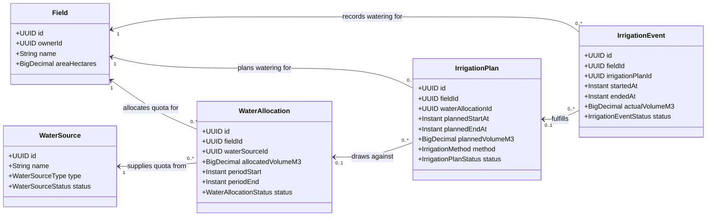
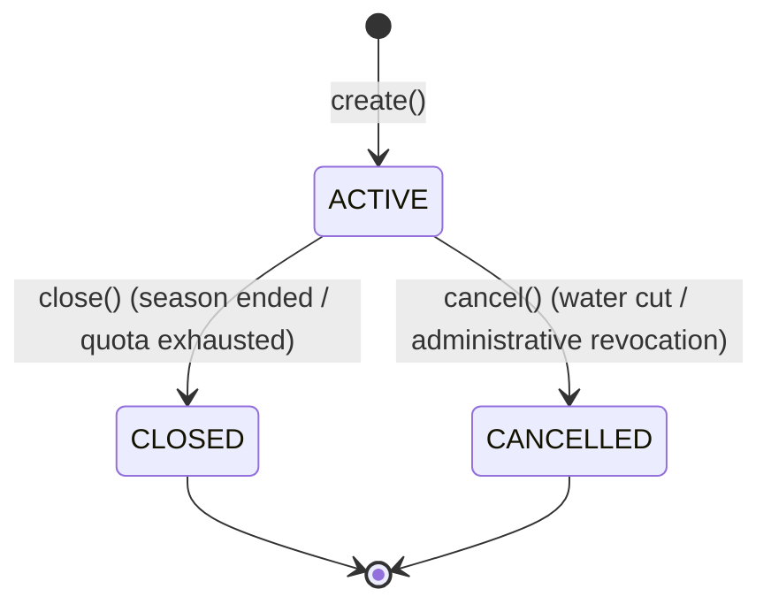
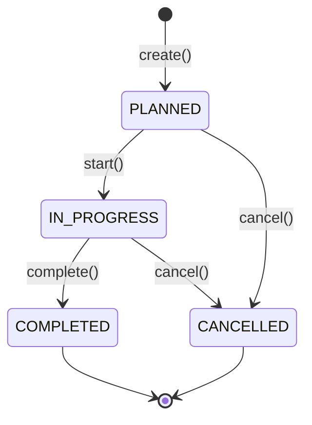
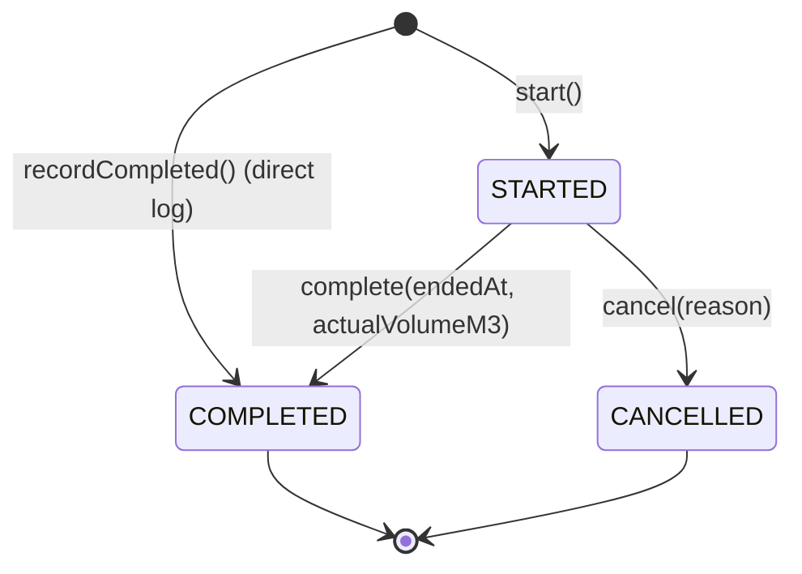

# Water Management & Irrigation Domain Blueprint

## 1. Domain Purpose & Overview

The **Water Management & Irrigation (`com.aquaai.water`)** domain establishes the core operational backbone for water allocation, scheduling, and delivery across agricultural parcels in Yangiariq district (Khorezm Region, Uzbekistan).

Following the implementation of the User/Farmer and Field domains, the business workflow advances to the water distribution chain:

```text
Farmer
   ↓
Field
   ↓
Water Source / Water Allocation
   ↓
Irrigation Plan / Irrigation Event
   ↓
Planned Water
   ↓
Actual Water Consumption
   ↓
Water Efficiency & Conservation
   ↓ (Future Milestones)
Sensor → Telemetry → Problem Detection → AI Advisory
```

### Architectural Role
- **Strict Decoupling**: Pure domain layer free from ORM (`jakarta.persistence`), Spring Data, and web frameworks.
- **DDD Aggregate Roots**: `WaterSource`, `WaterAllocation`, `IrrigationPlan`, `IrrigationEvent`.
- **Infrastructure Quotas vs Field Demands**: Clear delineation between regional shared distribution sources (canals, reservoirs, wells) and parcel-specific water quotas and events.
- **Planned vs. Actual Accounting**: Explicit architectural distinction between scheduled watering intention (`IrrigationPlan`) and operational ground truth (`IrrigationEvent`).

---

## 2. WaterSource Aggregate

`WaterSource` represents the regional shared or administrative hydrological infrastructure (e.g. primary distribution canals, secondary ditches, deep aquifer wells, reservoirs) that supplies water to Yangiariq fields.

### Shared Infrastructure Ownership Model
Unlike `Field`, which is strictly owned by individual farmers (`owner_id`), a `WaterSource` is modeled as a **shared district infrastructure entity**. A single distribution canal or ditch serves multiple parcels across different farmers. District operators and water basin authorities administer water sources, while farmers draw quotas through allocations.

### Attributes
| Field | Type | Description | Invariants |
| :--- | :--- | :--- | :--- |
| `id` | `UUID` | Aggregate unique identifier | Immutable, non-null |
| `name` | `String` | Official or colloquial infrastructure name | Non-blank, max 128 chars |
| `type` | `WaterSourceType` | Hydraulic classification | Non-null |
| `description` | `String` | Geographical or operational notes | Optional, max 500 chars |
| `status` | `WaterSourceStatus` | Operational state (`ACTIVE`, `INACTIVE`) | Defaults to `ACTIVE` |
| `createdAt` | `Instant` | Audited creation timestamp | Immutable |
| `updatedAt` | `Instant` | Audited modification timestamp | Maintained automatically |
| `version` | `Long` | Optimistic locking version | Controlled by persistence |

### WaterSource Types (`WaterSourceType`)
- `CANAL` (*Kanal* / *Канал*): Regional open trunk canals (e.g., Palvon-Yobi canal system).
- `DITCH` (*Ariq* / *Арык*): Secondary distribution ditches branching to parcel boundaries.
- `RESERVOIR` (*Suv ombori* / *Водохранилище*): Water storage basins regulating seasonal discharge.
- `WELL` (*Quduq* / *Скважина*): Deep vertical drainage and irrigation pump stations.
- `RIVER` (*Daryo* / *Река*): Direct river intakes from Amudarya tributaries.
- `OTHER` (*Boshqa* / *Другое*): Miscellaneous sources.

---

## 3. WaterAllocation Aggregate

`WaterAllocation` represents a volumetric water quota allocated to a specific agricultural parcel (`Field`) from a designated `WaterSource` over a defined seasonal or periodic time window.

### Attributes
| Field | Type | Description | Invariants |
| :--- | :--- | :--- | :--- |
| `id` | `UUID` | Unique allocation identifier | Immutable, non-null |
| `fieldId` | `UUID` | Associated parcel reference | Mandatory reference to `fields(id)` |
| `waterSourceId` | `UUID` | Source providing the quota | Mandatory reference to `water_sources(id)` |
| `allocatedVolumeM3` | `BigDecimal` | Quota volume in cubic meters ($m^3$) | Strictly `> 0`, 4 decimal precision |
| `periodStart` | `Instant` | Quota validity start timestamp | Mandatory, `periodStart <= periodEnd` |
| `periodEnd` | `Instant` | Quota validity end timestamp | Mandatory |
| `status` | `WaterAllocationStatus` | Lifecycle status (`ACTIVE`, `CLOSED`, `CANCELLED`) | Defaults to `ACTIVE` |
| `notes` | `String` | Administrative or allocation remarks | Optional, max 500 chars |
| `createdAt` | `Instant` | Creation timestamp | Audited |
| `updatedAt` | `Instant` | Last modification timestamp | Audited |
| `version` | `Long` | Concurrency control version | Managed by JPA |

---

## 4. IrrigationPlan Aggregate

`IrrigationPlan` represents the forward-looking watering schedule devised for an agricultural parcel. It specifies when, how much, and through which technique a watering operation is scheduled to occur.

### Quota Linkage Semantics
The `waterAllocationId` is **optional** (`UUID NULL`). While most formal irrigation schedules draw against an approved district quota, parcels utilizing on-farm private shallow wells or rainfall-supplemented furrow watering may schedule operations without a quota reservation.

### Attributes
| Field | Type | Description | Invariants |
| :--- | :--- | :--- | :--- |
| `id` | `UUID` | Plan identifier | Immutable, non-null |
| `fieldId` | `UUID` | Target agricultural parcel | Mandatory reference to `fields(id)` |
| `waterAllocationId` | `UUID` | Optional parent allocation | Nullable reference to `water_allocations(id)` |
| `plannedStartAt` | `Instant` | Scheduled start timestamp | Mandatory, `plannedStartAt < plannedEndAt` |
| `plannedEndAt` | `Instant` | Scheduled end timestamp | Mandatory |
| `plannedVolumeM3` | `BigDecimal` | Target water volume in $m^3$ | Strictly `> 0`, 4 decimal precision |
| `method` | `IrrigationMethod` | Planned technique | Mandatory (`CANAL`, `DITCH`, `FURROW`, `DRIP`, `SPRINKLER`, `OTHER`) |
| `status` | `IrrigationPlanStatus` | Execution state | `PLANNED`, `IN_PROGRESS`, `COMPLETED`, `CANCELLED` |
| `notes` | `String` | Planning and crop stage notes | Optional, max 500 chars |
| `createdAt` | `Instant` | Creation timestamp | Audited |
| `updatedAt` | `Instant` | Modification timestamp | Audited |
| `version` | `Long` | Concurrency version | Managed by JPA |

---

## 5. IrrigationEvent Aggregate

`IrrigationEvent` captures real-world ground truth: an actual watering operation executed on a parcel.

### Attributes
| Field | Type | Description | Invariants |
| :--- | :--- | :--- | :--- |
| `id` | `UUID` | Event identifier | Immutable, non-null |
| `fieldId` | `UUID` | Irrigated parcel | Mandatory reference to `fields(id)` |
| `irrigationPlanId` | `UUID` | Optional plan fulfilled by event | Nullable reference to `irrigation_plans(id)` |
| `startedAt` | `Instant` | Execution start timestamp | Mandatory |
| `endedAt` | `Instant` | Execution end timestamp | Mandatory when `COMPLETED`, `startedAt < endedAt` |
| `actualVolumeM3` | `BigDecimal` | Consumed water in $m^3$ | Mandatory when `COMPLETED`, `>= 0` |
| `status` | `IrrigationEventStatus` | Event lifecycle state | `STARTED`, `COMPLETED`, `CANCELLED` |
| `notes` | `String` | Operational observations | Optional, max 500 chars |
| `createdAt` | `Instant` | Creation timestamp | Audited |
| `updatedAt` | `Instant` | Modification timestamp | Audited |
| `version` | `Long` | Concurrency version | Managed by JPA |

### Planned Volume vs. Actual Volume
- `plannedVolumeM3`: Theoretical requirement planned prior to irrigation.
- `actualVolumeM3`: Real physical consumption recorded manually or through telemetry.
- **Variance**: $\Delta V = V_{planned} - V_{actual}$. Positive values represent water savings; negative values highlight over-irrigation.

---

## 6. Relationships & Domain Architecture



---

## 7. Business Invariants

1. **Volume Precision & Non-Negativity**:
   - `WaterAllocation.allocatedVolumeM3 > 0`
   - `IrrigationPlan.plannedVolumeM3 > 0`
   - `IrrigationEvent.actualVolumeM3 >= 0` (zero is accepted for failed pump attempts or aborted siphon starts).
   - Represented as `BigDecimal` with 4 decimal places (`NUMERIC(14, 4)`), eliminating floating-point imprecision.

2. **Time Ranges**:
   - `WaterAllocation`: `periodStart <= periodEnd`
   - `IrrigationPlan`: `plannedStartAt < plannedEndAt`
   - `IrrigationEvent`: `startedAt < endedAt` (upon completion).

3. **Autonomous Operational Flexibility**:
   - `waterAllocationId` in `IrrigationPlan` is optional.
   - `irrigationPlanId` in `IrrigationEvent` is optional, allowing ad-hoc manual irrigation logging.

4. **Historical Data Protection**:
   - Foreign key relationships to `fields(id)` use `ON DELETE RESTRICT`. Hard-deleting a field is blocked if allocations or irrigation records exist.

---

## 8. Status Transitions & State Machines

### WaterAllocation Lifecycle

- Modifications (`updateAllocation`) are permitted only while `ACTIVE`.
- `CLOSED` and `CANCELLED` are terminal states.

### IrrigationPlan Lifecycle

- Schedule details can be modified only while `PLANNED`.
- Terminal states: `COMPLETED` and `CANCELLED`. Transitioning from `COMPLETED` to `IN_PROGRESS` or `CANCELLED` is prohibited.

### IrrigationEvent Lifecycle

- `endedAt` and `actualVolumeM3` are strictly required when transitioning to `COMPLETED`.

---

## 9. Database Schema & Liquibase Migrations

All schema changes are tracked in versioned Liquibase changelog: `005-create-water-domain-tables.sql`.

### Tables Summary

```sql
-- Water Sources Table
CREATE TABLE water_sources (
    id UUID DEFAULT gen_random_uuid() PRIMARY KEY,
    name VARCHAR(128) NOT NULL,
    type VARCHAR(32) NOT NULL,
    description VARCHAR(500),
    status VARCHAR(32) NOT NULL DEFAULT 'ACTIVE',
    created_at TIMESTAMP WITH TIME ZONE NOT NULL DEFAULT CURRENT_TIMESTAMP,
    updated_at TIMESTAMP WITH TIME ZONE NOT NULL DEFAULT CURRENT_TIMESTAMP,
    version BIGINT DEFAULT 0,
    CONSTRAINT chk_water_source_status CHECK (status IN ('ACTIVE', 'INACTIVE')),
    CONSTRAINT chk_water_source_type CHECK (type IN ('CANAL', 'DITCH', 'RESERVOIR', 'WELL', 'RIVER', 'OTHER'))
);

CREATE UNIQUE INDEX idx_water_sources_active_name ON water_sources(LOWER(name)) WHERE status = 'ACTIVE';

-- Water Allocations Table
CREATE TABLE water_allocations (
    id UUID DEFAULT gen_random_uuid() PRIMARY KEY,
    field_id UUID NOT NULL,
    water_source_id UUID NOT NULL,
    allocated_volume_m3 NUMERIC(14, 4) NOT NULL,
    period_start TIMESTAMP WITH TIME ZONE NOT NULL,
    period_end TIMESTAMP WITH TIME ZONE NOT NULL,
    status VARCHAR(32) NOT NULL DEFAULT 'ACTIVE',
    notes VARCHAR(500),
    created_at TIMESTAMP WITH TIME ZONE NOT NULL DEFAULT CURRENT_TIMESTAMP,
    updated_at TIMESTAMP WITH TIME ZONE NOT NULL DEFAULT CURRENT_TIMESTAMP,
    version BIGINT DEFAULT 0,
    CONSTRAINT fk_water_allocations_field FOREIGN KEY (field_id) REFERENCES fields(id) ON DELETE RESTRICT,
    CONSTRAINT fk_water_allocations_source FOREIGN KEY (water_source_id) REFERENCES water_sources(id) ON DELETE RESTRICT,
    CONSTRAINT chk_water_allocation_volume CHECK (allocated_volume_m3 > 0),
    CONSTRAINT chk_water_allocation_period CHECK (period_start <= period_end),
    CONSTRAINT chk_water_allocation_status CHECK (status IN ('ACTIVE', 'CLOSED', 'CANCELLED'))
);

-- Irrigation Plans Table
CREATE TABLE irrigation_plans (
    id UUID DEFAULT gen_random_uuid() PRIMARY KEY,
    field_id UUID NOT NULL,
    water_allocation_id UUID,
    planned_start_at TIMESTAMP WITH TIME ZONE NOT NULL,
    planned_end_at TIMESTAMP WITH TIME ZONE NOT NULL,
    planned_volume_m3 NUMERIC(14, 4) NOT NULL,
    method VARCHAR(32) NOT NULL,
    status VARCHAR(32) NOT NULL DEFAULT 'PLANNED',
    notes VARCHAR(500),
    created_at TIMESTAMP WITH TIME ZONE NOT NULL DEFAULT CURRENT_TIMESTAMP,
    updated_at TIMESTAMP WITH TIME ZONE NOT NULL DEFAULT CURRENT_TIMESTAMP,
    version BIGINT DEFAULT 0,
    CONSTRAINT fk_irrigation_plans_field FOREIGN KEY (field_id) REFERENCES fields(id) ON DELETE RESTRICT,
    CONSTRAINT fk_irrigation_plans_allocation FOREIGN KEY (water_allocation_id) REFERENCES water_allocations(id) ON DELETE SET NULL,
    CONSTRAINT chk_irrigation_plan_volume CHECK (planned_volume_m3 > 0),
    CONSTRAINT chk_irrigation_plan_period CHECK (planned_start_at < planned_end_at),
    CONSTRAINT chk_irrigation_plan_method CHECK (method IN ('CANAL', 'DITCH', 'FURROW', 'DRIP', 'SPRINKLER', 'OTHER')),
    CONSTRAINT chk_irrigation_plan_status CHECK (status IN ('PLANNED', 'IN_PROGRESS', 'COMPLETED', 'CANCELLED'))
);

-- Irrigation Events Table
CREATE TABLE irrigation_events (
    id UUID DEFAULT gen_random_uuid() PRIMARY KEY,
    field_id UUID NOT NULL,
    irrigation_plan_id UUID,
    started_at TIMESTAMP WITH TIME ZONE NOT NULL,
    ended_at TIMESTAMP WITH TIME ZONE,
    actual_volume_m3 NUMERIC(14, 4),
    status VARCHAR(32) NOT NULL DEFAULT 'STARTED',
    notes VARCHAR(500),
    created_at TIMESTAMP WITH TIME ZONE NOT NULL DEFAULT CURRENT_TIMESTAMP,
    updated_at TIMESTAMP WITH TIME ZONE NOT NULL DEFAULT CURRENT_TIMESTAMP,
    version BIGINT DEFAULT 0,
    CONSTRAINT fk_irrigation_events_field FOREIGN KEY (field_id) REFERENCES fields(id) ON DELETE RESTRICT,
    CONSTRAINT fk_irrigation_events_plan FOREIGN KEY (irrigation_plan_id) REFERENCES irrigation_plans(id) ON DELETE SET NULL,
    CONSTRAINT chk_irrigation_event_volume CHECK (actual_volume_m3 IS NULL OR actual_volume_m3 >= 0),
    CONSTRAINT chk_irrigation_event_period CHECK (ended_at IS NULL OR started_at < ended_at),
    CONSTRAINT chk_irrigation_event_status CHECK (status IN ('STARTED', 'COMPLETED', 'CANCELLED'))
);
```

### High-Performance Indexes
- `idx_water_sources_status`, `idx_water_sources_type`
- `idx_water_allocations_field`, `idx_water_allocations_source`, `idx_water_allocations_status`, `idx_water_allocations_period_start`
- `idx_irrigation_plans_field`, `idx_irrigation_plans_allocation`, `idx_irrigation_plans_status`, `idx_irrigation_plans_planned_start_at`
- `idx_irrigation_events_field`, `idx_irrigation_events_plan`, `idx_irrigation_events_status`, `idx_irrigation_events_started_at`

---

## 10. Future Sensor Integration Strategy

In Milestone 06.1, `IrrigationEvent.actualVolumeM3` is logged either manually by the farmer or via operator records. The architecture is prepared for seamless telemetry ingestion without changing the domain model:

```text
[IoT Hardware / Water Flow Meter / Canal Ultrasonic Sensor]
                          ↓ (LoRaWAN / MQTT)
       +------------------------------------+
       |     MqttSensorProvider / Telemetry  |
       +------------------------------------+
                          ↓
       +------------------------------------+
       |   Telemetry Ingestion Service      |
       +------------------------------------+
                          ↓ (Computes cumulative m³)
       +------------------------------------+
       |   IrrigationEvent.complete(...)    |
       +------------------------------------+
```

The domain remains pure and has zero dependencies on MQTT or hardware SDKs.

---

## 11. Future AI Integration Strategy

In downstream milestones (07.x), AI advisory will consume the foundation built in 06.1:

```text
+---------------------+     +--------------------+     +---------------------+
|   Field Profile     |     | Cumulative Quota   |     | Historical Events   |
| (Area, Soil, Crop)  |     | (WaterAllocation)  |     | (Actual Volume m³)  |
+---------------------+     +--------------------+     +---------------------+
                                       │
                                       v
                    +------------------------------------+
                    |        AiProvider (Domain)         |
                    | (GeminiAiProvider / MockAiProvider)|
                    +------------------------------------+
                                       │
                                       v
                    +------------------------------------+
                    |  Optimal Irrigation Plan Proposal  |
                    |  (Recommended Time, Volume m³)     |
                    +------------------------------------+
```

AI recommendations will propose `IrrigationPlan` candidates that optimize allocation quotas and avoid drought stress.

---

## 12. Future Water Analytics & Water Efficiency

The current domain foundation enables the following analytical metrics for later dashboard milestones:

1. **Quota Consumption Rate**:
   $$\text{Consumption Rate (\%)} = \frac{\sum \text{actualVolumeM3}}{\text{allocatedVolumeM3}} \times 100$$
2. **Plan Compliance**:
   $$\Delta V = \text{plannedVolumeM3} - \text{actualVolumeM3}$$
3. **Application Efficiency**:
   $$\text{Water Intensity} = \frac{\text{actualVolumeM3}}{\text{field.areaHectares}} \quad [m^3/\text{ha}]$$
4. **Over-Consumption Early Warning**:
   Triggers notifications when projected irrigation events exceed allocated quotas.
